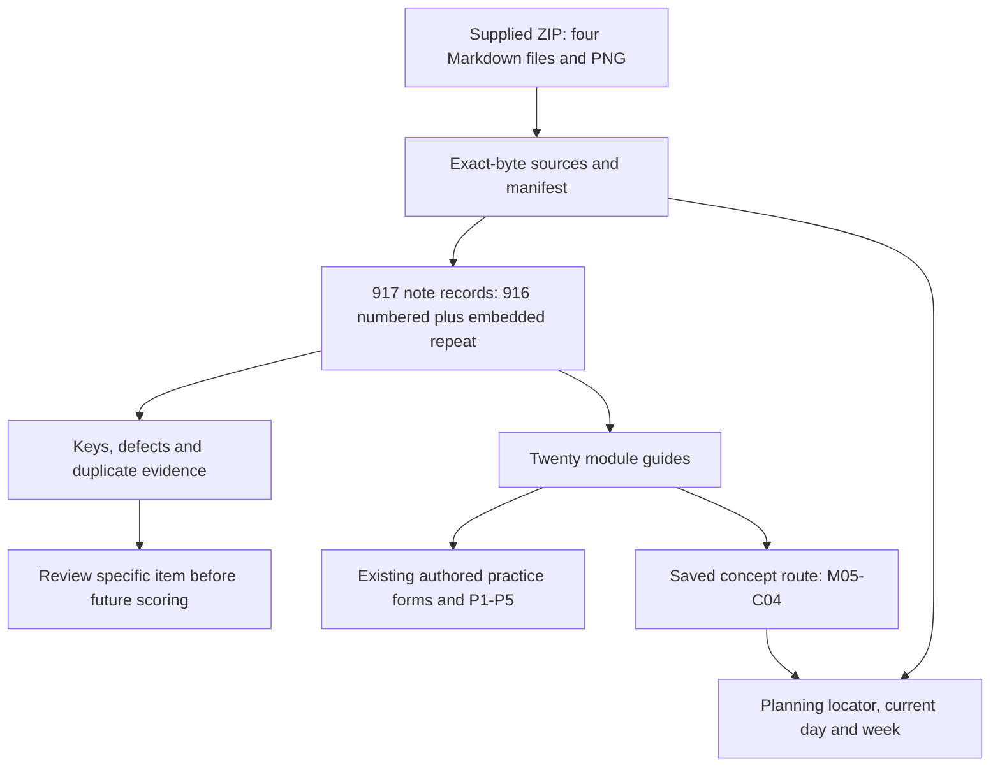

# Connections and ownership

[Collection index](README.md) · [Source receipt](../../source/2026-11-09-ceh-v13-mock-exams/README.md) · [Question audit](quality-audit.md)

Scarce resources are source fidelity, trustworthy study evidence and Jason's attention. The CEH repository owns the archive, interpretations, question audit and technical study guides. Planning owns discovery, capacity and next action. Kairos Learning owns public teaching content and its release evidence. This capture adds a reference collection to those existing roles.

## Source to interpretation

| Entry point | Destination and purpose | Evidence boundary |
| --- | --- | --- |
| [Source archive index](../../source/README.md#ceh-mock-notes-2026-11-09) | [Four preserved sources, image and manifest](../../source/2026-11-09-ceh-v13-mock-exams/README.md) | Establishes custody of supplied ZIP bytes, not PDF authenticity |
| [All-item register](items.csv) | Exact source heading/line/page plus one annotation for every entry | Source keys and editorial interpretations stay separate |
| [Detailed notes](README.md#source-and-coverage) | Nine question-note files; every note routes to a module guide | Opening notes exposes answers; it is not an unseen assessment |
| [Duplicate register](duplicates.csv) | Compare normalized identical stems and retained keys | 803 distinct normalized strings do not imply independent concepts |
| [Primary checks](references.md) | Selected mechanism/version corrections | Does not certify every key or authenticate the exam vendor |
| [Mock 03 Q101](questions/mock-03.md#ceh13-mock03-q101) | [Preserved zero-trust image](../../source/2026-11-09-ceh-v13-mock-exams/ceh13-03_assets/zero-trust-security.png) and [M01 explanation](modules/m01.md) | Image concepts support discussion; implementation/learner understanding require separate evidence |

## Existing learning and assessment records

| Existing owner / record | Connection | Next use and scope |
| --- | --- | --- |
| [Official twenty-module scope](../../curriculum/official-scope-map.md#ceh-mock-notes-2026-11-09) | Every item has an editorial primary M01–M20 tag; each module guide links its existing form | Official scope remains the backbone; downloaded category counts do not become exam weights |
| [Dated blueprint interpretation](../../curriculum/ceh-blueprint-weights-2026-09-22.md) | Distinguishes course modules and exam domains | Existing dated evidence is retained; this archive supplies no new official distribution |
| [Supporting-reference index](../../curriculum/important-references.md#ceh-mock-notes-2026-11-09) | Finds the new user-supplied transcription collection beside existing licensed/official references | Archive custody is classified as supplied/unverified, with its own review boundary |
| [Authored 600 items and Mock A/B](../../assessments/practice-bank/README.md#ceh-mock-notes-2026-11-09) | Twenty new guides link the corresponding existing module forms | New CEH13 source IDs remain separate from CEH26 core IDs and authored mock versions |
| [Assessment governance](../../assessment-governance/README.md#ceh-mock-notes-2026-11-09) | Existing attempt, exposure, confidence and original/retest workflow | Capture creates no attempt-log row or score; resolve a held key before future scoring |
| [Current reading rule](../../study-plan/concept-reading-2026-10-22.md) | Select a whole current concept and a relevant source example | One example/check when reading is activated; imported volume creates no reading debt |
| [M04 historical reading guide](../m04-enumeration/reading-route.md#ceh-mock-notes-2026-11-09) | [M04 enumeration synthesis](modules/m04.md) clarifies DNS, LDAP, SNMP and legacy service evidence | The older guide is a reference; the saved next concept currently remains M05-C04 |
| [September 15 weakness-to-harm lesson](../m05-vulnerability-analysis/lesson-01-weakness-to-harm.md#ceh-mock-notes-2026-11-09) | [M05 guide](modules/m05.md) extends weakness/applicability/impact distinctions with source cases | Original explain-back and learner status retain their own evidence |
| [M01–M03 course notes](../2026-09-20-ceh-week-01/README.md#ceh-mock-notes-2026-11-09) | [M01](modules/m01.md), [M02](modules/m02.md) and [M03](modules/m03.md) supply question-driven retrieval paths | Earlier source audits and terminology remain traceable |
| [M04–M06 Week 2 map](../2026-10-04-ceh-week-02/README.md#ceh-mock-notes-2026-11-09) | Enumeration → vulnerability analysis → credential/privilege evidence | Question explanations do not establish accepted operations |
| [Public teaching bridge](../../docs/public-teaching-bridge-2026-10-23.md#ceh-mock-notes-2026-11-09) | [Kairos M05-C04 authored content](../../../kairos-learning/content/concepts/ceh26-m05-c04.json) supplies the current concept context | Existing public content/versions remain owned by Kairos; no source questions are published by this task |

## CEHP reuse within existing families

These are interpretation routes to already prepared tasks, not additional assignments. The [existing practical form](../../assessments/practice-bank/practical.md) and [official scope map](../../curriculum/official-scope-map.md#cehp-review-scope) own task identity and acceptance.

| Family | Relevant guides | Evidence to keep distinct |
| --- | --- | --- |
| P1 Network / vulnerability scanning | [M03](modules/m03.md), [M05](modules/m05.md) | Probe/vantage and validated applicability versus a scanner label |
| P2 Banner grabbing / enumeration | [M03](modules/m03.md), [M04](modules/m04.md), [M13](modules/m13.md) | Banner, service query and permitted returned data versus inferred OS/exploitability |
| P3 Traffic analysis | [M08](modules/m08.md), [M11](modules/m11.md), [M16](modules/m16.md), [M18](modules/m18.md) | Captured bytes and state versus decrypted content, session takeover or RF replay |
| P4 System attack analysis | [M06](modules/m06.md), [M07](modules/m07.md), [M10](modules/m10.md), [M12](modules/m12.md) | Actual privilege/persistence/detection evidence versus prepared explanations |
| P5 Website attack analysis | [M13](modules/m13.md), [M14](modules/m14.md), [M15](modules/m15.md) | Safe controlled proof and repaired behavior versus a memorized payload/key |

## Existing module teaching media

The prepared teaching-media records provide another route into the same mechanisms. Their source/render/human-review states remain in those records; a link transfers no viewing, understanding or acceptance result.

| Module record | Reuse in this collection |
| --- | --- |
| [M05: Vulnerability analysis](../m05-vulnerability-analysis/video-production-2026-10-18.md) | [Scanner applicability, impact and prioritization](modules/m05.md) |
| [M06: System hacking](../m06-system-hacking/video-production-2026-10-18.md) | [Credentials, privilege and persistence](modules/m06.md) |
| [M07: Malware threats](../m07-malware-threats/video-production-2026-10-18.md) | [Classification, memory activity and recovery layers](modules/m07.md) |
| [M08: Sniffing](../m08-sniffing/video-production-2026-10-18.md) | [Capture vantage, protocol fields and interpretation](modules/m08.md) |
| [M09: Social engineering](../m09-social-engineering/video-production-2026-10-19.md) | [Channel, target, pretext and controls](modules/m09.md) |
| [M10: Denial of service](../m10-denial-of-service/video-production-2026-10-19.md) | [Resource bottleneck and layered mitigation](modules/m10.md) |
| [M11: Session hijacking](../m11-session-hijacking/video-production-2026-10-20.md) | [Fixation, replay, browser compromise and transport state](modules/m11.md) |

## Planning, daily notes and weekly plans

| Control-plane record | What is connected | Capacity / next gate |
| --- | --- | --- |
| [CEH project locator](../../../planning-everything-track/data/projects/2026-07-ceh-cehp-certification-training.md#ceh-mock-notes-2026-11-09) | Capture outcome, canonical paths and validation | Preserve saved M05-C04 route and learner evidence |
| [November 9 daily note](../../../planning-everything-track/weeks/2026-W46/days/2026-11-09.md#ceh-mock-notes-2026-11-09) | Jason supplied the archive and requested full notes/connections; agent organized and audited it | Capacity Unknown; personal study time unreported; no learning completion or new block |
| [W46 plan](../../../planning-everything-track/weeks/2026-W46/weekly-plan.md#ceh-mock-notes-2026-11-09) | Reference available for the current week's existing learning lane | Shared 240-minute / course-day 25-minute ceilings; fixed work/recovery remain protected |
| [W47 plan](../../../planning-everything-track/weeks/2026-W47/weekly-plan.md#ceh-mock-notes-2026-11-09) | Carry the reference locator into the next existing plan | Apply its existing capacity reassessment; no quota, new deadline or incident-project activation |
| [November 8 M05 context](../../../planning-everything-track/weeks/2026-W45/days/2026-11-08.md#kairos-m05-pnpm-closeout-2026-11-08) and [W45 receipt](../../../planning-everything-track/weeks/2026-W45/weekly-plan.md#kairos-m05-pnpm-closeout-2026-11-08) | Earlier M05 material/publication context explains why current M05 examples are useful | Historical delivery evidence stays dated; this capture does not add another delivery |
| [Network-security knowledge index](../../../planning-everything-track/data/knowledge/cybersecurity/network-security/README.md#ceh-mock-notes-2026-11-09) | Route to protocol/transport and crypto reference notes | Detailed exam notes remain in CEH |
| [Existing mTLS concept](../../../planning-everything-track/data/knowledge/cybersecurity/network-security/concept-notes/mutual-tls-stunnel-client-authentication.md) | [M20](modules/m20.md) separates encryption, certificate validation and peer authentication | A conceptual connection transfers no practical completion |
| [AI/cybersecurity roadmap](../../../planning-everything-track/data/projects/2026-09-ai-cybersecurity-year-end-roadmap.md) | The source's adversarial-input/poisoning cases connect to [M07](modules/m07.md); cloud identity cases to [M19](modules/m19.md) | Roadmap reference only; no new AI incident project or experiment is activated |

## Next action and unresolved claims

The [key audit](quality-audit.md#qualifications-and-future-scoring) assigns future review triggers. Jason chooses whether and when to use a reference during existing reading or to activate formal practice. The learning owner repairs a particular held item before scoring and records only actual learner evidence. Source custody, technical interpretation, learner acceptance and public publication retain separate status. Current Git changes are local; a later explicit publication request would require a separate review of scope and rights.
