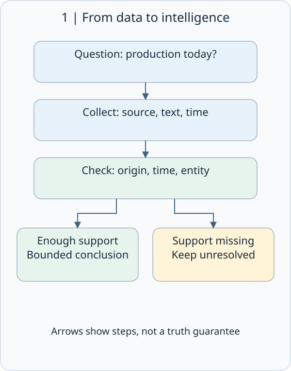
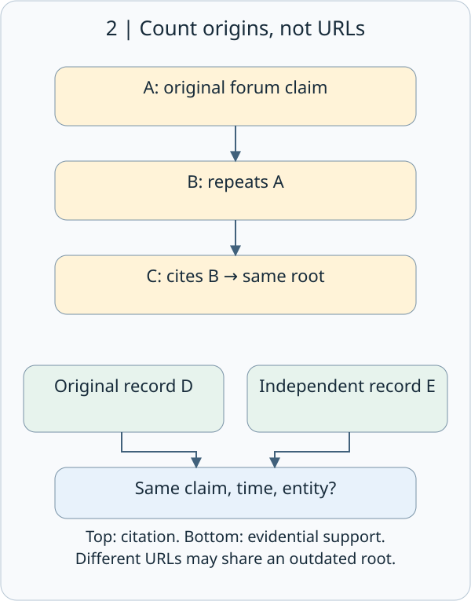
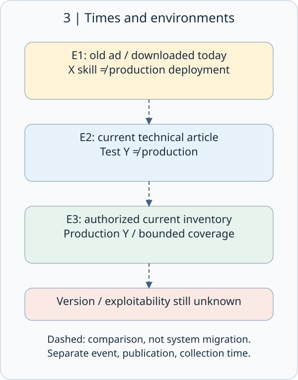
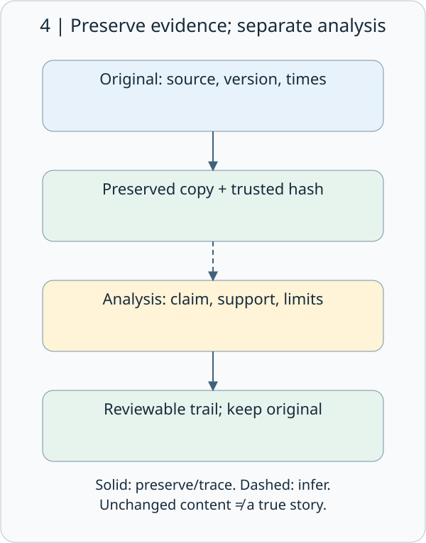

# CEH M02-02 | OSINT Sources and Source Validation: Finding information does not prove a claim

## 1. The conclusion first

**OSINT is valuable when you can explain which evidence supports which bounded conclusion, at what time—not when you collect the largest number of pages.** Three websites repeating one article are not three independent observations. An authentic old document does not automatically establish today's situation.

Imagine planning a visit to a coffee shop. A search snippet says it closes at ten, a blog says nine, and a recent announcement says it is temporarily closed for renovation. You would not average the closing times. You would ask which source is original, which date it describes, and which branch it concerns. Cybersecurity intelligence requires the same care.

This lesson uses synthetic records and public methodology documents. It does not probe third-party accounts, hosts, or websites.

## 2. The knowledge map: How does public data become useful intelligence?

OSINT, Open-Source Intelligence, means collecting, checking, and analyzing publicly obtainable information to answer a question and support decisions. Open-source does not mean only open-source software. The material may be true, false, outdated, or incomplete; finding it in a search is only a starting point.

Source validation means checking the origin, content, time, subject, and support for each claim. It is not a permanent “trustworthy” badge for an entire website.

Figure 1 shows a workflow, not a machine that automatically turns information into truth. Insufficient support leads to an unresolved item, not an invented answer.

M02-01 asked whether collection directly interacted with the target. This lesson asks how far the resulting information can be trusted. These are different axes: passively obtained information can be wrong, and a direct response can have limited meaning. M09's independent verification also taught us not to rely on contact channels supplied by a suspicious message. Here we additionally examine whether different records truly have different origins.

## 3. Common sources: Their uses and their limits

| Source | Useful clues | Unsupported leap |
| --- | --- | --- |
| Official announcements and product documents | A publisher's statement at a particular time; product capabilities | Every deployment is identical; every announcement is correct and current |
| Job ads, procurement notices, technical articles | Previously mentioned skills, requirements, or technology choices | Every production host currently uses that technology |
| Search snippets and web archives | Information indexed or preserved at a particular time | The website remains unchanged; no search result means nonexistence |
| Public code and documentation | What a particular file version contains | Production is running exactly that code |
| DNS, RDAP, and certificate transparency records | Different layers of naming, registration, and certificate information | All sites on one IP share an owner; a certificate name is currently an operating service |
| Social posts, news, and forums | Descriptions of events, dates, and relationships | The account is authentic; repetition is independent confirmation |

DNS, the Domain Name System, associates names with network information. RDAP, the Registration Data Access Protocol, supplies structured registration information. Certificate Transparency, or CT, uses public records to help monitor certificate issuance. They are different records, not an all-knowing inventory of an organization. Query operations and DNS/RDAP detail belong to M02-04. RDAP fields may be redacted because of policy or access rights. CT can also contain precertificates, which do not by themselves prove a website is online. [Source: RFC 9537 §1](https://www.rfc-editor.org/rfc/rfc9537.html#section-1); [RFC 9162 §1 and §3.2.1](https://www.rfc-editor.org/rfc/rfc9162.html). The latter is Experimental; this is not a claim that every current deployment uses that version.

MITRE identifies public websites, search engines, social media, and code repositories as reconnaissance sources. This explains how exposure can be misused; it does not mean every reader is an attacker. [Source: MITRE T1593](https://attack.mitre.org/techniques/T1593/)

## 4. Six checking questions—not just whether the website is famous

This is a teaching checklist, not a claim that an official framework requires exactly six steps.

| Question | Practical action | Common trap |
| --- | --- | --- |
| Who produced it? | Identify the original publisher and what they could observe | Treating a republisher as an eyewitness |
| Where is the original? | Trace the document, version, or dataset | Reading only a title, screenshot, or AI summary |
| When does it apply? | Separate event, publication, and collection times | Treating today's download as today's event |
| Who or what does it concern? | Check organization, domain, branch, version, and environment | Same-name confusion; testing treated as production |
| Is there independent support? | Check how another source obtained its evidence | Counting repeated copies as independent confirmation |
| What remains missing? | Record conflicts, gaps, and alternative explanations | Replacing uncertainty with certainty to finish a report |

Provenance describes the entities, people, and activities involved in producing information. W3C's PROV model provides a way to describe these relationships. Provenance helps assess trustworthiness; it does not automatically establish truth. [Source: W3C PROV Overview](https://www.w3.org/TR/prov-overview/)

A primary source is an original record relative to the question. A secondary source summarizes or repeats it. Primary does not mean infallible: an announcement can establish that a company made a statement without independently proving that every promised security improvement was implemented.

## 5. Three websites may still have only one origin

The upper arrows in Figure 2 mean citation or repetition, not independent observations. The lower paths represent different collection routes supporting the same explicit claim. They may increase confidence, but dates, subjects, and evidence quality still need checking.

Suppose forum A says Island Coffee uses system X. Blog B repeats A, and news aggregator C cites B. Three URLs share one root: A. Circular reporting creates the misleading impression that everyone has independently confirmed the story.

Corroboration means comparing evidence, not counting URLs. For example, a current official deployment document and an authorized current asset inventory may both identify the same system and environment. That usually provides more support than three reposts. But if both were copied from the same outdated spreadsheet, their independence is still weak.

This reposting chain is a synthetic teaching example. The Berkeley Protocol distinguishes source, file, content, and external corroboration. Its methodology does not guarantee admissibility in a particular legal proceeding. [Source: Berkeley Protocol (2022), §176–194](https://humanrights.berkeley.edu/wp-content/uploads/2024/02/Berkeley-Protocol.pdf)

“Not found” is not proof of absence. A search may not cover the page, the information may not be public, or a different name may have been used. Write “not found within these sources and this search scope,” not “definitely does not exist.”

## 6. Worked example: An old job ad is not today's vulnerability report

Island Coffee and coffee.example are entirely fictional. All records below are manually created teaching copies.

Your question is: “Does this company's production customer-service system still use X today?” You receive three records:

| ID | Synthetic record | Supported conclusion |
| --- | --- | --- |
| E1 | Last year's job ad mentions X skills; downloaded today | That job ad mentioned the skill then—not proof of today's deployment |
| E2 | This month's official article says the test environment moved to Y | A current statement about testing—not production |
| E3 | This week's authorized inventory from the asset owner lists production customer service on Y | Supports Y within the inventory's update time and coverage |

E1 and E2 need not contradict each other: time, purpose, and environment may differ. E3 is additional internal verification, not a public source. Label the distinction and do not publish the internal inventory or its details in OSINT teaching material.

A defensible conclusion is: “Historical public material mentioned X. The current public article concerns only the Y test environment. Separately, authorized current asset records list production customer service on Y as of the inventory date. Runtime version and weaknesses were not verified; exploitability has not been established.”

Confidence concerns support for a particular conclusion, not an invented probability of success. If using high, medium, or low, define the report's criteria and give reasons. One source can strongly support that an article was published but barely support a claim about a current production vulnerability. Do not present a teaching confidence scale as an official standard.

## 7. Preserve evidence while protecting people and information

Solid arrows in Figure 4 represent preservation or traceability; the dashed arrow represents inference. Keep original material separate from analysis, so revising a conclusion does not overwrite the evidence.

A useful record includes an evidence ID, original URL or file version, publisher, event/publication/collection times and time zones, relevant text with context, collection method, supported claim, limitations, and unresolved questions. If a time is unknown, leave it unknown. Do not substitute collection time for publication time.

A hash maps content to a fixed-length digest and helps compare it later. **A matching hash does not prove that the content is true, who created it, when it was created, or whether it is complete.** Comparison requires a trustworthy baseline. Hashes do not provide an absolute mathematical guarantee against collisions. They address a particular integrity-comparison problem, not every aspect of authenticity. [Source: NIST FIPS 180-4](https://nvlpubs.nist.gov/nistpubs/FIPS/NIST.FIPS.180-4.pdf). This connects to M01's integrity concept: integrity must not be confused with factual truth.

| Defensive measure | Purpose | Verification evidence |
| --- | --- | --- |
| Review technical and personnel information before publication | Reduce unnecessary exposure and impersonation material | Review checklist, published version, responsible owner |
| Separate source copies and analysis | Allow reasoning to be rechecked | Evidence IDs, versions, verification records |
| Minimize collection and restrict access | Avoid creating a concentrated store of personal information or secrets | Purpose, access rights, retention period |
| Preserve counterevidence and unknowns | Reduce confirmation bias | Alternative explanations, conflicting sources, open questions |

Confirmation bias means preferentially noticing information that supports an existing belief. Asking “What evidence would disprove this hypothesis?” helps counter it. Public availability does not grant unlimited collection, reproduction, or redistribution rights. Do not use leaked passwords, log into someone else's account, or exceed authorization to test a guess. If possible secrets appear, use the established reporting process rather than copying them into public material.

## 8. A three-minute exercise and reasoning checks

Write one claim on paper, draw its cited sources, and circle common upstream origins. Add three columns: time, subject, and the strongest supported conclusion. No installation or collection of anyone's personal information is needed.

Check 1: In Figure 2, three websites cite one forum post. Is this three-way independent confirmation? What would you seek next?

Check 2: In Figure 3, E1 is an old job ad downloaded today and E2 concerns only testing. Do they prove that today's production system has an X vulnerability? Why?

Check 3: You hash a screenshot and later obtain the same digest. What does that support, and what does it not establish?

Check 4: A search finds no customer-service subdomain. May you delete it from the current asset inventory? How should you state a bounded conclusion?

## 9. The takeaway

**Trace the origin, match the time and subject, and separate observations, inferences, and verification. Keep unresolved gaps explicit.** M02-03 next covers search engines and website footprinting; today's validation method continues to apply.
