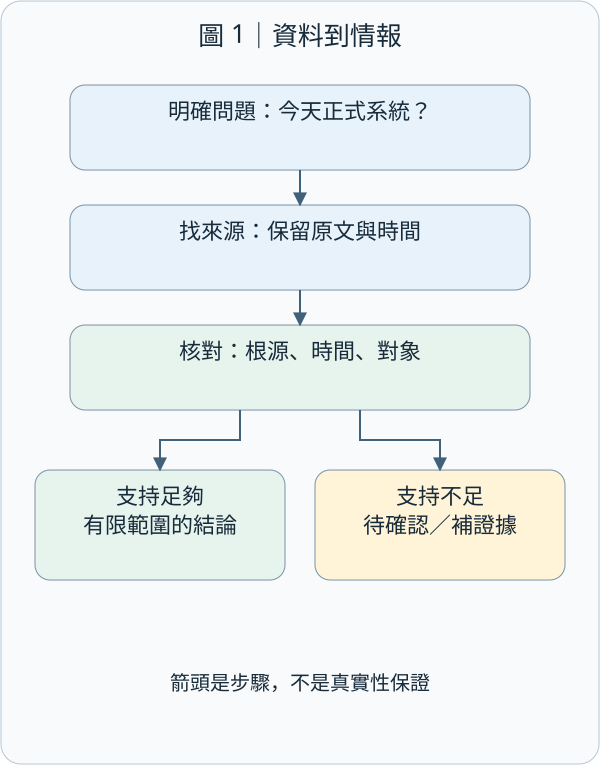
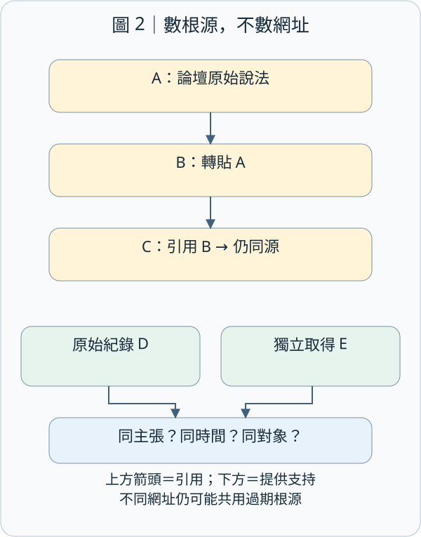
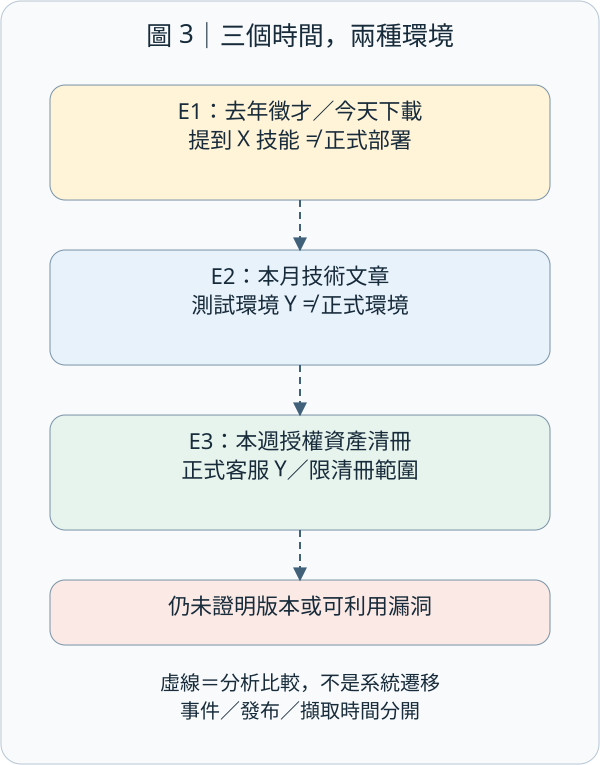
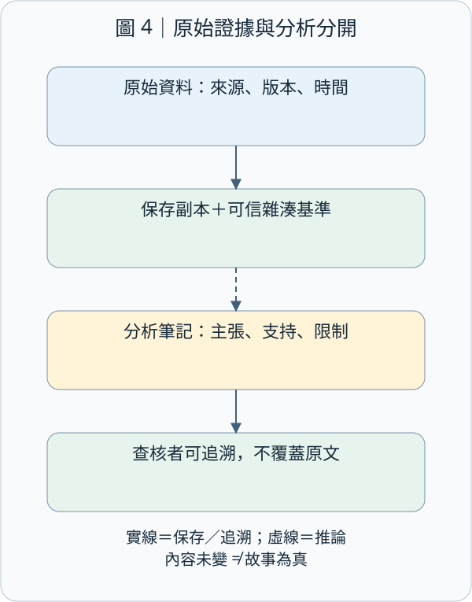

# CEH M02-02｜公開來源情報與來源查證：找到資料，不等於證明事情是真的

## 1. 先記住結論

**OSINT 的價值，不是找到最多網頁，而是說清楚：哪一筆證據，在什麼時間，能支持哪一個有限的結論。** 三個網站轉貼同一篇文章，不是三份獨立證據；一份真的舊文件，也不能直接證明今天的狀態。

想像你要去一間咖啡店：搜尋摘要寫晚上十點打烊，部落格說九點，店家最近公告則說裝修暫停營業。你不會把三個時間平均後出門；你會先問「哪個是原始來源？說的是哪一天、哪間分店？」資安情報也是如此。

本堂只閱讀人工製作的資料與公開方法文件，不對第三方帳號、主機或網站進行探查。

## 2. 知識地圖：公開資料如何變成可用情報？

OSINT，Open-Source Intelligence（公開來源情報），是針對問題，把公開可取得的資料蒐集、查核、分析後，形成能協助決策的情報。Open-source 在這裡不是只指開放原始碼。資料可能是真的、假的、舊的、片面的；「搜尋得到」只是起點。

Source Validation（來源查證）不是替網站貼一個永久可信標章，而是核對每個主張的來源、內容、時間、對象與支持程度。

圖 1 的箭頭代表工作順序，不代表資料經過幾個步驟就自動變真。查核不足就走向「待確認」，而不是硬湊答案。

前一堂 M02-01 問「蒐集時有沒有直接與目標互動？」本堂問「拿到之後，能相信到哪裡？」這是兩條不同軸線：被動取得的資料仍可能錯；直接收到的回應也可能只有局部意義。M09 的獨立查證則提醒我們，不沿著可疑訊息提供的聯絡管道自證；現在進一步檢查資料是否真的來自不同根源。

## 3. 常見來源：知道它能說什麼，也要知道它不能說什麼

| 來源 | 可以提供的線索 | 不可直接推論 |
| --- | --- | --- |
| 官方公告、產品文件 | 發布者在特定時間的正式說法、產品能力 | 所有部署都相同、公告永遠正確或仍有效 |
| 徵才、採購、技術文章 | 曾提及的技能、需求或技術選擇 | 現在每台正式主機都使用該技術 |
| 搜尋摘要、網頁封存 | 索引或保存當時看得到的內容 | 網站現在仍相同、未找到就是不存在 |
| 公開程式碼與文件 | 該版本檔案寫了什麼 | 正式服務正在執行這份程式碼 |
| DNS、RDAP、憑證透明度資料 | 名稱解析、註冊資料、憑證紀錄等不同層次資訊 | IP 上所有網站同一擁有者、憑證中的名稱現在一定提供服務 |
| 社群貼文、新聞與論壇 | 對事件的描述、時間與關係線索 | 帳號是真本人、轉述就是獨立證實 |

DNS（Domain Name System，網域名稱系統）處理名稱與網路資訊的對應；RDAP（Registration Data Access Protocol，註冊資料存取協定）提供結構化註冊資訊；Certificate Transparency，CT（憑證透明度）以公開紀錄協助監督憑證簽發。這些是不同種類的紀錄，不是「公司現況全知資料庫」。本堂不展開查詢操作，DNS／RDAP 細節留給 M02-04。RDAP 欄位可能因政策或權限而被遮蔽；CT 也可能記錄預憑證，不能直接當成網站已上線的證明。[來源：RFC 9537 §1](https://www.rfc-editor.org/rfc/rfc9537.html#section-1)；[RFC 9162 §1、§3.2.1](https://www.rfc-editor.org/rfc/rfc9162.html)（後者是 Experimental 文件，並非宣稱所有現行系統都使用該版本）。

MITRE 將公開網站、搜尋引擎、社群與程式碼儲存庫列為偵察來源；這說明資料曝光可能被利用，不表示每次閱讀都是攻擊。[來源：MITRE T1593](https://attack.mitre.org/techniques/T1593/)

## 4. 六個查核問題：不要只問網站有沒有名氣

以下是本堂教學用檢查表，不是假稱官方固定六步法。

| 問題 | 白話做法 | 常見陷阱 |
| --- | --- | --- |
| 誰產生資料？ | 找原始發布者與其觀察能力 | 把轉貼者當目擊者 |
| 原文在哪裡？ | 追到原始文件、版本或資料集 | 只讀標題、截圖或 AI 摘要 |
| 說的是何時？ | 分開事件時間、發布時間、擷取時間 | 今天下載就當今天發生 |
| 說的是誰或什麼？ | 核對公司、網域、分店、版本與環境 | 同名誤認、測試環境當正式環境 |
| 有獨立支持嗎？ | 查第二個來源是否自己取得證據 | 多站轉載被算成多次證實 |
| 還缺什麼？ | 明列矛盾、缺口與替代解釋 | 為了交報告把未知寫成確定 |

Provenance（資料來源脈絡／來歷）是資料由哪些人、活動、材料產生的紀錄。W3C 的 PROV 模型提供描述這些關係的方法；有來源脈絡能協助評估可信度，但不會自動保證內容真實。[來源：W3C PROV Overview](https://www.w3.org/TR/prov-overview/)

Primary Source（第一手來源）是相對於問題的原始紀錄；Secondary Source（二手來源）則整理或轉述它。第一手不等於絕對正確：公司公告可以證明「公司如此宣告」，未必單憑公告就能證明服務真的已完成所有安全改善。

## 5. 三個網站，也可能只有一個消息來源

圖 2 上半部的箭頭是「引用／轉貼」，不是三個獨立觀測。下半部是不同取得途徑對同一個明確主張提供支持，才可能增加信心；仍需查日期、對象與資料品質。

假設論壇 A 寫「海嶼咖啡用系統 X」，部落格 B 引用 A，新聞彙整 C 又引用 B。三個網址實際共用 A 這一個根源。這叫 Circular Reporting（循環轉述／循環引用）：重複出現製造了「大家都這樣說」的錯覺。

Corroboration（交叉佐證）不是數網址，而是核對不同取得途徑是否支持同一主張。例如，一份當期官方部署說明與獲授權的現行資產清冊，都列出相同系統名稱與環境，支持力通常比三篇同源轉貼好；若兩份其實由同一個過期清單複製，獨立性仍然不足。

以上轉貼鏈是本堂合成例子；查證方法可參考 Berkeley Protocol 對來源、檔案、內容與外部佐證的區分，不能把這份方法指引當成特定案件的司法證據資格保證。[來源：Berkeley Protocol（2022），§176–194](https://humanrights.berkeley.edu/wp-content/uploads/2024/02/Berkeley-Protocol.pdf)

「查無資料」也不是「證明沒有」。搜尋可能未涵蓋該頁、資料可能未公開，或你使用了不同名稱。報告應寫「在本次來源與查詢範圍內未找到」，不要寫「絕對不存在」。

## 6. 完整案例：別把去年的徵才文變成今天的漏洞報告

以下「海嶼咖啡」與 coffee.example 完全虛構；所有文件都是教材自製副本。

你的問題是：「這家公司今天的正式客服系統，是否仍使用系統 X？」你取得三筆資料：

| 編號 | 人工情境資料 | 可以支持的結論 |
| --- | --- | --- |
| E1 | 去年徵才文要求熟悉系統 X；今天才下載 | 去年的職缺曾提到這項技能；不是今天的部署證明 |
| E2 | 本月官方技術文章說測試環境遷移到 Y | 當期文章宣告測試環境變更；正式環境仍未知 |
| E3 | 本週資產負責人提供獲授權清冊，列正式客服使用 Y | 在清冊更新時間與涵蓋範圍內，支持正式客服採用 Y |

E1 與 E2 不一定矛盾：時間、用途和環境都可能不同。E3 是補充的內部驗證資料，不是公開來源；報告必須分別標示，不能把內部清冊或其細節公開到 OSINT 教材裡。

合格結論可以是：「歷史公開資料曾提及 X；當期公開文章只談測試環境 Y；另經獲授權現行資產紀錄核對，正式客服於清冊更新日列為 Y。未驗證實際執行版本與弱點，不能宣稱存在可利用漏洞。」

Confidence（信心程度）是你對這個特定結論支持程度的判斷，不是隨便填的成功機率。若使用高／中／低，先訂定本報告的判準，並寫理由；同一來源對「曾發布過文章」可能支持很強，對「正式環境現在有漏洞」卻幾乎沒有支持。不要把信心等級冒充官方量表。

## 7. 留下證據，也保護人與資料

圖 4 實線代表保存或追溯關係，虛線代表分析推論。原始資料與分析筆記分開，修改推論時不要覆蓋原文。

一筆有用紀錄至少包含：證據 ID、原始 URL／檔案版本、發布者、事件／發布／擷取時間與時區、相關原文與上下文、取得方式、支持的主張、限制與待查事項。時間查不到就留未知，不用擷取時間冒充發布時間。

Hash（雜湊值）可把檔案內容轉成固定長度的摘要，幫助之後比對是否仍是同一份內容。**雜湊相同不代表內容是真的，也不證明誰寫的、何時寫的或是否完整。** 比對必須有可信基準；雜湊並非數學上的絕對不碰撞保證。它解決的是特定的完整性比對問題，不是全套真偽判定。[來源：NIST FIPS 180-4](https://nvlpubs.nist.gov/nistpubs/FIPS/NIST.FIPS.180-4.pdf)這也連回 M01 的 Integrity（完整性）；不能把完整性直接當成真實性。

| 防護措施 | 目的 | 可留下的驗證依據 |
| --- | --- | --- |
| 發布前審核技術與人員資訊 | 減少不必要曝光與冒充素材 | 審核清單、發布版本、負責人 |
| 原始副本與分析分離 | 讓別人能重查推論 | 證據 ID、版本、查核紀錄 |
| 最小蒐集與限制存取 | 避免情報庫變成個資或秘密集中處 | 蒐集目的、存取權、保存期限 |
| 保留反證與未知 | 降低確認偏誤 | 替代解釋、矛盾來源、待查清單 |

Confirmation Bias（確認偏誤）是只注意支持原先想法的線索。刻意問「什麼證據會推翻我的假設？」可以幫助減少它。公開不等於可以任意蒐集、重製或擴散；不要使用外洩密碼、登入他人帳號，或為驗證猜測而超出授權。若看到疑似秘密，依既有通報流程處理，不把秘密貼進報告或公開教材。

## 8. 三分鐘練習與小檢核

在紙上寫一個主張，畫出它引用的來源，再把共同上游圈在一起。最後補上「時間、對象、目前能說到哪裡」三欄。這個練習不需安裝工具，也不需查任何人的個資。

檢核 1：圖 2 中三個網站引用同一篇論壇文，能否說已經三方獨立證實？你會再找什麼？

檢核 2：圖 3 中 E1 是今天下載的去年徵才文，E2 只談測試環境。它們能證明今天的正式系統有 X 的漏洞嗎？為什麼？

檢核 3：你替一張截圖算出雜湊值，之後比對相同。這證明了什麼，還不能證明什麼？

檢核 4：搜尋沒有找到某個客服子網域，可以把它從現行資產清冊刪掉嗎？應如何寫出有邊界的結論？

## 9. 一句話帶走

**先追來源根，再對時間與對象；把觀察、推論、驗證分開寫，缺口就保留待確認。** 下一單元 M02-03 才深入搜尋引擎與網站足跡蒐集；本堂的查核方法會一路沿用。
