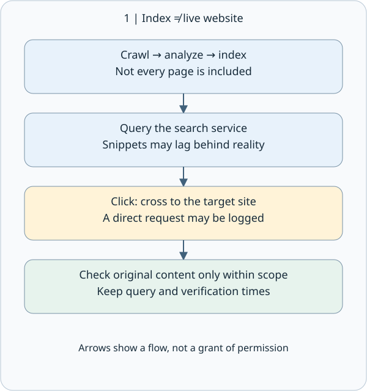
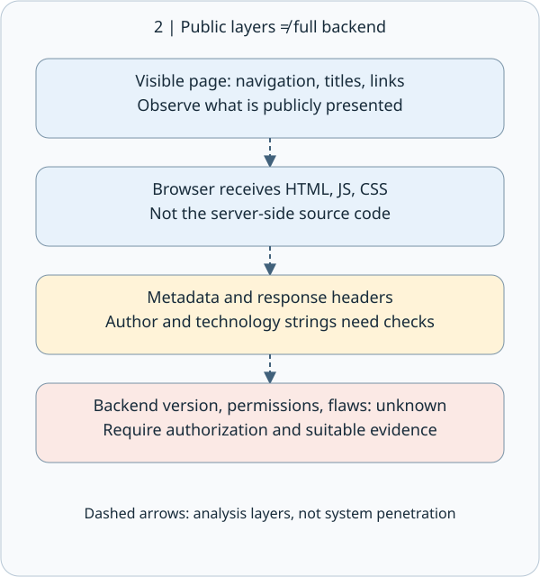
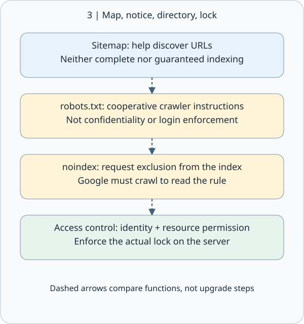
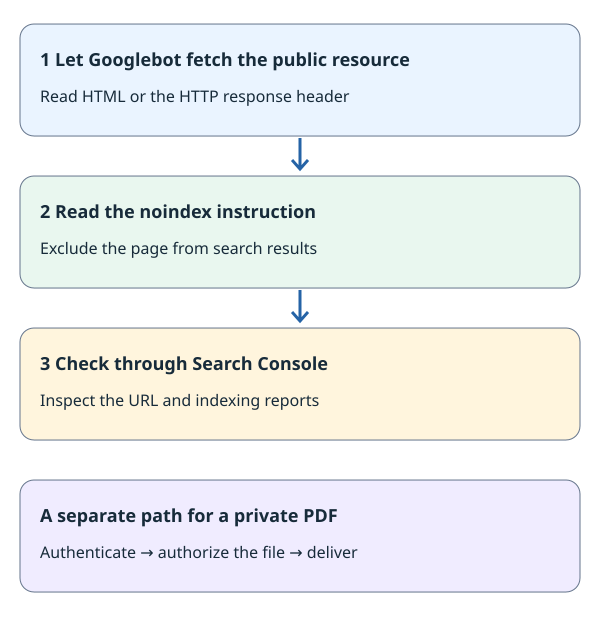
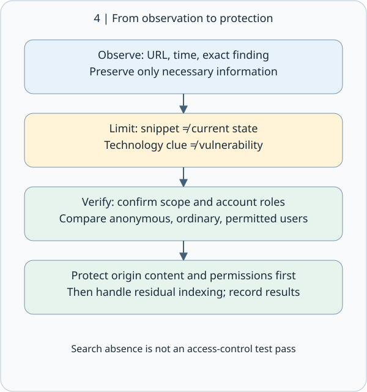

# CEH M02-03 | Search Engine and Website Footprinting: Public Clues Are Not Proven Vulnerabilities

## 1. Start with this conclusion

Search Engine and Website Footprinting means organizing what a website exposes through search results and publicly provided content. The goal is a verifiable picture, not permission to enter every discovered URL.

Remember three distinctions: search results are not necessarily the website's current content; public clues are not proven weaknesses; visibility is not authorization to test.

M02-02 introduced source validation. Apply it here: a search snippet, its original page, and an article quoting that page are not automatically three independent pieces of evidence.

## 2. Understand search through a café menu

Imagine looking for a café menu. A search engine resembles a periodically updated directory, not a live camera inside the café. Its broad stages are crawling, where software fetches pages; indexing, where content is analyzed and stored for retrieval; and serving, where results are selected for a query. Not every page is necessarily indexed. [How Google Search works](https://developers.google.com/search/docs/fundamentals/how-search-works)

If a snippet mentions an old menu, it supports only the statement that the search engine displayed that information at query time. It does not establish that the café still uses that menu. To check the present state, compare the current original page within authorization, recording query time separately from the content's own date.

This connects to M02-01: querying a third-party search service differs from clicking through and making a request to the target site. Even ordinary browsing can produce access logs. This lesson does not interact with any third-party target.



## 3. Search operators clarify questions; they do not grant access

A search operator is special syntax that narrows results. All examples below use the fictional coffee.example domain to explain syntax; there is no need to execute them.

| Syntax | Question it helps ask | What it does not establish |
| --- | --- | --- |
| site:coffee.example | Which indexed results are associated with this domain? | The results are not a complete asset inventory |
| "seasonal menu" | Which results match this phrase? | Content is not necessarily current or from the intended business |
| filetype:pdf | Which results are identified as PDF files? | A PDF is not necessarily more reliable or recent |
| menu -careers | Can results containing a specified term be excluded? | Exclusion may also remove useful results |

A combined example is site:coffee.example "seasonal menu" filetype:pdf. Do not insert a space after site:. Support differs between search services; do not treat one provider's syntax or an old textbook's features as universal and permanent. [Google Search help](https://support.google.com/websearch/answer/2466433?hl=en)

A missing site: result does not establish that a site does not exist or that content was deleted. A returned result does not make the list exhaustive either. Google's documentation explicitly notes indexing and retrieval limitations for search operators. [Google search operators](https://developers.google.com/search/docs/monitor-debug/search-operators)

## 4. Website footprints: separate public-facing clues from backend facts

Website footprints are structural and technical clues in public content. The visible page is one layer. HTML, or HyperText Markup Language, describes page structure and is delivered to the browser alongside public resources. HTTP response headers are descriptive fields accompanying a server's response and may reveal transport or software clues.

| Public clue | What can be recorded | Limit to preserve |
| --- | --- | --- |
| Navigation, titles, links, URL paths | Public services and relationships between pages | An absent link does not prove absent functionality |
| HTML comments and public JavaScript/CSS | Text, code, and styling delivered to the browser | This is not the server-side source code |
| Document metadata | Descriptive fields such as title, author, and creation time | Template authors and timestamps may be misleading |
| Response headers and technology labels | What a particular response says about software or services | A proxy, stale string, or simplified label may be involved |

For example, a Server header does not justify writing “the backend version has a confirmed vulnerability.” It is initially a technical clue requiring verification. The HTML source received by a browser may also differ from the page structure after JavaScript executes; neither is the complete backend program.

OWASP includes comments and metadata among potential information-disclosure surfaces. Here we only organize authorized public content: no path guessing, bulk enumeration, or login-bypass testing. [OWASP WSTG: webpage content information leakage](https://wstg.owasp.org/v4.2/4-Web_Application_Security_Testing/01-Information_Gathering/05-Review_Webpage_Content_for_Information_Leakage/)



## 5. noindex: give search indexing and content access distinct jobs

In one sentence, noindex asks supporting search engines to exclude a page from search results; the website's access settings govern delivery of the page itself.

Think of a library: a sitemap supplies catalog clues, robots.txt assigns crawler routes, noindex selects pages to leave the search catalog, and access control checks a reader's identity and borrowing rights.

| Mechanism | Goal | Practical action |
| --- | --- | --- |
| Sitemap | Help search services discover URLs | Supply intended public URLs |
| robots.txt | Set routes for cooperative crawlers | Configure the appropriate crawling scope |
| noindex | Manage the search index | Send an index-exclusion instruction for an accessible resource |
| Authentication and authorization | Control who can obtain each resource | Check identity, resource, and allowed action on each request |

[Google robots.txt guide](https://developers.google.com/search/docs/crawling-indexing/robots/intro)



For example, the fictional https://coffee.example/test/ page can remain publicly readable while using noindex to manage search visibility. Search proceeds through crawling (fetching content), indexing (analyzing and storing searchable information), and ranking / serving results. noindex governs indexing.

Method A: an HTML page can include this meta tag in its <head>:

```html
<meta name="robots" content="noindex">
```

Method B: the server can send X-Robots-Tag in an HTTP response header, a descriptive field delivered alongside content. This also works for resources such as PDFs and images:

```http
HTTP/1.1 200 OK
Content-Type: application/pdf
X-Robots-Tag: noindex
```

Both methods have the same noindex effect for Google. Choose according to resource type and configuration options. [Google noindex setup](https://developers.google.com/search/docs/crawling-indexing/block-indexing)

The sequence is “fetch resource → read noindex → update the search index.” Keep the resource and rule accessible to Googlebot when a publicly readable page should leave search results. For example, Disallow: /test/ in robots.txt stops crawling that route first, leaving the new page-level noindex unread; links from other pages may still surface the URL in search results. Review crawling and indexing rules together.



For a members-only PDF, use authentication (checking identity) and authorization (checking permitted files) on each download request. Test signed-out, signed-in but unpermitted, and permitted roles, inspecting actual responses and file contents. Continue with [M01-06 security controls and defense in depth](https://learn.cs-kairos.com/en/courses/ceh/v13/m01/concepts/m01-06/), [M13 web server hardening](https://learn.cs-kairos.com/en/courses/ceh/v13/m13/web-server-exposure-and-hardening/), and [M14 object authorization](https://learn.cs-kairos.com/en/courses/ceh/v13/m14/object-level-authorization/). [OWASP authorization guidance](https://cheatsheetseries.owasp.org/cheatsheets/Authorization_Cheat_Sheet.html)

Verify indexing through Google Search Console's URL Inspection and Page Indexing reports; verify private access with the role tests above. For urgent removal of an owned URL already in Google Search, the temporary-removal tool lasts about six months. Use that period to maintain accessible noindex, remove content, or enforce private access, according to the goal. [Search Console Removals tool](https://support.google.com/webmasters/answer/9689846)

Remember the roles: noindex manages indexing for a public test page, robots.txt manages crawler routes, and authentication plus authorization protects private files.

## 6. Turn clues into a useful report: a complete synthetic example

Suppose you are authorized to inspect your café's training site. You may inspect public teaching pages and supplied example documents, but not probe other paths.

First clue: a sample search screenshot shows last year's menu. Record “the sample search snippet mentions last year's menu,” not “the current site still sells last year's items.”

Second clue: a public training PDF has an author field of “Office Template.” Record the field and document URL. Do not interpret it as an actual employee's name or the document's actual owner.

Third clue: a sample robots.txt names an internal-document path. Record that the path name is exposed; do not open or guess paths on that basis. Whether it is readable, contains confidential data, or represents a weakness remains unverified. Obtain appropriate authorization before deeper checks.

A suitable report says: “Public sample materials expose descriptive document fields and path-naming clues. Current evidence does not establish the backend version, readability of private documents, or an exploitable vulnerability. The owner should review the publishing inventory and access controls.” This is not evasive: it separates observation from inference.

## 7. Defense and evidence: do more than hide search results

Before publication, identify the pages and documents actually intended for public access. Remove unnecessary personal metadata, internal comments, and test information. Public JavaScript is not a secret vault; required authorization decisions belong on the server.

When content should not have been public, first address the original site's content and access permissions, then handle residual search indexing. Removing a search result alone may leave the original URL readable. Editing the original page may not immediately update a search snippet. If credentials are exposed, revoke or replace them through the incident-response process rather than merely deleting the displayed text.

The owner should validate protection using authorized test accounts, comparing unauthenticated, ordinary-user, and permitted-user access. “Not found in search” is not a passed security test.

At minimum, record authorization scope, observation time and timezone, query, source URL, the exact observation, any content date shown by the source, unresolved questions, and the proposed next step. Preserve only necessary information in screenshots or excerpts. If personal data or secrets appear unexpectedly, stop expanding collection and follow the established reporting process.



## 8. Small check: can you preserve the inference boundary?

Scenario: authorized teaching materials show an old PDF in search results, a directory disallowed in robots.txt, and a software name in a response header.

Explain in your own words: (1) Does the snippet prove the PDF is still public? (2) Does robots.txt guarantee that the directory is private? (3) Does the header directly prove a version-specific vulnerability? (4) As the site owner, what evidence would you use to verify that private content is protected?

This is one scenario with four short prompts; no long essay is needed. An unanswered check is not evidence of mastery. Reference answers accompany the website lesson and do not depend on a learner response.

Supplement check: a PDF response contains X-Robots-Tag: noindex while the site still serves it publicly. What will someone with its full URL receive? Which checks would you add for members-only access?

## 9. One takeaway and sources

Search engines help discover clues; original pages help check the present state; authorization determines what you may do. Only appropriately verified evidence can support a security conclusion.

This lesson follows the existing M02-03 route and uses synthetic examples. Current search syntax is governed by each provider's official documentation. Cache or provider-specific features described in older WSTG editions are not guarantees of current service behavior. [OWASP search-engine reconnaissance](https://wstg.owasp.org/v4.2/4-Web_Application_Security_Testing/01-Information_Gathering/01-Conduct_Search_Engine_Discovery_Reconnaissance_for_Information_Leakage/)
