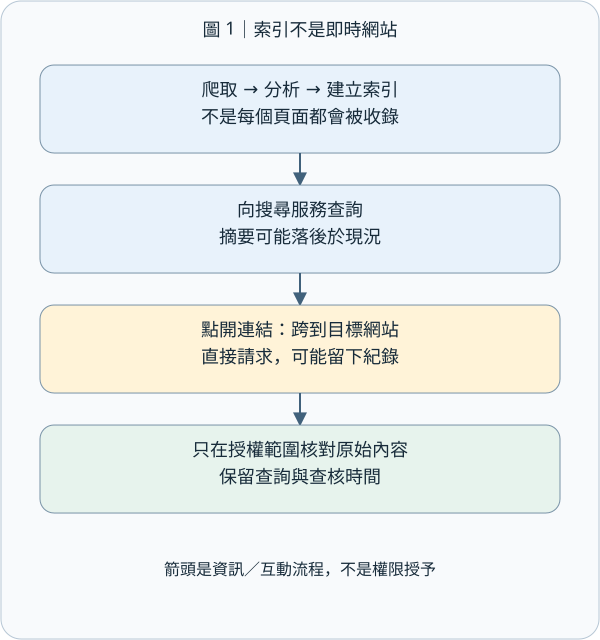
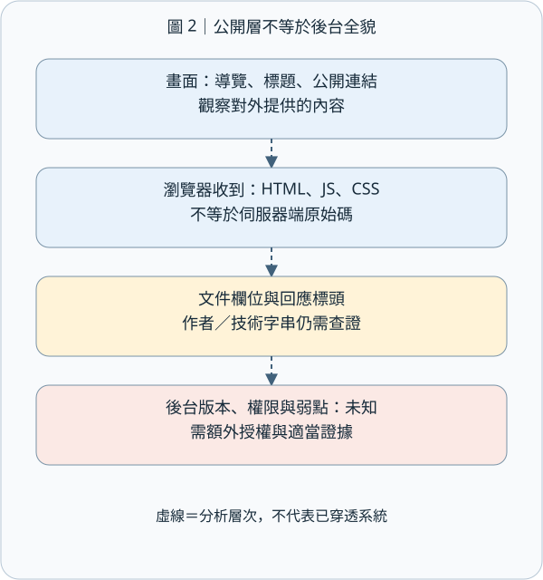
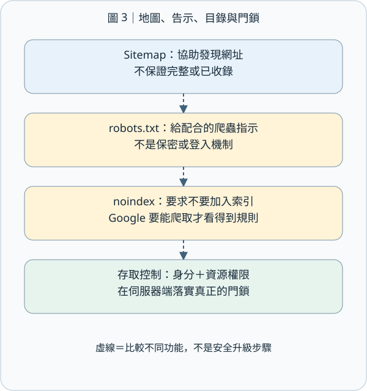
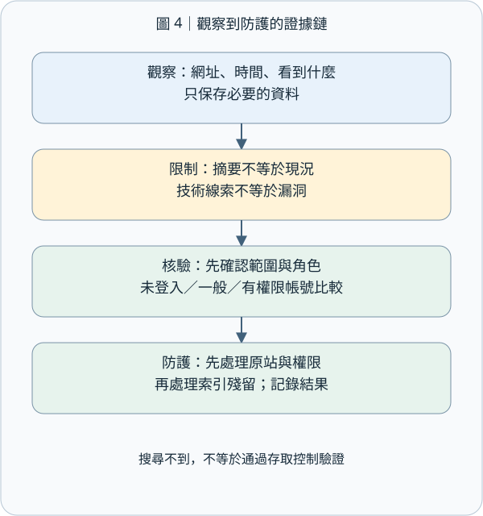

# CEH M02-03｜搜尋引擎與網站足跡：看見公開線索，不把線索當成漏洞

## 1. 先記住這個結論

搜尋引擎與網站足跡蒐集（Search Engine & Website Footprinting），就是從搜尋結果與網站公開提供的內容，整理「這個網站對外露出了什麼」。目的是畫出可查證的輪廓，不是看到網址就嘗試闖入。

今天最重要的三句話：搜尋結果不等於網站現在的內容；公開線索不等於已證實的弱點；看得到不等於有權測試。

上次 M02-02 練的是來源驗證，這次把它用在網站：同一則搜尋摘要、原始頁面與轉貼文章，不能自動當成三個獨立證據。

## 2. 先用找咖啡店菜單理解搜尋引擎

想像你找咖啡店菜單。搜尋引擎像一份定期更新的店家目錄，不是店裡的即時監視器。它大致經過三步：爬取（Crawling）是程式讀取網頁；建立索引（Indexing）是分析內容並存入可搜尋的資料；提供搜尋結果（Serving）是根據你的查詢挑出結果。不是每個頁面都一定會被收錄。[Google 搜尋運作方式](https://developers.google.com/search/docs/fundamentals/how-search-works)

因此，搜尋摘要寫「舊菜單」，只能支持「查詢當下搜尋引擎顯示了這段資訊」。你還不能說店家現在仍用那份菜單。要確認現況，必須在授權範圍內核對當前原始頁面，並分開記錄查詢時間與頁面內容時間。

這也連回 M02-01 的界線：查詢第三方搜尋服務，和點進網站讓瀏覽器向目標送出請求，是不同的互動。即使只是一般瀏覽，網站也可能留下存取紀錄；本課不操作任何第三方目標。

## 3. 搜尋運算子：把問題問清楚，而不是變出隱藏權限

搜尋運算子（Search Operator）是協助縮小結果的特殊語法。下面全部是虛構的 coffee.example 範例，只用來讀懂語法，不必實際執行。

| 語法 | 想問的問題 | 不能推論的事 |
| --- | --- | --- |
| site:coffee.example | 搜尋引擎收錄了這個網域的哪些結果？ | 結果不是完整資產清單 |
| "季節菜單" | 找到符合這組詞語的結果 | 不代表內容仍有效或來自正確店家 |
| filetype:pdf | 將結果限縮到 PDF 類型 | PDF 不一定比網頁可靠或較新 |
| 菜單 -招募 | 排除含有指定詞的結果 | 排除條件也可能漏掉有用內容 |

組合例子是 site:coffee.example "季節菜單" filetype:pdf。site: 後不要加空格。不同搜尋服務支援的語法可能不同，不要把某一家或舊教材的功能當成永遠通用。[Google 搜尋說明](https://support.google.com/websearch/answer/2466433?hl=en)

尤其要記住：site: 查不到，不等於網站不存在或資料已刪除；查得到，也不代表列出了全部頁面。Google 官方明確提醒搜尋運算子有索引與擷取限制。[Google 搜尋運算子文件](https://developers.google.com/search/docs/monitor-debug/search-operators)

## 4. 網站足跡可以看什麼？先分清「前台線索」與「後台事實」

網站足跡是公開頁面留下的結構與技術線索。一般畫面是第一層；瀏覽器收到的 HTML（超文字標記語言，描述網頁結構）與公開資源，是第二層；HTTP 回應標頭（伺服器回覆時附帶的描述資訊）則可能提供傳輸或軟體線索。

| 公開線索 | 可以記下什麼 | 必須保留的限制 |
| --- | --- | --- |
| 導覽、頁面標題、連結、網址路徑 | 對外提供的服務與頁面關係 | 沒有連結不代表功能不存在 |
| HTML 註解、公開 JavaScript／CSS | 已交付給瀏覽器的文字、程式與樣式 | 不等於取得伺服器端原始碼 |
| 文件中繼資料（Metadata） | 文件標題、作者欄位、建立時間等描述 | 作者欄可沿用範本；時間也可能不準 |
| 回應標頭或頁面上的技術標示 | 某次回應顯示的軟體或服務線索 | 可能是代理服務、舊字串或刻意簡化資訊 |

例如看到 Server 標頭，不應直接寫「已確認後端版本有漏洞」。它最多先是一個待驗證的技術線索。瀏覽器檢視到的 HTML 原始內容，也可能和 JavaScript 執行後的畫面結構不同；兩者都不是完整的後端程式。

OWASP 的網頁內容檢查把註解、中繼資料等列為資訊外洩檢查面向；本課只整理已授權的公開內容，不猜路徑、批量枚舉或測試登入繞過。[OWASP WSTG：網頁內容資訊外洩](https://wstg.owasp.org/v4.2/4-Web_Application_Security_Testing/01-Information_Gathering/05-Review_Webpage_Content_for_Information_Leakage/)

## 5. 最容易混淆的四樣東西：地圖、爬蟲規則、索引規則與門鎖

網站地圖（Sitemap）像提供給搜尋服務的網址目錄，協助發現內容；它不是完整網站保證書，也不代表其中每個網址都已被收錄。

robots.txt 是給配合規則的爬蟲看的存取指示。它不是登入系統，也不是保密措施。被禁止爬取的網址，仍可能因其他地方的連結而出現在搜尋結果；不要把敏感路徑寫進 robots.txt 就以為藏好了。[Google robots.txt 說明](https://developers.google.com/search/docs/crawling-indexing/robots/intro)

noindex 的意思是要求支援此規則的搜尋引擎不要把內容放進搜尋索引。Google 必須能爬取頁面，才能讀到頁面中的 noindex 或 HTTP 標頭規則；若同時用 robots.txt 阻擋，可能看不到這項指示。noindex 也不會阻止知道網址的人直接打開內容。[Google noindex 說明](https://developers.google.com/search/docs/crawling-indexing/block-indexing)

真正要保護私人內容，需要驗證身分與授權檢查：你是誰，以及你能不能讀這份資料。白話記法：Sitemap 是地圖；robots.txt 是給爬蟲的告示；noindex 是不要列入目錄的請求；存取控制才是門鎖。這些功能不同，不能互相代替。

## 6. 把線索寫成有用報告：一個完整的虛構例子

假設你獲准檢查自家咖啡店的測試站，只能檢視公開教學頁與提供給你的範例文件，不可探測其他路徑。

第一個線索：搜尋範例畫面顯示去年菜單。你記錄「範例搜尋摘要提到去年菜單」，不寫「目前網站仍販售去年品項」。

第二個線索：測試站公開 PDF 的作者欄是「Office Template」。你記錄欄位值與文件網址，不把它當成真實員工姓名，也不把它當成文件實際擁有人。

第三個線索：示範 robots.txt 寫著一個內部文件路徑。你只記錄它洩露了路徑名稱，不因此開啟或猜測該路徑；是否能讀取、是否有機密資料、是否存在弱點，全都尚未確認。需要更深入驗證時，先取得相應授權。

報告可以寫：「公開範例資料暴露文件描述與路徑命名線索。現有證據不足以判定後端版本、私人文件可讀性或可利用漏洞。建議由站方核對發布清單及存取控制。」這不是含糊，而是把事實與推論分清楚。

## 7. 防護與證據：不只把搜尋結果藏起來

發布前，先列出真正要公開的頁面與文件；移除不必要的作者個資、內部註解與測試資訊。公開的 JavaScript 不能當秘密保管箱，必要的權限判斷應在伺服器端落實。

發現不該公開的內容時，先處理原始網站的內容與存取權限，再處理搜尋服務上的索引殘留。只移除搜尋結果，原始網址仍可能可讀；只改原始頁面，搜尋摘要也不一定立刻更新。若真的暴露憑證，應依事件處理流程撤銷或更換，而不是僅刪除畫面上的文字。

驗證防護是否有效，應由站方使用授權測試帳號，比較未登入、一般帳號與有權限帳號的結果；不把「搜尋不到」當成安全測試通過。

最低限度的證據紀錄包括：授權範圍、查核時間與時區、查詢語句、來源網址、看到的具體內容、來源顯示的內容日期、尚未驗證的部分，以及建議下一步。截圖或節錄只保留必要資訊；若意外遇到個資或秘密，停止擴大蒐集並走既定通報管道。

## 8. 小檢核：你能否守住推論邊界？

情境：你在授權的教學資料中看到三件事：搜尋結果有一份舊 PDF；robots.txt 禁止爬取一個目錄；某頁標頭顯示軟體名稱。

請用自己的話回答：① 搜尋摘要能證明 PDF 目前仍公開嗎？② robots.txt 能保證目錄保密嗎？③ 標頭能直接證明某個版本漏洞存在嗎？④ 若你是網站負責人，要用什麼證據驗證私人內容受到保護？

這是一題情境檢核，不用長篇回答；尚未作答不代表已學會。參考答案會隨網站教材提供，不以作答作為公布條件。

## 9. 今天帶走的一句話與來源

搜尋引擎幫你找線索，原始頁面幫你核對現況，授權範圍決定你能做什麼；只有經過適當驗證的證據，才能支撐安全結論。

本單元依既有 M02-03 路線編寫，使用合成案例。搜尋引擎的即時語法以各服務官方文件為準；舊版 WSTG 的快取或特定搜尋功能說明不視為現行服務保證。[OWASP 搜尋引擎偵察方法](https://wstg.owasp.org/v4.2/4-Web_Application_Security_Testing/01-Information_Gathering/01-Conduct_Search_Engine_Discovery_Reconnaissance_for_Information_Leakage/)
