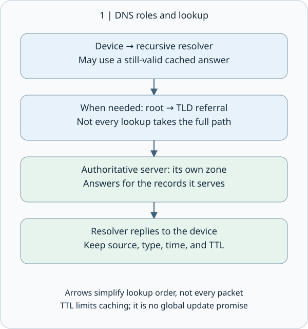
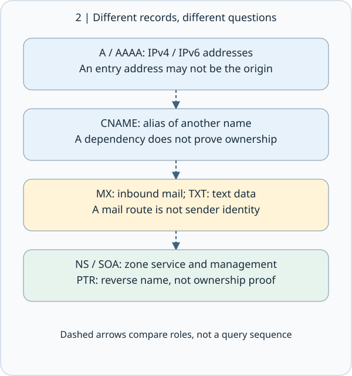
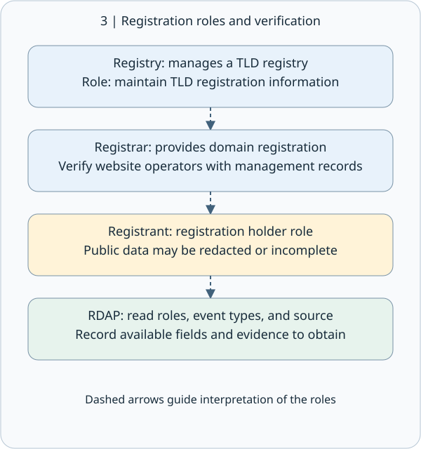
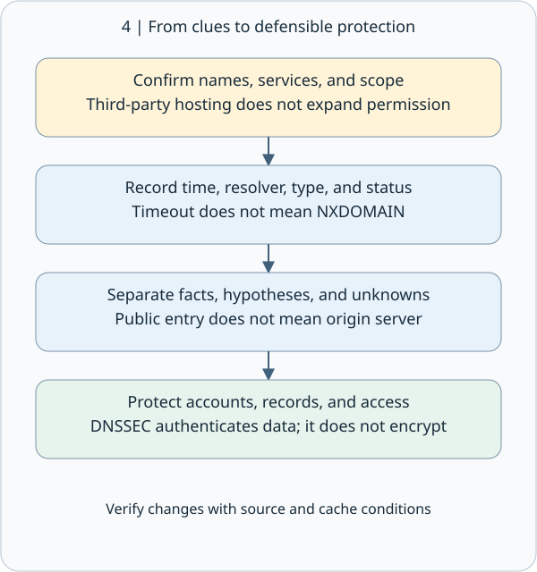

# M02-04 | DNS, WHOIS / RDAP Footprinting: An Address Does Not Identify the Owner

## 1 | The main idea: Separate finding a service from registering a domain

Today we study one complete concept: using DNS and domain registration data to build a verifiable external picture, rather than assuming that an IP address identifies a company's server or owner.

DNS, the Domain Name System, works like a telephone directory combined with a layered system for asking directions. It answers, “What service records exist for this name?” WHOIS, the traditional registration-data query protocol, and RDAP, the Registration Data Access Protocol, are closer to looking up registration records. They answer, “What information does the registration system hold about this domain?” Footprinting means organizing these clues into a clearly scoped picture with sources and timestamps.

Think of a coffee shop. Its delivery telephone number, mail-receiving address, and the person named on its lease may all differ. Domains are similar: the website, email service, DNS hosting provider, registrar, and actual operator can involve different roles. The important skill is knowing which question each field answers—and which questions it does not answer.

## 2 | The DNS lookup journey: Who asks for you, and who can answer authoritatively?

Suppose you want to open www.coffee.example in our fictional scenario. Your device normally asks a recursive resolver first. This service finds answers for you and may also keep previous answers. If its cache already contains a usable answer, it can reply without starting the search again.

When a lookup is needed, the resolver can follow referrals through the DNS hierarchy. Root name servers provide delegation information for top-level domains. A Top-Level Domain, or TLD, server then points toward the domain's authoritative name servers. An authoritative server supplies records for the zone it serves. This describes the roles; it does not mean every query follows the entire path.

“Recursive” means completing the lookup on your behalf. “Authoritative” means supplying authoritative data for a zone the server manages. A DNS zone is a portion of the namespace managed by particular authoritative servers. It does not always match the whole domain as people use that word in conversation: a subdomain can be delegated separately. See [RFC 1034](https://www.rfc-editor.org/rfc/rfc1034) for these roles and delegation concepts.

A cache resembles a copied telephone directory that remains usable temporarily. TTL, or Time to Live, tells a cache how long it may retain a record. It does not guarantee that every system worldwide will reflect a change within that period. The TTL you observe may also be the remaining lifetime. Different resolvers, query times, or network locations can produce different results.

## 3 | Reading records: Each type answers its own question

A resource record is a unit of data in DNS. Do not interpret every record as saying, “This is the company's server.”

| Type | Plain-language purpose | Useful clue and limitation |
| --- | --- | --- |
| A | Maps a name to an IPv4 address | May identify shared hosting or a proxy, not necessarily an origin server |
| AAAA | Maps a name to an IPv6 address | Query separately from A; no A record does not mean no service |
| CNAME | Makes one name an alias for another name | Can reveal a service dependency, but does not establish ownership of the final server |
| MX | Identifies mail exchange hosts to which mail should be sent | A clue about incoming-mail routing, not the source of every outgoing message |
| NS | Identifies name servers serving a zone | Often reflects DNS hosting, not the domain holder |
| SOA | Provides zone administration information and timing parameters | Its serial helps track zone versions; it is not guaranteed to use a date format |
| TXT | Holds text used for purposes such as verification or policy | Interpret its content under the relevant specification; text is not automatically a secret |
| PTR | Commonly supports reverse lookup, from an address to a name | Not legal proof of ownership, nor a guarantee of a one-to-one match with forward lookup |

For MX records, a lower preference number is tried first; a higher number does not mean greater importance. TXT records may contain SPF, the Sender Policy Framework used to express sending-source policy, or domain-verification strings. These serve different purposes: not every TXT record is an email setting. See [RFC 1035](https://www.rfc-editor.org/rfc/rfc1035) for basic record formats and most of the types above, and [RFC 3596](https://www.rfc-editor.org/rfc/rfc3596) for IPv6 AAAA records.

## 4 | WHOIS and RDAP: A registrar is not a registrant

A registrant is the holder role in a domain registration relationship. A registrar provides domain registration services. A registry maintains registration information for a top-level domain. These are distinct roles. Even when a platform offers several services, interpret each field according to its stated role.

Traditional WHOIS uses TCP (Transmission Control Protocol) port 43. A port is a service endpoint, like a receiving window for that service. Its responses are often text, with formatting and available fields varying by service. The protocol itself has no built-in strong access-control or data-confidentiality mechanisms. [RFC 3912](https://www.rfc-editor.org/rfc/rfc3912)

RDAP security requirements mandate support for HTTPS, which carries HTTP (Hypertext Transfer Protocol, a commonly used set of rules for web transfers) data over an encrypted connection. A secure connection does not, however, make every registration field proof of the website’s actual operator. [RFC 7481](https://www.rfc-editor.org/rfc/rfc7481)

RDAP uses standardized queries and structured responses, making fields easier for people and software to identify. JSON, or JavaScript Object Notation, is a data-exchange format that organizes field names and values; it is not the web page's visual presentation. An RDAP response may include names, status, events, entities and their roles, name servers, notices, and links. Read roles and event types together with their values. [RFC 9083](https://www.rfc-editor.org/rfc/rfc9083)

For example, before interpreting a date, check whether its event is registration, update, or expiration. An update date is not necessarily the date of a website redesign; a registration date is not a company's incorporation date. A listed registrar does not mean that registrar operates the website. If privacy protection causes fields to be redacted or omitted, the conclusion is “insufficient public information,” not “there is no holder” or “this must be suspicious.”

At the time of this lesson's check, ICANN describes RDAP as the principal replacement protocol for registration data. Since January 28, 2025, generic top-level domain registries and registrars generally have no obligation to provide WHOIS, but the page lists exceptions for .com, .name, and .post. This does not mean every WHOIS service has disappeared, and it should not be applied automatically to every country-code top-level domain. [ICANN's RDAP explanation](https://www.icann.org/rdap)

## 5 | Connecting the clues: An external picture of a fictional coffee shop

All data below was invented for teaching; it is not an actual query result. The .example names and documentation IP address are illustrations, not targets for testing third parties.

| Invented observation | Fact you may record | Conclusion not yet justified |
| --- | --- | --- |
| The CNAME for www.coffee.example points to edge.vendor.example | This website name aliases another name | Its origin server belongs to that provider, or the provider's entire infrastructure is authorized for testing |
| A subsequent A response for the alias is 192.0.2.10 | This lookup returned that IPv4 address | The IP is exclusive to the coffee shop, identifies its internal network, or has a vulnerability |
| The MX for coffee.example is 10 mail.vendor.example | Incoming-mail routing points to that mail host | You have obtained the account list, sender identities, or passwords |
| RDAP identifies an example registrar in the registrar role | The registration data assigns that registrar role | The example registrar is the shop owner |
| A query at another time returns a different IP | Results differ; preserve both timestamps and query conditions | A compromise definitely occurred |

A Content Delivery Network, or CDN, or a reverse proxy—a front-end service receiving requests on behalf of a back end—may expose only a public entry point rather than the origin server. Several websites commonly share one entry-point IP. A shared IP does not mean the sites belong to the same company. Describe the relationship as an “observed dependency or mapping,” not “confirmed asset ownership.”

## 6 | Missing and different answers, and the passive/active boundary

NXDOMAIN means the response states that the queried name does not exist. The absence of one record type does not necessarily mean the name is absent. A timeout means no answer arrived in time; causes may involve the network, server, restrictions, or configuration. Do not report it as “does not exist.” Preserve the response status, query name, and query type instead of recording only a blank result. Negative DNS responses may also be cached. [RFC 2308](https://www.rfc-editor.org/rfc/rfc2308)

Different results may reflect caching, the timing of changes, geographic or load-based routing, or different DNS views. Split DNS provides different answers to internal and external networks. Therefore, not seeing a host externally does not prove it is absent internally. Two different answers alone also do not establish DNS tampering.

Looking at historical DNS data already held by a third party is a different interaction from querying a resolver or authoritative server directly. An ordinary DNS query still generates network traffic. Asking a recursive resolver can indirectly cause it to query an authoritative server. Whether an activity counts as passive collection depends on the course definition and written testing rules. “DNS is public” is not authorization for unlimited queries or unrestricted targets.

This unit focuses on interpreting a small number of clearly scoped records. Use the earlier M04 material on DNS Enumeration—systematically discovering DNS information—as a brief review: collecting one clue does not mean you have listed every name. Large-scale name guessing, zone-transfer testing, or further probing require separate confirmation of authorization and rules; we do not perform them in this lesson.

## 7 | Protection and evidence: Visibility does not grant unrestricted access

DNS needs to publish some service information. The defensive goal is not to hide everything. It is to keep public information appropriate, management access secure, and the services themselves protected by access controls.

Practical measures include regularly reviewing public records, removing unused records and service dependencies, keeping internal naming and sensitive information out of public zones, protecting registrar and DNS administration accounts, and enabling suitable multifactor authentication and change monitoring. If a CNAME points to a discontinued external service, verify the service's actual state and the conditions required for takeover before addressing the record. A name alone does not prove that takeover is possible.

DNSSEC, Domain Name System Security Extensions, lets a validating party check DNS data's origin authenticity and integrity. It does not encrypt DNS content or guarantee safe website content, uninterrupted service, or a trustworthy domain operator. These are separate security questions. [RFC 4033](https://www.rfc-editor.org/rfc/rfc4033)

| Evidence field | What to retain |
| --- | --- |
| Scope and source | Authorized name, query service or database, and whether the data came from a direct query or historical records |
| Time and conditions | Date, time zone, resolver, network viewpoint, query name, and record type |
| Original result | Response status, record values, and TTL; retain only necessary data |
| Interpretation | Observed facts, possible explanations, and ownership that remains unverified |
| Defensive validation | Authorized before-and-after comparisons, administration records, and remaining uncertainties |

For example, “the old CNAME was removed” needs support from the configuration change and appropriate checks. If a cache still returns the old value immediately after a change, examine timing, TTL, and the query source before declaring the change unsuccessful.

## 8 | Small check: One scenario, four interpretations

In an authorized fictional exercise, you observe that www.coffee.example points to a CDN name. An A response returns 192.0.2.10. RDAP provides registrar information but does not publicly disclose the holder field. A colleague's DNS query times out.

Try answering in your own words: ① Can you treat 192.0.2.10 as the coffee shop's exclusive origin server? ② Can you treat the registrar as the website owner? ③ Can a timeout establish that the name does not exist? ④ What query conditions must you add so someone else can recheck your report?

This checks understanding and does not require interacting with third-party targets. A reference answer is a learning aid, not evidence that a learner has mastered the concept.

## 9 | Takeaway and sources

In one sentence: DNS describes how names connect to services, while WHOIS and RDAP describe roles in registration data. Both require sources, timestamps, and limitations before they become reliable asset clues.

The next unit is M02-05 Email Footprinting, connecting email clues with delivery paths and verifiable information. We do not add that second unit here.

Primary references: [DNS concepts, RFC 1034](https://www.rfc-editor.org/rfc/rfc1034), [DNS records, RFC 1035](https://www.rfc-editor.org/rfc/rfc1035), [IPv6 DNS, RFC 3596](https://www.rfc-editor.org/rfc/rfc3596), [Negative caching, RFC 2308](https://www.rfc-editor.org/rfc/rfc2308), [RDAP JSON, RFC 9083](https://www.rfc-editor.org/rfc/rfc9083), [ICANN RDAP](https://www.icann.org/rdap), and [DNSSEC, RFC 4033](https://www.rfc-editor.org/rfc/rfc4033).
