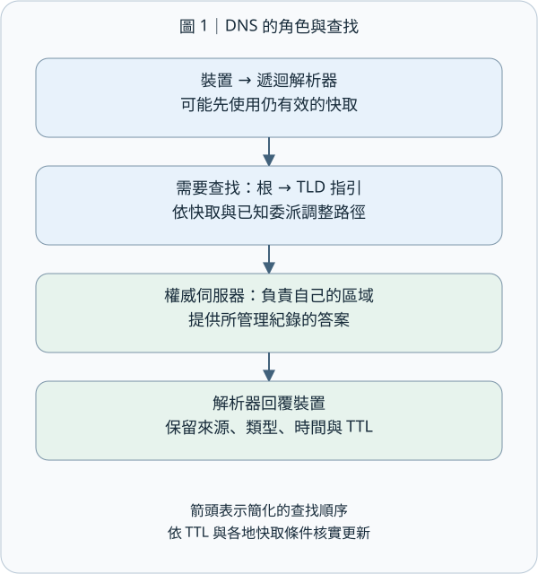
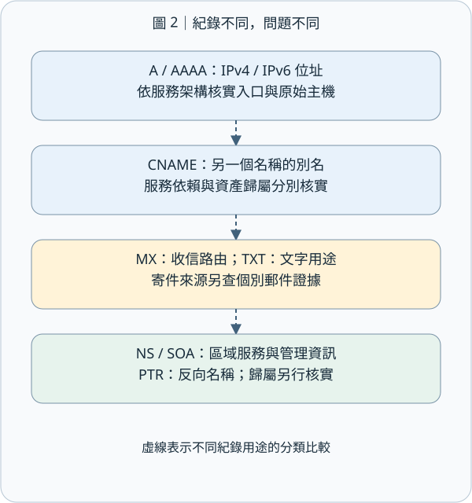
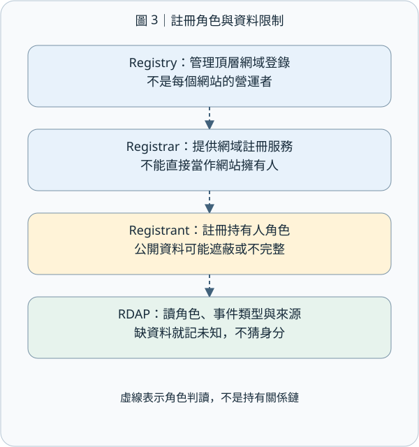
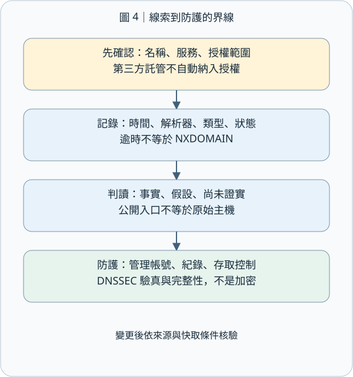

# M02-04｜DNS、WHOIS / RDAP Footprinting：從服務位址讀懂註冊角色

## 1｜結論先行：把「服務怎麼找到」與「網域怎麼登記」分開

今天只學一個完整概念：用 DNS 與網域註冊資料建立可查證的外部輪廓，並依資料角色與證據核實服務位置及營運歸屬。

DNS（Domain Name System，網域名稱系統）像電話簿加分層問路系統，回答「這個名稱有哪些服務紀錄」。WHOIS（傳統註冊資料查詢協定）與 RDAP（Registration Data Access Protocol，註冊資料存取協定）則比較像查登記資料，回答「這個網域在註冊體系中留下哪些資料」。Footprinting（足跡蒐集）是把這些線索整理成範圍清楚、附時間與來源的輪廓。

生活上，一間咖啡店的外送聯絡電話、代收郵件地址、店面租約登記人可能各不相同。網域也一樣：網站、信箱、DNS 託管商、註冊商和實際營運者可以是不同角色。真正要學會的是「每個欄位回答哪個問題，以及進一步核實需要哪些資料」。

## 2｜DNS 查詢的旅程：誰幫你問，誰有權回答？

假設你要開啟合成案例的 www.coffee.example。你的裝置通常先問遞迴解析器（Recursive Resolver）：一個替你找答案、也可能保存先前答案的服務。若快取已有可使用的答案，它就直接回覆，節省查找時間。

若需要查找，解析器可沿 DNS 階層取得指引：根名稱伺服器知道頂層網域的委派資訊；頂層網域（Top-Level Domain，TLD）伺服器再指向相關網域的權威名稱伺服器（Authoritative Name Server）。權威伺服器提供它負責區域的紀錄。實際查詢路徑會依可用快取與已知委派資訊調整。

「遞迴」是幫你完成查找；「權威」是對自己管理的區域提供正式資料。DNS 區域（Zone）是一段由特定權威伺服器管理的名稱空間，其管理範圍依委派切分，子網域可以另外委派。以上角色與委派結構可參考 [RFC 1034](https://www.rfc-editor.org/rfc/rfc1034)。

快取（Cache）像抄下來暫時使用的電話簿。TTL（Time to Live，存活時間）告訴快取一筆紀錄可以保留多久；全球各處反映變更的時間，還要搭配各解析器快取與查詢條件觀察。觀察到的 TTL 也可能是剩餘時間。不同解析器、查詢時間或網路位置，可能看到不同結果。

## 3｜讀懂紀錄：每種欄位都只回答自己的問題

資源紀錄（Resource Record）是 DNS 中的資料單位。每種紀錄描述一種對應關係，資產歸屬則搭配管理或契約資料核實。

| 類型 | 白話用途 | 判讀重點與核實方向 |
| --- | --- | --- |
| A | 名稱對應 IPv4 位址 | 可能指向共用主機、代理入口或原始主機，依服務架構核實 |
| AAAA | 名稱對應 IPv6 位址 | 與 A 分開查，完整掌握 IPv4 與 IPv6 服務配置 |
| CNAME | 這個名稱是另一個名稱的別名 | 可看出服務依賴，主機歸屬再由資產管理資料核實 |
| MX | 郵件應送往哪些郵件交換主機 | 提供收信路由線索；寄件來源需另查該封郵件的傳送證據 |
| NS | 這個區域由哪些名稱伺服器服務 | 常反映 DNS 託管；持有人則依註冊角色與管理資料核實 |
| SOA | 區域管理的起始資訊與計時參數 | 序號協助區域版本管理，格式依管理者採用的編號方式判讀 |
| TXT | 文字資料，可供驗證或政策使用 | 依內容與相應規格解讀，辨識驗證、政策等公開用途 |
| PTR | 常用於反向查詢，由位址找名稱 | 提供反向名稱線索；正向對應及所有權分別核實 |

MX 的偏好值較小者優先嘗試，數值表達嘗試順序。TXT 可能放 SPF（Sender Policy Framework，寄信來源政策）、網域驗證字串等；依字串內容與規格，分別辨識寄信政策、驗證等用途。DNS 的基本紀錄格式及多數上述類型見 [RFC 1035](https://www.rfc-editor.org/rfc/rfc1035)；IPv6 的 AAAA 紀錄見 [RFC 3596](https://www.rfc-editor.org/rfc/rfc3596)。

## 4｜WHOIS 與 RDAP：辨識註冊體系的三種角色

註冊人（Registrant）是網域註冊關係中的持有人角色；註冊商（Registrar）提供網域註冊服務；註冊管理機構（Registry）管理某個頂層網域的登錄資料。這三種角色各有職責。即使某平台同時提供多種服務，仍要按欄位角色判讀。

傳統 WHOIS 使用 TCP（Transmission Control Protocol，傳輸控制協定）的 43 埠；埠可想成服務的收件窗口。回覆常是文字，格式及可取得的欄位會因服務而異；它採用傳統文字交換設計；需要強固存取控制與資料保密時，應選用具備這些安全服務的協定。[RFC 3912](https://www.rfc-editor.org/rfc/rfc3912)

RDAP 的安全規範要求支援 HTTPS，也就是以加密連線傳送 HTTP（Hypertext Transfer Protocol，超文字傳輸協定，網頁傳輸常用規則）資料；連線加密保護資料傳輸，網站營運歸屬則依欄位角色及管理證據核實。[RFC 7481](https://www.rfc-editor.org/rfc/rfc7481)

RDAP 使用標準化查詢與結構化回應，讓人和程式較容易辨識欄位；JSON（JavaScript Object Notation，資料交換格式）將欄位名稱和值組織起來，供程式處理或介面呈現。RDAP 回應可包含名稱、狀態、事件、實體及其角色、名稱伺服器、說明與連結，應連同角色和事件類型一起讀。[RFC 9083](https://www.rfc-editor.org/rfc/rfc9083)

例如「某日期」要先看它是註冊、更新還是到期事件，再按該事件解讀。網站改版日可查發布紀錄，公司成立日可查公司登記；各類日期都有對應來源。註冊商欄位說明提供註冊服務的角色，網站營運者則搭配管理資料核實。資料因隱私保護而遮蔽或缺省時，記錄為「公開欄位未提供」，並列出確認持有人所需的合法來源。

截至本課查核，ICANN 說明 RDAP 已成為註冊資料的主要替代協定；自 2025 年 1 月 28 日起，一般頂層網域的註冊管理機構與註冊商通常不再被要求提供 WHOIS，但頁面列有 .com、.name、.post 例外。實際 WHOIS 服務可能持續運作；國家或地區頂層網域則依各自規則查核。[ICANN RDAP 說明](https://www.icann.org/rdap)

## 5｜把線索串起來：一間合成咖啡店的外部輪廓

以下使用教材自編資料、.example 名稱與文件用 IP。練習範圍是閱讀這組合成資料，實際操作應置於合法授權的隔離環境。

| 自編觀察 | 可以記錄的事實 | 進一步核實的資料 |
| --- | --- | --- |
| www.coffee.example 的 CNAME 指向 edge.vendor.example | 這個網站名稱使用了另一名稱作為別名 | 原始主機的位置須查服務設定；測試對象須逐一對照書面授權 |
| 別名後續的 A 回覆為 192.0.2.10 | 此次解析取得這個 IPv4 位址 | 位址使用者、網路位置與弱點狀態，各需對應的資產及授權驗證資料 |
| coffee.example 的 MX 為 10 mail.vendor.example | 收信路由指向這個郵件主機 | 帳號管理與個別郵件的傳送證據，依其目的與授權另外查核 |
| RDAP 的 registrar 角色為範例註冊商 | 登記資料標示此註冊商角色 | 店主與網站營運者的歸屬，需查對應管理或登記資料 |
| 另一時間查詢得到不同 IP | 兩次結果不同，需保留各自時間與查詢條件 | 快取、異動紀錄、服務配置及安全紀錄，可協助釐清差異來源 |

內容傳遞網路（Content Delivery Network，CDN）或反向代理（Reverse Proxy，替後端接收請求的前端服務）可替後端提供對外入口，原始主機的位置由服務架構決定。多個網站共用一個入口 IP 很常見，各網站的營運者可各自獨立。報告可先寫「觀察到依賴或對應」，再以資產管理或契約資料確認歸屬。

## 6｜回應狀態、差異原因與查詢互動

NXDOMAIN 是回覆所述的名稱不存在狀態。名稱存在、但所問紀錄類型缺少資料時，要依相應回覆內容判讀。逾時表示在等待期限內未收到答案，可從網路、伺服器、限制或設定查找原因。保留回應狀態、查詢名稱和類型，就能讓讀者重建當時條件。DNS 負面回覆也可能被快取。[RFC 2308](https://www.rfc-editor.org/rfc/rfc2308)

結果不同，可能是快取、變更時點、地理或負載導向、不同 DNS 視圖。Split DNS（分割視圖 DNS）讓內外部網路看到不同答案，外部與內部的資產狀態應在各自授權視角查核。若要判定竄改，需進一步比對設定變更、管理者授權及安全紀錄。

查第三方已保存的歷史 DNS 資料，和直接向解析器或權威伺服器查詢，屬於不同互動路徑。一般 DNS 查詢仍會產生網路流量；你問遞迴解析器，也可能間接觸發它去問權威伺服器。是否列為被動蒐集，要按課程定義與書面測試規則判斷，並依書面授權明定查詢對象、頻率與方法。

本單元重點是少量、範圍明確的紀錄判讀。先前 M04 的 DNS Enumeration（DNS 列舉）內容可用來快速複習：單筆查詢提供該次紀錄的線索；完整列舉則需要另定範圍與方法。大量猜名稱、測試區域傳送或進一步探測，應先確認相應授權與規則。本課專注於已提供的合成紀錄判讀。

## 7｜防護與證據：讓公開資料與管理權各得其所

DNS 本來就需要對外公布部分服務線索。防護目標是讓公開資料恰當、管理權安全、服務本身有存取控制。

可落實的作法包括定期盤點公開紀錄，移除不再使用的紀錄與服務依賴，避免把內部命名或敏感資料放入公開區域，保護註冊商與 DNS 管理帳號，啟用適當的多因素驗證與異動監控。若 CNAME 指向已停用的外部服務，先核實服務實際狀態與可接管條件，再處理紀錄，並用查核結果描述實際風險。

DNSSEC（Domain Name System Security Extensions，DNS 安全擴充）讓驗證端檢查 DNS 資料來源真實性及完整性。DNSSEC 的工作是驗真與完整性驗證，DNS 資料仍可被讀取。傳輸保密需另用加密機制；網站內容安全、服務可用性及營運者可信度，各由相應的安全控制與證據評估。[RFC 4033](https://www.rfc-editor.org/rfc/rfc4033)

| 證據欄位 | 要留下什麼 |
| --- | --- |
| 範圍與來源 | 被授權的名稱、查詢服務或資料庫、直接查詢或歷史資料 |
| 時間與條件 | 日期、時區、解析器、網路視角、查詢名稱與紀錄類型 |
| 原始結果 | 回應狀態、紀錄值、TTL；只保留必要資料 |
| 判讀 | 觀察到的事實、可能解釋、待核實的歸屬 |
| 防護核驗 | 經授權的變更前後比較、管理紀錄及仍待確認之處 |

例如「已移除舊 CNAME」要以設定變更與適當查核支持；剛改完後某個快取仍看到舊值，可先檢查時間、TTL 與查詢來源，再依快取期限和權威資料確認生效情況。

## 8｜小檢核：一個情境，四個判讀

在授權的合成練習中，你看到：www.coffee.example 指向某 CDN 名稱；A 回覆 192.0.2.10；RDAP 只有註冊商資料，持有人欄位未公開；另一位同事的 DNS 查詢逾時。

請試著用自己的話回答：① 192.0.2.10 提供哪種線索，核實原始主機與歸屬還需要哪些資料？② 註冊商扮演什麼角色，網站營運者如何核實？③ 逾時描述哪種狀態，應如何記錄並查找原因？④ 若想讓報告可重查，你最少要補哪些查詢條件？

使用本頁合成資料即可完成理解檢核；將判讀理由說清楚，有助於檢查自己是否掌握各欄位的意義。

## 9｜今天帶走的觀念與來源

一句話收束：DNS 告訴你「名稱如何連到服務」，WHOIS／RDAP 告訴你「註冊資料如何描述角色」；兩者都需要來源、時間與適用條件，才能變成可靠的資產線索。

下一個單元是 M02-05 Email Footprinting，再把郵件線索接回寄送路徑與可證實的資訊。本單元到這裡完成 DNS 與註冊資料的連結。

主要查證來源：[DNS 概念 RFC 1034](https://www.rfc-editor.org/rfc/rfc1034)、[DNS 紀錄 RFC 1035](https://www.rfc-editor.org/rfc/rfc1035)、[IPv6 DNS RFC 3596](https://www.rfc-editor.org/rfc/rfc3596)、[負面快取 RFC 2308](https://www.rfc-editor.org/rfc/rfc2308)、[RDAP JSON RFC 9083](https://www.rfc-editor.org/rfc/rfc9083)、[ICANN RDAP](https://www.icann.org/rdap)、[DNSSEC RFC 4033](https://www.rfc-editor.org/rfc/rfc4033)。
