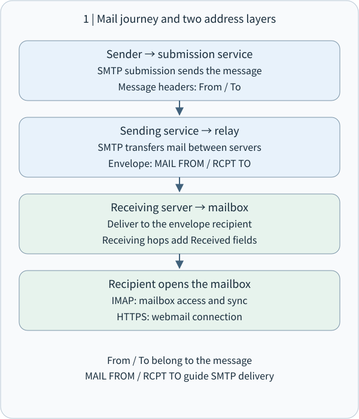
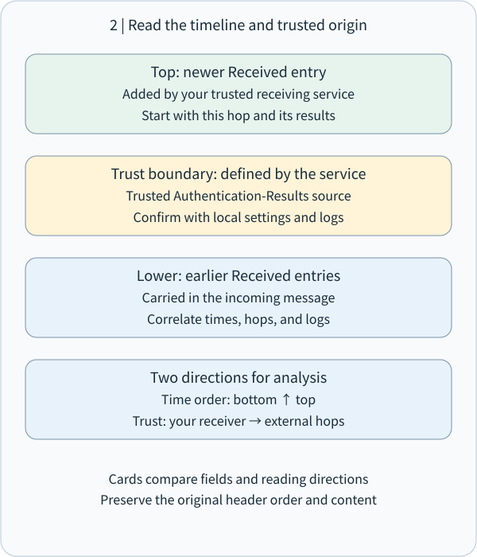
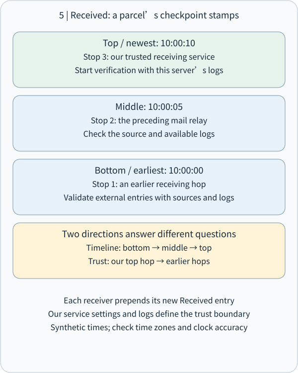
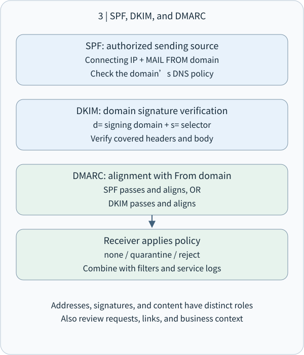
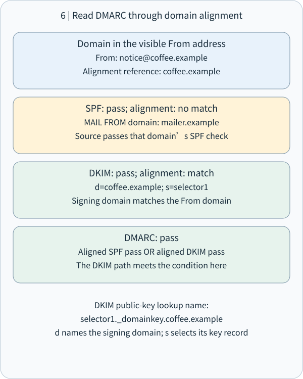
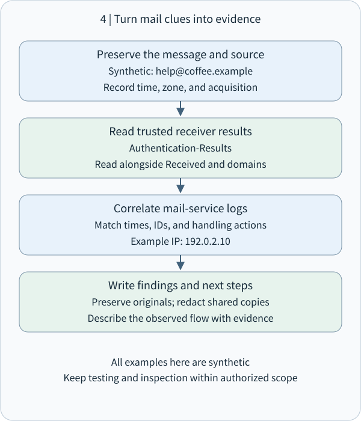

# CEH M02-05 | Email Footprinting: Reading Delivery Paths and Domain Authentication


## 1 | The main idea

Email footprinting uses public contact information and original messages you are authorized to inspect to organize sending domains, mail services, delivery paths, and authentication results. Together, these clues answer: Which systems handled this message? Which domain was used? What checks did the receiving system perform?

This lesson follows M02-04 DNS: MX records help locate receiving services; now we examine the evidence left by an actual message. It also connects to M09 anti-phishing: technical checks help validate domain use and delivery, while important business requests are confirmed through an established independent channel.

Remember the division of work: the envelope routes delivery, headers describe the message, and the receiving system supplies path and authentication evidence. All examples use synthetic data and .example domains for offline reading practice.

## 2 | Understand email through a parcel delivery

A parcel has a shipping label on the outside and a letter inside. Email also has two layers.

The envelope carries system delivery information. In SMTP (Simple Mail Transfer Protocol), MAIL FROM supplies the return path for delivery errors, while RCPT TO identifies actual delivery recipients. The header is the set of fields at the start of the message, including the visible From, To, and Subject. The body carries text and associated content.

For example, an event platform may send a coffee shop's receipt. The visible From can be receipt@coffee.example while bounce@mailer.example handles delivery errors. Label the separate responsibilities first. Bcc provides another helpful illustration: a recipient can be in the delivery envelope while the visible To field presents a different list. [SMTP envelope and transport](https://www.rfc-editor.org/rfc/rfc5321), [message format](https://www.rfc-editor.org/rfc/rfc5322)

A common path is: sender's mail application → submission service → one or more relay servers → recipient server → recipient's mail application. A relay is an MTA (Mail Transfer Agent), which hands the message to the next system. Webmail lets a person use a mailbox through a website. [Internet mail architecture](https://www.rfc-editor.org/rfc/rfc5598)

Think of ports as numbered service entrances. Server-to-server SMTP commonly uses TCP 25; user submission commonly uses 587 or implicit TLS on 465. TLS (Transport Layer Security) protects data in transit. IMAP (Internet Message Access Protocol) lets a mail application read and synchronize a mailbox; implicit TLS commonly uses 993. Webmail usually uses HTTPS on 443. Interpret a port together with the service configuration. [TLS for mail submission and access](https://www.rfc-editor.org/rfc/rfc8314)



## 3 | Open the original message: each field answers a question

In browser-based Gmail, open a message you received and choose Show original from the More menu next to Reply. Other mail applications may call this View source or Full headers. Preserve the original and prepare a redacted working copy for analysis. [Gmail's official steps](https://support.google.com/mail/answer/29436?hl=en)

• From: the presented author address. A display name is the human-friendly name beside it. Read the complete address and its domain.
• Reply-To: the suggested reply destination. Customer-service, delegated-sending, and ticketing systems may use a separate address; compare it with the actual business workflow.
• To / Cc: the message's presented primary and copy recipients.
• Return-Path: the return path recorded at final delivery, useful for comparison with the SMTP envelope.
• Date: the creation date declared in the message. Retain the time zone when comparing it with receipt time.
• Message-ID: a message identifier useful for searching and correlating logs. Services may also assign their own internal message IDs; record them separately.
• Received: reception records left by delivery nodes, central to rebuilding the message route.
• Authentication-Results: checks recorded by an authentication service, often including SPF, DKIM, and DMARC. [Message fields](https://www.rfc-editor.org/rfc/rfc5322), [authentication-result header](https://www.rfc-editor.org/rfc/rfc8601)

Role mailboxes such as info@ and support@ on public contact pages, and department or contact details in signatures, can also reveal an organization's public footprint. Collect fields relevant to the task and separate public-page information from technical message evidence. This continues M02-02 source validation: each field retains its own source and time.

## 4｜Reading Received: establish trusted hops, then reconstruct chronology

Received describes reception hops. SPF, DKIM, and DMARC describe sending authorization, signing domains, and their relationship to the visible author. Separate these questions first, then connect the evidence into a clear account of the message.

**4.1 Understand reception records through parcel delivery**

Imagine a parcel leaving Taipei and passing through an origin station, a transfer station, and a destination station. Each station records: “At this time, I received the parcel from this previous station.” A mail server leaves similar handover records. Received is a reception field in the message header; a system that transfers messages is called an MTA (Mail Transfer Agent).

```
Received: from outbound.mailer.example (192.0.2.25)
        by mx.recipient.example;
        Sat, 31 Oct 2026 10:00:05 +0000
```

| Field | Plain-language meaning and verification point |
|---|---|
| Received | A reception event; identify the system that wrote it first. |
| from outbound.mailer.example | Information about the previous host's name; interpret it alongside the connection IP. |
| (192.0.2.25) | In this example, the connection-source IP recorded by the receiver. |
| by mx.recipient.example | The server recording this reception event. |
| 10:00:05 +0000 | The server's recorded time; +0000 is the same offset as UTC. |

Once the record is established as originating from trusted mx.recipient.example, report: “At this time, this receiving server recorded a mail connection from 192.0.2.25.” That is evidence of a handover between systems. To identify the operating account or device, obtain authorized submission-service, sign-in, or endpoint records, giving each layer of the conclusion its own supporting material. [SMTP trace information: RFC 5321 §4.4](https://www.rfc-editor.org/rfc/rfc5321.html#section-4.4)

**4.2 A three-hop example: chronology and trust verification have different directions**

The following synthetic message contains three reception records. All .example names and 192.0.2.x addresses are instructional. Assume the receiving organization operates mx.recipient.example and mailbox.recipient.example and can examine both systems' logs.

```
Received: from mx.recipient.example (192.0.2.30)
        by mailbox.recipient.example;
        Sat, 31 Oct 2026 10:00:10 +0000
Received: from outbound.mailer.example (192.0.2.25)
        by mx.recipient.example;
        Sat, 31 Oct 2026 10:00:05 +0000
Received: from submit.mailer.example (192.0.2.20)
        by outbound.mailer.example;
        Sat, 31 Oct 2026 10:00:00 +0000
```

A receiving server adds its own Received above the existing records. Here, the top entry is at 10:00:10 and the bottom entry is at 10:00:00. [How Received is added: RFC 5321 §4.4](https://www.rfc-editor.org/rfc/rfc5321.html#section-4.4)

| Reading goal | Starting point and direction | Application to this example |
|---|---|---|
| Reconstruct the chronology described by the records | Bottom to top, earlier to later | 10:00:00 acceptance by the outbound server → 10:00:05 gateway reception → 10:00:10 internal delivery. |
| Verify the credibility of each segment | Start with your trusted receiver and work toward earlier hops | Check mailbox's internal reception, then mx's external connection; obtain separate provider evidence for the earlier record written by outbound. |

Convert times to a common zone first. For example, 10:00:05 +0000 is 18:00:05 +0800 in Taiwan. Estimating delay between two servers also requires considering clock synchronization. Record “the difference between header timestamps” separately from “verified transport delay” for a precise analysis.

**4.3 Trust boundaries: connect each record to the system that produced it**

A trust boundary separates systems you can verify from externally supplied information. In this example, mx directly observed outbound's connection; an external system describes the earlier submit → outbound segment. Divide an evidence table into “corroborated with our logs” and “external record awaiting corroboration,” then complete it segment by segment.

For example, this header entry initially provides a source claim to investigate:

```
Received: from official-bank.example
        by secure-gateway.example;
        Sat, 31 Oct 2026 09:00:00 +0000
```

Verify the claim by identifying its writer and comparing the trusted reception chain with relevant service logs. An external sender may prepopulate header content before the message enters the trusted system, so record “appearance of the entry” and “verification of its origin” separately. This connects to M09 social engineering: official-looking names and familiar brands attract trust, while independent sources and system records provide a verifiable basis for that trust.





## 5｜SPF, DKIM, and DMARC: three complementary checks

**5.1 Think of authorized vehicles, document seals, and a storefront name**

Suppose a message displays From: A Bank <service@bank.example>. From presents author information; the receiving system then checks sending authorization and signatures to connect that name with technical evidence.

| Mechanism | Everyday analogy | Actual check |
|---|---|---|
| SPF | A list of authorized delivery vehicles | Whether the connection-source IP matches the checked domain's sending policy. |
| DKIM | A digital document seal | Whether the signing domain's signature and the content it covers verify consistently. |
| DMARC | Comparing credentials with the storefront name | Whether a domain authenticated by SPF or DKIM aligns with the From domain. |

**5.2 SPF: compare a source IP with a domain's authorization list**

SPF (Sender Policy Framework) lets a domain publish sending policy in DNS (Domain Name System). TXT is a DNS record type that holds text. If a delivery platform uses 192.0.2.25, an instructional policy can be written as:

```
mailer.example. TXT "v=spf1 ip4:192.0.2.25 -all"
```

v=spf1 identifies the SPF version; ip4:192.0.2.25 lists an authorized IPv4 source. If preceding conditions do not match, -all produces an SPF fail result, expressing that this domain has not authorized that source. The receiver then applies its own handling policy to reject, annotate, or otherwise process the message. [SPF fail and handling: RFC 7208 §2.6.4 and §8.4](https://www.rfc-editor.org/rfc/rfc7208.html#section-8.4)

The receiver usually compares the current connection IP with the domain in SMTP (Simple Mail Transfer Protocol) MAIL FROM, the delivery envelope's reverse-path identity. SPF also defines checks of the HELO/EHLO identity, the greeting name used in an SMTP connection. In your analysis, explicitly record “which IP, which identity, which domain, and which result,” then compare those with the visible From. [SPF identities: RFC 7208 §2](https://www.rfc-editor.org/rfc/rfc7208.html#section-2)

**5.3 DKIM: use a key pair to verify covered content**

DKIM (DomainKeys Identified Mail) uses asymmetric cryptography: the signer keeps a private key to generate a digital signature, and the receiver obtains the public key from DNS to verify it.

This excerpt shows the tags to recognize. A real signature also contains an algorithm, signature value, and other required fields:

```
DKIM-Signature: v=1;
    d=coffee.example;
    s=selector1;
    h=from:to:subject:date;
    c=relaxed/relaxed;
```

| Tag or step | How to understand it |
|---|---|
| d=coffee.example | The signing domain, subsequently compared with From for alignment. |
| s=selector1 | The selector locates a key. Here the verifier queries the DNS TXT record at selector1._domainkey.coffee.example. |
| h=from:to:subject:date | Lists the header names selected for this signature; From must be signed, and the verifier selects corresponding field instances according to the rules. |
| c=relaxed/relaxed | Canonicalization rules for headers and body respectively; they normalize allowed formatting differences before calculation. |
| bh= and b= | bh= holds the body hash; b= holds the signature value. The verifier checks both the body hash and the signature. |
| Optional l= | Specifies the number of canonicalized body octets included in hashing; omitting it covers the entire canonicalized body. |

The digital seal covers selected headers and the body data processed under those rules. Recording h=, c=, and the presence of l= precisely describes the verification scope. When forwarding or mailing-list processing changes protected material, interpret the result together with that processing. Business-content checks continue through orders, established contact channels, and account activity. [DKIM tags and verification: RFC 6376 §3.4, §3.5, and §6](https://www.rfc-editor.org/rfc/rfc6376.html#section-3.5)

**5.4 DMARC: at least one path that both passes and aligns**

DMARC (Domain-based Message Authentication, Reporting, and Conformance) connects an authenticated identity with the author domain in From. Alignment compares the relationship between those domains. Suppose:

```
From: receipt@coffee.example
Return-Path: <bounce@mailer.example>
```

The trusted receiver records SPF pass for mailer.example and DKIM pass with d=coffee.example. From also uses coffee.example, so the DKIM path both passes and aligns. Its logic can be written as:

```
DMARC pass =
  (SPF pass AND SPF domain aligned)
  OR
  (DKIM pass AND DKIM signing domain aligned)
```

Strict alignment requires the compared domains to be identical. Relaxed alignment checks whether they share an organizational domain under the specification. For example, if coffee.example is their common organizational domain, mail.coffee.example and coffee.example can align in relaxed mode. Implementations discover organizational domains using the current specification rather than simply taking the last two labels. [DMARC alignment: RFC 9989](https://www.rfc-editor.org/rfc/rfc9989.html)

The domain policy p=none expresses monitoring mode, p=quarantine expresses a quarantine preference, and p=reject expresses a rejection preference. The receiver combines these preferences with its own assessment when deciding how to handle mail. Verification and supplementation: RFC 9989 was published in May 2026 and obsoletes RFC 7489 and RFC 9091; this lesson uses that current core specification. [RFC 9989 publication information and policy](https://www.rfc-editor.org/rfc/rfc9989.html)

**5.5 Read Authentication-Results field by field**

Authentication-Results records checks performed by a receiving authentication service. First establish the authserv-id (authentication service identifier) and that the field was actually produced by a trusted service; then interpret pass or fail. Your mail-administration rules, trusted gateways, and logs provide that source assurance. [Authentication-result trust boundaries: RFC 8601 §1.2 and §7](https://www.rfc-editor.org/rfc/rfc8601.html#section-1.2)

```
From: Coffee Shop <receipt@coffee.example>
Return-Path: <bounce@mailer.example>
Authentication-Results: mx.recipient.example;
    spf=pass smtp.mailfrom=mailer.example;
    dkim=pass header.d=coffee.example;
    dmarc=pass header.from=coffee.example
```

| Observed field | Interpretation |
|---|---|
| mx.recipient.example | The declared authentication service identifier; compare it with trusted-service configuration and logs first. |
| spf=pass | This SPF check passed. |
| smtp.mailfrom=mailer.example | The envelope-sender domain checked here. |
| dkim=pass | This DKIM signature verified. |
| header.d=coffee.example | The signing domain of that DKIM signature. |
| dmarc=pass | This DMARC evaluation passed. |
| header.from=coffee.example | The author domain compared by DMARC. |

Read this as one complete assessment: “The trusted receiving service verified the platform's SPF and coffee.example's DKIM. DKIM aligns with From, satisfying the DMARC passing condition.” If forwarding occurred, also record the changed connection source and message processing to investigate differences in results. [Indirect mail flows: RFC 7960](https://www.rfc-editor.org/rfc/rfc7960.html)





## 6 | Worked example: a platform sends the coffee shop's receipt

This teaching excerpt omits real signatures and other headers. Assume a trusted receiving system produced the results:

```
From: Coffee Shop <receipt@coffee.example>
Reply-To: support@coffee.example
Return-Path: <bounce@mailer.example>
Authentication-Results: mx.recipient.example;
        spf=pass smtp.mailfrom=mailer.example;
        dkim=pass header.d=coffee.example;
        dmarc=pass header.from=coffee.example
```

First, identify roles. The visible author uses coffee.example, replies go to its support address, and delivery errors go to mailer.example.

Second, read each check. SPF pass says the current source fits mailer.example's policy. DKIM pass says the coffee.example signature validated.

Third, check alignment. From uses coffee.example and DKIM d= also uses coffee.example. That DKIM path has both a successful check and alignment, supporting DMARC pass. SPF checks the sending platform's mailer.example identity in this example.

Fourth, connect the business context. For a receipt from a purchase you just made, compare the order ID, items, and amount. A request to change payment details should be confirmed through a previously saved contact channel. The technical layer validates domain use; the business layer validates the requested action.

**6.1 Six layers of assessment: connect transport, domain, and business evidence**

| Analysis layer | Main question | Supporting evidence |
|---|---|---|
| Delivery path | Which node handed the message to which node? | Received and a timeline normalized to one time zone. |
| Trusted origin | Which records come from verifiable systems? | Your MTA, gateway configuration, and mail logs. |
| Source authorization | Does this connection IP match the domain's sending policy? | SPF results and the checked identity. |
| Signature verification | How are the signing domain and protected content verified? | DKIM results, d=, s=, and coverage. |
| Domain alignment | How does an authenticated domain relate to From? | DMARC and at least one passing, aligned path. |
| Business credibility | Does the request match the real transaction and established process? | Orders, transaction records, established contacts, and account activity. |

Technical validation addresses domain authorization and signatures; business validation addresses the actual request. A compromised legitimate account or an attacker-owned lookalike domain may have normal domain-authentication results, so payment changes and sign-in requests receive a further independent-channel check. This connects M02 with M09: M02 builds traceable technical evidence, and M09 examines how messages use interpersonal trust. Together they support the next decision.

## 7 | Turn footprinting into protection and useful evidence

For administrators, inventory the systems sending on the organization's behalf: support, newsletters, receipts, and cloud services. Compare SPF, DKIM, and DMARC settings with that inventory. Test legitimate sending and forwarding incrementally, review results and reports, and adjust handling policy for the organization's needs. Multi-factor authentication, unusual-login detection, and established independent confirmation channels cover accounts and business processes alongside domains.

For analysts, a useful record contains message provenance and access authorization, acquisition time and zone, original file or internal identifier, trusted receiving nodes, relevant domains, SPF / DKIM / DMARC results, business checks, and next steps. Keep a controlled original and share redacted excerpts; headers can contain addresses, internal names, or personal information.

Email tracking is another footprinting topic: a requested remote image or tracking link can produce a server-side request record. Image proxies, caching, and preloading affect its interpretation. Report which resource was requested and when, then corroborate reading behavior with an appropriate recipient response or other evidence. This lesson uses offline analysis of available data; active tracking and test sending follow separately authorized exercise rules. [Apple Mail Privacy Protection](https://www.apple.com/legal/privacy/data/en/mail-privacy-protection/)



## 8 | Small check: connect sending roles and authentication

Synthetic case: From is notice@shop.example; Return-Path is bounce@platform.example. A trusted receiver records SPF pass for platform.example, DKIM pass with d=shop.example, and DMARC pass.

Explain briefly: ① Which domains handle delivery errors and the visible author? ② Which authentication path aligns with From? ③ If the message requests a new payment account, which established channel would you use to confirm it?

Multiple choice: To identify the connection peer from which your mail server accepted a message, which evidence do you check first? A. Display name; B. Received generated by your trusted node; C. Subject; D. Message signature block.

Reference answers will accompany the website lesson. Try your own explanation first; it will help focus any follow-up teaching.

**8.1 Extended understanding check: a bank-message scenario**

Assume these results have been established as originating from the company's trusted receiving service. This synthetic example is for offline interpretation:

```
From: security@bank.example
Authentication-Results: mx.company.example;
    spf=pass smtp.mailfrom=mailer.example;
    dkim=pass header.d=mailer.example;
    dmarc=fail header.from=bank.example
```

Question 1: SPF and DKIM both pass, while DMARC fails. What is the most direct reason? A. The authenticated domains do not align with From; B. SPF requires the same IP as DKIM; C. DKIM allows only self-operated sending; D. I would like to compare the domains again.

Question 2: The lowest Received entry says the message came from a bank. What is the appropriate next step? A. Attribute the source directly from that bank name; B. Start with trusted receiving nodes and verify the entry's producer and evidence segment by segment; C. I would like to review the trust boundary again.

Question 3: As the company's security analyst, name two pieces of evidence to check next and explain how they help establish technical origin and business credibility.

## 9 | Takeaway

Read a message through four questions: Who is presented as its author? How did the envelope route it? Which paths and checks did trusted systems record? How will the actual request be confirmed?

This connects M02 sources, DNS, and footprinting with M09 trust and independent verification. M02-06 extends the same relationship-building approach to IP addresses, ASNs, traceroute, and network footprinting.

This is one complete Email Footprinting unit, including the supporting delivery and authentication concepts. Technical sources are IETF RFCs and official Google and Apple guidance; all scenario data is synthetic.
