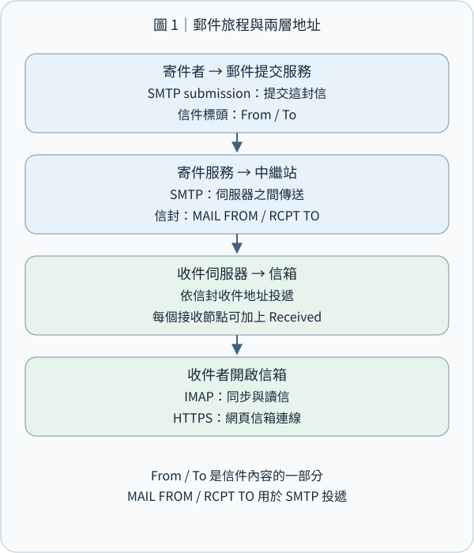
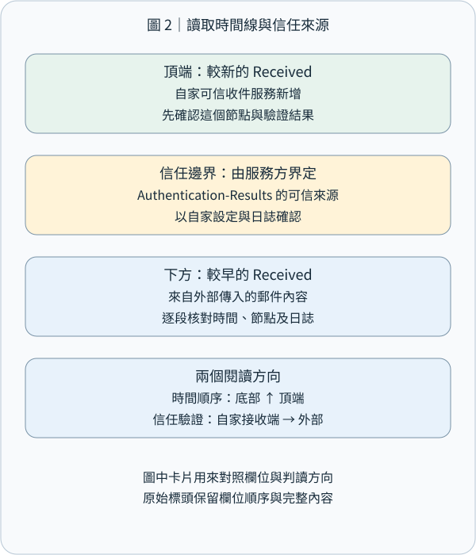
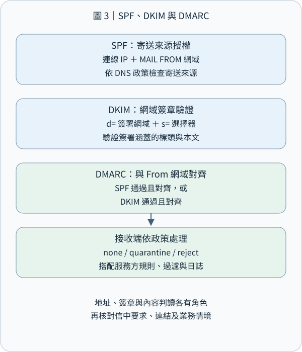
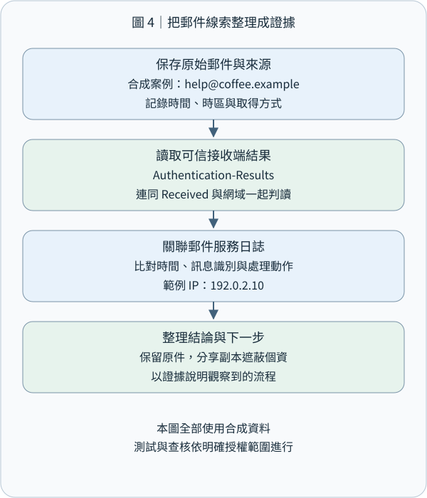

# CEH M02-05｜電子郵件足跡：讀懂寄送路徑與網域驗證

## 1｜先記住這個結論

電子郵件足跡蒐集（Email Footprinting）是從公開的聯絡資訊，以及自己有權查看的郵件原始資料，整理寄件網域、郵件服務、傳遞路徑與驗證結果。把這些線索放在一起，就能回答：「這封信經過哪些系統？使用哪個網域寄送？收件端做過哪些檢查？」

本課接續 M02-04 的 DNS：DNS 的 MX 紀錄協助找到收信服務；這次往下一層，閱讀一封信真正留下的資料。也呼應 M09 的反釣魚觀念：技術驗證協助確認網域與傳遞，重要業務要求則透過既有聯絡管道確認。

用一句話記住分工：信封負責投遞，標頭描述郵件，收件系統提供路徑與驗證證據。以下全部使用合成案例與 .example 教學網域，練習範圍是離線判讀。

## 2｜先用寄包裹理解電子郵件

你寄一個包裹時，有包裹外的物流單，也有包裹內的信。電子郵件同樣有兩層資料。

Envelope（郵件信封）是系統投遞時使用的資訊。SMTP（Simple Mail Transfer Protocol，簡單郵件傳輸協定）的 MAIL FROM 提供退信路徑，RCPT TO 指定實際投遞對象。Header（郵件標頭）是信件本身開頭的欄位；使用者看到的 From、To、Subject 就在這一層。Body（本文）則是文字與附加內容。

像活動平台代咖啡店寄收據：畫面 From 可以是 receipt@coffee.example，退信則交給 bounce@mailer.example 處理。兩個地址各有職責；判讀時先把角色標清楚。密件副本 Bcc 也能幫助理解：收件人可能已列入投遞信封，而畫面上的 To 欄保持另一份清單。[SMTP 信封與傳輸規範](https://www.rfc-editor.org/rfc/rfc5321)、[郵件格式規範](https://www.rfc-editor.org/rfc/rfc5322)

常見寄送流程是：寄件人的郵件軟體 → 提交服務 → 一個或多個轉送伺服器 → 收件伺服器 → 收件人的郵件軟體。轉送伺服器稱為 MTA（Mail Transfer Agent，郵件傳輸代理），每一站把信交給下一站。Webmail（網頁信箱）則讓使用者透過網站操作信箱。[網際網路郵件架構](https://www.rfc-editor.org/rfc/rfc5598)

連接埠可以當作服務入口編號來記：SMTP 伺服器間傳遞常見 TCP 25；使用者提交郵件常見 587，或使用隱式 TLS 的 465。TLS（Transport Layer Security，傳輸層安全協定）保護連線中的資料。IMAP（Internet Message Access Protocol，網際網路郵件存取協定）供郵件軟體讀取及同步信箱，隱式 TLS 常見 993；網頁信箱通常透過 HTTPS 443。看到入口編號後，再配合服務設定確認用途。[郵件提交與存取的 TLS 建議](https://www.rfc-editor.org/rfc/rfc8314)



## 3｜開啟原始郵件：每個欄位回答一種問題

在 Gmail 網頁版，開啟自己收到的郵件，從回覆旁的更多選單選「顯示原始郵件」，可以查看完整標頭。其他郵件軟體可能稱為「檢視來源」或「完整標頭」。分析時保留原始檔，另製作遮蔽個資的工作副本。[Gmail 官方步驟](https://support.google.com/mail/answer/29436?hl=en)

• From：信件所呈現的作者地址；Display Name（顯示名稱）是旁邊方便人閱讀的名稱。先讀完整地址，再看其網域。
• Reply-To：按下回覆時建議使用的地址；客服平台、代寄或工單服務可能使用獨立回覆地址，適合與實際業務流程核對。
• To／Cc：信件呈現的主要收件人與副本收件人。
• Return-Path：最終投遞時記錄的退信路徑，可協助對照 SMTP 信封。
• Date：郵件中標示的建立日期；與收件時間比較時，一併保留時區。
• Message-ID：訊息識別碼，可作為搜尋與比對日誌的線索；有些系統另外提供自己的內部郵件 ID，記錄時分開保存。
• Received：傳遞節點留下的接收紀錄，是重建寄送路徑的主要材料。
• Authentication-Results：驗證服務記錄的檢查結果，通常包含 SPF、DKIM、DMARC。[郵件欄位](https://www.rfc-editor.org/rfc/rfc5322)、[驗證結果標頭](https://www.rfc-editor.org/rfc/rfc8601)

公開聯絡頁上的 info@、support@ 等角色信箱，以及郵件簽名檔中的部門與聯絡方式，也能提供組織足跡。整理時只收與任務相關的欄位，並把「公開頁面資料」與「已取得郵件的技術資料」分開列出。這延續 M02-02 的來源查證：每個欄位都帶著自己的來源與時間。

## 4｜Received 怎麼讀：先確認可信節點，再還原時間順序

郵件伺服器接到信時，通常把自己的 Received 欄位加到既有標頭的上方。因此，畫面上方通常是較新的接收紀錄；要描述信件走過的時間順序，可以由下往上整理。[SMTP 的追蹤資訊](https://www.rfc-editor.org/rfc/rfc5321)

實際查核則從自己收件端的可信紀錄開始，確認「哪台伺服器記錄它從哪個連線對象收到信」，再往前追溯。這裡有兩種不同方向：敘述路徑按時間前進，確認可信度從自己的系統往外延伸。

假設可信收件端留下這段合成資料：

```
Received: from outbound.mailer.example (192.0.2.25)
        by mx.recipient.example;
        Sat, 31 Oct 2026 10:00:05 +0000
```

它呈現的事實是：mx.recipient.example 記錄在該時間，從 IP 192.0.2.25 的連線收到郵件，並附上對方名稱。確認這筆紀錄由自家收件系統產生後，就能把它作為該段傳遞的證據。郵件服務商的出口 IP 對應服務節點；若要追查操作帳號或裝置，再依法定與授權程序對照服務端紀錄。

更前面的 Received 資料可能來自其他系統，應逐段記下其產生者與可核對來源。每一站的時間還涉及時區與系統時鐘；分析延遲時，先統一時區並核對可信節點。這就是 M02-01 的範圍觀念在郵件上的應用：本課分析已取得的資料，進一步向第三方發送探測或測試郵件時，另依書面授權執行。



## 5｜SPF、DKIM、DMARC：三個互補的檢查

先把它想成「寄件車輛名單」「文件封條」「品牌與憑證的對照規則」。三者共同提供網域寄送的技術證據，內容中的付款、登入或資料提供要求，再接回 M09-06 的獨立查證流程。

SPF（Sender Policy Framework，寄件者政策框架）讓網域在 DNS 公告哪些來源可代表它寄信。收件端主要把目前連進來的 IP，和 SMTP MAIL FROM 所用網域的政策比較；在相關情況也會檢查 HELO 身分。HELO／EHLO 是 SMTP 連線時的身分招呼。SPF 的核心問題是：「這個寄送來源是否符合這個網域的寄信政策？」[SPF 規範](https://www.rfc-editor.org/rfc/rfc7208)

DKIM（DomainKeys Identified Mail，網域金鑰識別郵件）由寄件系統使用私鑰產生數位簽章，收件端依 DNS 中的公鑰驗證。簽章的 d= 標示簽署網域，s= 標示 selector（選擇器，用來找到對應金鑰）。驗證涵蓋簽章指定的標頭與本文資料，協助確認簽署網域及受保護內容的一致性。[DKIM 規範](https://www.rfc-editor.org/rfc/rfc6376)

DMARC（Domain-based Message Authentication, Reporting, and Conformance，網域式郵件驗證、報告與一致性機制）把使用者看到的 From 網域，與通過 SPF 或 DKIM 的網域作 Alignment（對齊）檢查。只要至少一條路徑「驗證通過，而且與 From 網域對齊」，即可形成 DMARC 通過條件。Strict（嚴格）對齊要求網域相同；Relaxed（寬鬆）對齊依組織網域規則判定。[現行 DMARC 規範 RFC 9989](https://www.rfc-editor.org/rfc/rfc9989)

網域也可以公布處理偏好：p=none 供觀察與評估，p=quarantine 建議隔離，p=reject 建議拒收；收件端會結合自身政策與其他訊號決定處理方式。2026 年發布的 RFC 9989 已取代舊 RFC 7489，本課採現行規範的核心概念。[DMARC 處理政策](https://www.rfc-editor.org/rfc/rfc9989)

查看 Authentication-Results 時，先辨識寫下結果的 authserv-id（驗證服務識別），以自己郵件服務的可信結果為主。轉寄會改變接收端看見的連線 IP；郵件清單加上頁尾時，也可能改動被簽署內容。遇到驗證差異，就把轉寄流程、網域對齊與服務日誌一起納入分析。[結果標頭的信任模型](https://www.rfc-editor.org/rfc/rfc8601)、[間接郵件流程](https://www.rfc-editor.org/rfc/rfc7960)



## 6｜完整例子：咖啡店使用代寄平台寄收據

以下為教學節錄，省略真實簽章與其他標頭；假設驗證結果由可信的收件系統產生：

```
From: Coffee Shop <receipt@coffee.example>
Reply-To: support@coffee.example
Return-Path: <bounce@mailer.example>
Authentication-Results: mx.recipient.example;
        spf=pass smtp.mailfrom=mailer.example;
        dkim=pass header.d=coffee.example;
        dmarc=pass header.from=coffee.example
```

第一步，辨識角色。畫面作者是 coffee.example，回覆流向同網域客服；退信交給 mailer.example。

第二步，閱讀各自的驗證。SPF pass 表示目前寄信來源符合 mailer.example 的政策；DKIM pass 表示 coffee.example 的簽章驗證通過。

第三步，檢查對齊。From 是 coffee.example，DKIM 的 d= 也是 coffee.example，所以 DKIM 這條路徑同時具備「通過」與「對齊」，支持 DMARC pass。SPF 使用 mailer.example，在這個例子裡負責代寄平台自身的來源檢查。

第四步，結合業務情境。如果這是你剛完成購買的收據，可以再核對訂單編號、品項與金額；若信件另要求更改匯款帳戶，就透過原先保存的客服管道確認。技術層確認網域使用，業務層確認要求內容，兩層配合形成完整判讀。

## 7｜從足跡轉成防護：收集適量、驗證到位

對組織管理者而言，先盤點哪些系統會代公司寄信，包括客服、電子報、收據與雲端服務，再把 SPF、DKIM 和 DMARC 設定與這份清單對照。逐步測試合法寄送與轉寄流程，持續看驗證結果和報告，依組織需求調整處理政策。配合帳號多因素驗證、異常登入偵測與既有獨立確認管道，可以把網域、帳號與業務流程一起照顧好。

對足跡分析者而言，一份實用紀錄可包含：郵件來源與取得權限、取得時間與時區、原始檔或內部識別、可信收件節點、涉及的網域、SPF／DKIM／DMARC 結果、相關業務查核與下一步。保留受控原檔，分享時使用遮蔽後節錄；標頭可能含信箱地址、內部名稱或個人資訊。

Email Tracking（郵件追蹤）也會出現在足跡教材中：遠端圖片或追蹤連結被請求時，伺服器可以記錄該次請求。圖片代理、快取與預先載入會影響這些紀錄的意義，因此報告應寫清楚觀察到的是「哪個資源在何時被請求」，閱讀行為再配合收件者回覆或其他適當證據確認。本課以已取得資料離線分析；主動追蹤與測試寄信由獨立授權的練習規則規範。[Apple 郵件隱私保護的運作](https://www.apple.com/legal/privacy/data/en/mail-privacy-protection/)



## 8｜小檢核：把寄信角色與驗證串起來

合成案例：From 是 notice@shop.example；Return-Path 是 bounce@platform.example。可信收件端顯示 SPF pass（platform.example）、DKIM pass（d=shop.example），並記錄 DMARC pass。

請用幾句話說明：① 退信與畫面作者各使用哪個網域？② 哪一條驗證路徑提供與 From 的對齊？③ 如果信中要求改用新的付款帳戶，你會透過哪個既有管道確認？

選擇題：要找「自家郵件伺服器從哪個連線對象接到信」，最直接先查看哪項資料？A. 顯示名稱；B. 自家可信節點產生的 Received；C. 主旨；D. 信件簽名檔。

參考答案會隨網站教材提供。你可以先用自己的話回答，我再依你的理解補充。

## 9｜今天帶走的觀念

讀一封信，可以依序問四件事：誰在畫面上署名？信封如何投遞？可信系統記錄了哪些路徑與驗證？實際要求要如何確認？

這把 M02 的來源、DNS 與足跡觀念，接回 M09 的人際信任與獨立確認。下一個單元 M02-06 會延伸到 IP、ASN、Traceroute 與網路足跡，繼續整理系統之間的關係。

本課為 Email Footprinting 的一個完整單元，含郵件路徑與驗證所需子概念。技術來源以 IETF RFC、Google 與 Apple 官方說明為主；情境資料均為合成。
