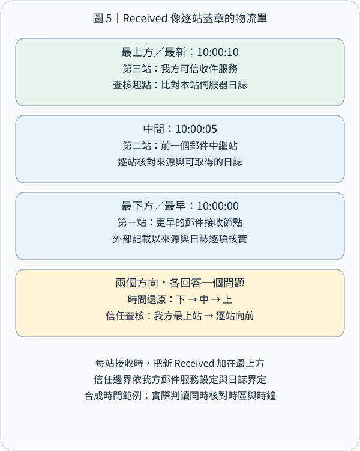
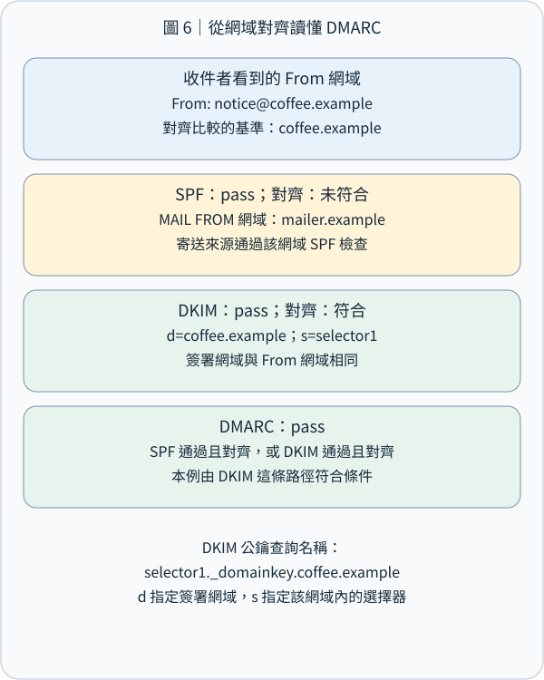

# CEH M02-05｜電子郵件足跡：讀懂寄送路徑與網域驗證


## 1｜先記住這個結論

電子郵件足跡蒐集（Email Footprinting）是從公開的聯絡資訊，以及自己有權查看的郵件原始資料，整理寄件網域、郵件服務、傳遞路徑與驗證結果。把這些線索放在一起，就能回答：「這封信經過哪些系統？使用哪個網域寄送？收件端做過哪些檢查？」

本課接續 M02-04 的 DNS：DNS 的 MX 紀錄協助找到收信服務；這次往下一層，閱讀一封信真正留下的資料。也呼應 M09 的反釣魚觀念：技術驗證協助確認網域與傳遞，重要業務要求則透過既有聯絡管道確認。

用一句話記住分工：信封負責投遞，標頭描述郵件，收件系統提供路徑與驗證證據。以下全部使用合成案例與 .example 教學網域，練習範圍是離線判讀。

## 2｜先用寄包裹理解電子郵件

你寄一個包裹時，有包裹外的物流單，也有包裹內的信。電子郵件同樣有兩層資料。

Envelope（郵件信封）是系統投遞時使用的資訊。SMTP（Simple Mail Transfer Protocol，簡單郵件傳輸協定）的 MAIL FROM 提供退信路徑，RCPT TO 指定實際投遞對象。Header（郵件標頭）是信件本身開頭的欄位；使用者看到的 From、To、Subject 就在這一層。Body（本文）則是文字與附加內容。

像活動平台代咖啡店寄收據：畫面 From 可以是 receipt@coffee.example，退信則交給 bounce@mailer.example 處理。兩個地址各有職責；判讀時先把角色標清楚。密件副本 Bcc 也能幫助理解：收件人可能已列入投遞信封，而畫面上的 To 欄保持另一份清單。[SMTP 信封與傳輸規範](https://www.rfc-editor.org/rfc/rfc5321)、[郵件格式規範](https://www.rfc-editor.org/rfc/rfc5322)

常見寄送流程是：寄件人的郵件軟體 → 提交服務 → 一個或多個轉送伺服器 → 收件伺服器 → 收件人的郵件軟體。轉送伺服器稱為 MTA（Mail Transfer Agent，郵件傳輸代理），每一站把信交給下一站。Webmail（網頁信箱）則讓使用者透過網站操作信箱。[網際網路郵件架構](https://www.rfc-editor.org/rfc/rfc5598)

連接埠可以當作服務入口編號來記：SMTP 伺服器間傳遞常見 TCP 25；使用者提交郵件常見 587，或使用隱式 TLS 的 465。TLS（Transport Layer Security，傳輸層安全協定）保護連線中的資料。IMAP（Internet Message Access Protocol，網際網路郵件存取協定）供郵件軟體讀取及同步信箱，隱式 TLS 常見 993；網頁信箱通常透過 HTTPS 443。看到入口編號後，再配合服務設定確認用途。[郵件提交與存取的 TLS 建議](https://www.rfc-editor.org/rfc/rfc8314)


## 3｜開啟原始郵件：每個欄位回答一種問題

在 Gmail 網頁版，開啟自己收到的郵件，從回覆旁的更多選單選「顯示原始郵件」，可以查看完整標頭。其他郵件軟體可能稱為「檢視來源」或「完整標頭」。分析時保留原始檔，另製作遮蔽個資的工作副本。[Gmail 官方步驟](https://support.google.com/mail/answer/29436?hl=en)

• From：信件所呈現的作者地址；Display Name（顯示名稱）是旁邊方便人閱讀的名稱。先讀完整地址，再看其網域。
• Reply-To：按下回覆時建議使用的地址；客服平台、代寄或工單服務可能使用獨立回覆地址，適合與實際業務流程核對。
• To／Cc：信件呈現的主要收件人與副本收件人。
• Return-Path：最終投遞時記錄的退信路徑，可協助對照 SMTP 信封。
• Date：郵件中標示的建立日期；與收件時間比較時，一併保留時區。
• Message-ID：訊息識別碼，可作為搜尋與比對日誌的線索；有些系統另外提供自己的內部郵件 ID，記錄時分開保存。
• Received：傳遞節點留下的接收紀錄，是重建寄送路徑的主要材料。
• Authentication-Results：驗證服務記錄的檢查結果，通常包含 SPF、DKIM、DMARC。[郵件欄位](https://www.rfc-editor.org/rfc/rfc5322)、[驗證結果標頭](https://www.rfc-editor.org/rfc/rfc8601)

公開聯絡頁上的 info@、support@ 等角色信箱，以及郵件簽名檔中的部門與聯絡方式，也能提供組織足跡。整理時只收與任務相關的欄位，並把「公開頁面資料」與「已取得郵件的技術資料」分開列出。這延續 M02-02 的來源查證：每個欄位都帶著自己的來源與時間。

## 4｜Received 怎麼讀：先確認可信節點，再還原時間順序

Received 回答「信經過哪些接收節點」，SPF、DKIM、DMARC 則回答「寄送來源、簽署網域與畫面作者如何對照」。先把兩類問題分開，再把證據接起來，閱讀完整郵件就有了清楚順序。

**4.1 用物流配送理解接收紀錄**

想像從台北寄出的包裹，依序經過寄件站、轉運站、收件站。每到一站，該站都寫下：「我在什麼時間，從哪個上一站收到包裹。」郵件伺服器（Mail Server）也會留下這類交接紀錄。Received 是寫在郵件標頭（Header）中的接收欄位；負責轉送的系統稱為 MTA（Mail Transfer Agent，郵件傳輸代理）。

```
Received: from outbound.mailer.example (192.0.2.25)
        by mx.recipient.example;
        Sat, 31 Oct 2026 10:00:05 +0000
```

| 欄位 | 白話意思與查核重點 |
|---|---|
| Received | 一筆接收事件，先確認由哪個系統寫入。 |
| from outbound.mailer.example | 上一站的名稱資訊；與實際連線 IP 一起判讀。 |
| (192.0.2.25) | 此例中接收端記錄的連線來源 IP。 |
| by mx.recipient.example | 寫下這筆接收事件的伺服器。 |
| 10:00:05 +0000 | 該伺服器記錄的時間；+0000 表示與 UTC 相同的時差。 |

若已確認這筆紀錄由可信的 mx.recipient.example 產生，可寫成：「該收件伺服器在這個時間，記錄到來自 192.0.2.25 的郵件連線。」這是節點間交接的證據。要進一步確認操作帳號與裝置，再依權限取得提交服務、登入或端點紀錄，讓每一層結論都有對應材料。[SMTP 追蹤資訊：RFC 5321 §4.4](https://www.rfc-editor.org/rfc/rfc5321.html#section-4.4)

**4.2 三站例子：時間閱讀與可信度查核各有方向**

以下是同一封合成郵件的三筆接收紀錄。所有 .example 名稱與 192.0.2.x 位址都供教學使用。假設收件組織管理 mx.recipient.example 與 mailbox.recipient.example，並能查閱兩者的日誌。

```
Received: from mx.recipient.example (192.0.2.30)
        by mailbox.recipient.example;
        Sat, 31 Oct 2026 10:00:10 +0000
Received: from outbound.mailer.example (192.0.2.25)
        by mx.recipient.example;
        Sat, 31 Oct 2026 10:00:05 +0000
Received: from submit.mailer.example (192.0.2.20)
        by outbound.mailer.example;
        Sat, 31 Oct 2026 10:00:00 +0000
```

新接收的伺服器會把自己的 Received 加在既有紀錄上面。於是這段標頭最上方是 10:00:10，最下方是 10:00:00。[Received 的加入方式：RFC 5321 §4.4](https://www.rfc-editor.org/rfc/rfc5321.html#section-4.4)

| 閱讀目的 | 起點與方向 | 這個例子的做法 |
|---|---|---|
| 還原記錄中的時間順序 | 由下往上，較早到較晚 | 10:00:00 代寄出口接收 → 10:00:05 閘道接收 → 10:00:10 內部投遞。 |
| 查核每段紀錄的可信度 | 從自己的可信收件系統，逐站往前 | 先核對 mailbox 的內部接收，再核對 mx 的外部連線；outbound 寫下的更早資料另找服務商證據。 |

先把各筆時間換成同一時區。例如 10:00:05 +0000 對應台灣 18:00:05 +0800。要估算兩站延遲，還要考慮兩台系統的時鐘同步狀態；把「標頭記載的時差」與「已核實的傳遞延遲」分開記錄，分析會更精確。

**4.3 信任邊界：把每筆紀錄接回產生它的系統**

信任邊界（Trust Boundary）是區分「自己可查核的系統」與「外部提供的資料」的界線。上例中，mx 直接觀察到 outbound 的連線；更早的 submit → outbound 段，則由外部系統描述。可以把證據表分成「己方日誌已對照」和「外部紀錄待對照」兩欄，再逐段補齊。

例如標頭中出現下面這行時，它首先是一項待核對的來源主張：

```
Received: from official-bank.example
        by secure-gateway.example;
        Sat, 31 Oct 2026 09:00:00 +0000
```

確認這段主張的做法，是辨識寫入者、核對可信接收鏈與相關服務日誌。信件進入可信系統以前的標頭可能由外部寄件方預先填入，因此「紀錄外觀」與「來源核驗」各自列欄。這也接回 M09 社交工程：正式名稱和熟悉招牌可以吸引信任；獨立來源與系統紀錄，則讓信任有可查核的依據。




## 5｜SPF、DKIM、DMARC：三個互補的檢查

**5.1 用車輛名單、文件封條與招牌對照來理解**

假設郵件顯示 From: 台灣某銀行 <service@bank.example>。From 是郵件呈現的作者資訊；收件系統接著核對寄送來源與簽章，把這個名稱連到技術證據。

| 機制 | 生活比喻 | 實際檢查 |
|---|---|---|
| SPF | 寄送車輛的授權名單 | 連線來源 IP 是否符合所檢查網域的寄送政策。 |
| DKIM | 文件的數位封條 | 簽署網域的簽章與其涵蓋的內容是否驗證一致。 |
| DMARC | 憑證與店面招牌的對照 | 通過 SPF 或 DKIM 的網域，是否和 From 網域對齊。 |

**5.2 SPF：將來源 IP 與網域授權名單對照**

SPF（Sender Policy Framework，寄件者政策框架）讓網域在 DNS（Domain Name System，網域名稱系統）公布寄送政策。TXT 是 DNS 中可放文字資料的紀錄類型。假設代寄平台使用 192.0.2.25，教學政策可寫成：

```
mailer.example. TXT "v=spf1 ip4:192.0.2.25 -all"
```

v=spf1 標示 SPF 版本；ip4:192.0.2.25 列出授權的 IPv4 來源。若前面的條件都未符合，-all 讓 SPF 得到 fail 結果，表達這個網域未授權該來源；收件系統再依自己的處理政策決定拒收、標記或其他處置。[SPF fail 與處理：RFC 7208 §2.6.4、§8.4](https://www.rfc-editor.org/rfc/rfc7208.html#section-8.4)

收件端通常將當前連線 IP 與 SMTP（Simple Mail Transfer Protocol，簡單郵件傳輸協定）MAIL FROM 的網域比對；MAIL FROM 是投遞信封的退信身分。SPF 也定義 HELO／EHLO 身分檢查；這是 SMTP 連線的招呼名稱。分析結果時，直接寫出「哪個 IP、哪個身分、哪個網域、什麼結果」，就能和畫面上的 From 分開對照。[SPF 驗證身分：RFC 7208 §2](https://www.rfc-editor.org/rfc/rfc7208.html#section-2)

**5.3 DKIM：以公私鑰驗證簽章涵蓋的內容**

DKIM（DomainKeys Identified Mail，網域金鑰識別郵件）使用非對稱式密碼學（Asymmetric Cryptography）：簽署方保管私鑰（Private Key）來產生數位簽章，收件端取得 DNS 上的公鑰（Public Key）來驗證。

以下節錄只展示需要辨識的標籤，真正的簽章另有演算法與簽章值等欄位：

```
DKIM-Signature: v=1;
    d=coffee.example;
    s=selector1;
    h=from:to:subject:date;
    c=relaxed/relaxed;
```

| 標籤或步驟 | 怎麼理解 |
|---|---|
| d=coffee.example | 簽署網域；接著用它和 From 做對齊檢查。 |
| s=selector1 | Selector（選擇器），用來定位金鑰。此例查詢 selector1._domainkey.coffee.example 的 DNS TXT 紀錄。 |
| h=from:to:subject:date | 列出這個簽章選用的標頭名稱；From 必須納入簽署，驗證器依規則選取相應欄位實例。 |
| c=relaxed/relaxed | Canonicalization（正規化）規則，分別作用於標頭與本文，把允許的格式差異整理後再計算。 |
| bh= 與 b= | bh= 保存本文的雜湊值；b= 是簽章值。驗證器檢查本文雜湊及簽章。 |
| 可選的 l= | 指定正規化後本文參與雜湊的位元組長度；省略時涵蓋整份正規化後本文。 |

數位封條的保護範圍，是選入的標頭及依規則處理的本文資料。閱讀時一併標出 h=、c= 與是否存在 l=，就能精確描述驗證涵蓋什麼。轉寄或郵件清單若改寫受保護資料，應配合其處理流程解釋驗證結果。業務內容的查核則接續由訂單、原有聯絡管道與帳號活動完成。[DKIM 標籤與驗證：RFC 6376 §3.4、§3.5、§6](https://www.rfc-editor.org/rfc/rfc6376.html#section-3.5)

**5.4 DMARC：至少一條「驗證通過且對齊」的路徑**

DMARC（Domain-based Message Authentication, Reporting, and Conformance，網域式郵件驗證、報告與一致性機制）把驗證身分連到 From 的作者網域。Alignment（對齊）就是比較這兩個網域的關係。假設：

```
From: receipt@coffee.example
Return-Path: <bounce@mailer.example>
```

可信收件端記錄 SPF pass，所檢查的是 mailer.example；DKIM pass 的 d= 是 coffee.example。From 也是 coffee.example，因此 DKIM 這條路徑同時符合「通過」與「對齊」。可以把邏輯寫成容易閱讀的式子：

```
DMARC 通過 =
  (SPF 通過 且 SPF 網域對齊)
  或
  (DKIM 通過 且 DKIM 簽署網域對齊)
```

Strict Alignment（嚴格對齊）要求比較的網域完全相同；Relaxed Alignment（寬鬆對齊）依規範判定兩者是否具有相同的 Organizational Domain（組織網域）。例如在 coffee.example 為共同組織網域的前提下，mail.coffee.example 與 coffee.example 可寬鬆對齊。實作依現行規範尋找組織網域，並非一律截取最後兩段文字。[DMARC 對齊：RFC 9989](https://www.rfc-editor.org/rfc/rfc9989.html)

網域政策 p=none 表達觀察模式；p=quarantine 表達隔離偏好；p=reject 表達拒收偏好。收件系統將這些偏好與自己的評估一起用於處理決策。查證與補充：RFC 9989 於 2026 年 5 月發布，取代 RFC 7489 與 RFC 9091；本課採此現行核心規範。[RFC 9989 發布資訊與政策](https://www.rfc-editor.org/rfc/rfc9989.html)

**5.5 逐欄閱讀 Authentication-Results**

Authentication-Results（驗證結果標頭）是收件驗證服務寫下的檢查紀錄。先確認 authserv-id（驗證服務識別）及該欄位確由可信服務產生，再解讀每個 pass 或 fail。自己的郵件管理規則、可信閘道與日誌，是確認來源的依據。[驗證結果的信任邊界：RFC 8601 §1.2、§7](https://www.rfc-editor.org/rfc/rfc8601.html#section-1.2)

```
From: Coffee Shop <receipt@coffee.example>
Return-Path: <bounce@mailer.example>
Authentication-Results: mx.recipient.example;
    spf=pass smtp.mailfrom=mailer.example;
    dkim=pass header.d=coffee.example;
    dmarc=pass header.from=coffee.example
```

| 看到的欄位 | 解讀方式 |
|---|---|
| mx.recipient.example | 宣告產生結果的驗證服務識別；先與可信服務設定及日誌對照。 |
| spf=pass | 此次 SPF 檢查通過。 |
| smtp.mailfrom=mailer.example | 此次檢查的信封寄件網域。 |
| dkim=pass | 此次 DKIM 簽章驗證通過。 |
| header.d=coffee.example | 該 DKIM 簽章的簽署網域。 |
| dmarc=pass | 此次 DMARC 評估通過。 |
| header.from=coffee.example | DMARC 對照的作者網域。 |

把這段讀成一句完整的判斷：「可信收件服務確認代寄平台的 SPF，以及 coffee.example 的 DKIM；其中 DKIM 和 From 對齊，形成 DMARC 通過條件。」若經過轉寄，另記錄連線來源的變化與郵件內容處理，便能追查結果差異。[間接郵件流程：RFC 7960](https://www.rfc-editor.org/rfc/rfc7960.html)




## 6｜完整例子：咖啡店使用代寄平台寄收據

以下為教學節錄，省略真實簽章與其他標頭；假設驗證結果由可信的收件系統產生：

```
From: Coffee Shop <receipt@coffee.example>
Reply-To: support@coffee.example
Return-Path: <bounce@mailer.example>
Authentication-Results: mx.recipient.example;
        spf=pass smtp.mailfrom=mailer.example;
        dkim=pass header.d=coffee.example;
        dmarc=pass header.from=coffee.example
```

第一步，辨識角色。畫面作者是 coffee.example，回覆流向同網域客服；退信交給 mailer.example。

第二步，閱讀各自的驗證。SPF pass 表示目前寄信來源符合 mailer.example 的政策；DKIM pass 表示 coffee.example 的簽章驗證通過。

第三步，檢查對齊。From 是 coffee.example，DKIM 的 d= 也是 coffee.example，所以 DKIM 這條路徑同時具備「通過」與「對齊」，支持 DMARC pass。SPF 使用 mailer.example，在這個例子裡負責代寄平台自身的來源檢查。

第四步，結合業務情境。如果這是你剛完成購買的收據，可以再核對訂單編號、品項與金額；若信件另要求更改匯款帳戶，就透過原先保存的客服管道確認。技術層確認網域使用，業務層確認要求內容，兩層配合形成完整判讀。

**6.1 六層判斷：把傳遞、網域與業務證據接起來**

| 分析層次 | 主要問題 | 對應證據 |
|---|---|---|
| 傳遞路徑 | 哪個節點把郵件交給哪個節點？ | Received 與統一時區的時間線。 |
| 可信來源 | 哪些紀錄來自可查核的系統？ | 己方 MTA、閘道設定與郵件日誌。 |
| 來源授權 | 此連線 IP 是否符合該網域寄送政策？ | SPF 結果及所檢查的身分。 |
| 簽章驗證 | 簽署網域與受保護內容如何驗證？ | DKIM 結果、d=、s= 與涵蓋範圍。 |
| 網域對齊 | 通過驗證的網域如何對應 From？ | DMARC 與至少一條通過且對齊的路徑。 |
| 業務可信度 | 這項要求是否符合真實交易與既有流程？ | 訂單、交易紀錄、原有聯絡管道與帳號活動。 |

技術驗證處理網域授權與簽章；業務驗證處理實際要求。像遭接管的合法帳號、或攻擊者自有的相似拼字網域，都可能具備正常的網域驗證結果；因此付款變更與登入要求，接著透過獨立管道確認。這正是 M02 與 M09 的連結：M02 建立可追溯的技術證據，M09 檢視訊息如何利用人際信任，兩者一起支持下一步決策。

## 7｜從足跡轉成防護：收集適量、驗證到位

對組織管理者而言，先盤點哪些系統會代公司寄信，包括客服、電子報、收據與雲端服務，再把 SPF、DKIM 和 DMARC 設定與這份清單對照。逐步測試合法寄送與轉寄流程，持續看驗證結果和報告，依組織需求調整處理政策。配合帳號多因素驗證、異常登入偵測與既有獨立確認管道，可以把網域、帳號與業務流程一起照顧好。

對足跡分析者而言，一份實用紀錄可包含：郵件來源與取得權限、取得時間與時區、原始檔或內部識別、可信收件節點、涉及的網域、SPF／DKIM／DMARC 結果、相關業務查核與下一步。保留受控原檔，分享時使用遮蔽後節錄；標頭可能含信箱地址、內部名稱或個人資訊。

Email Tracking（郵件追蹤）也會出現在足跡教材中：遠端圖片或追蹤連結被請求時，伺服器可以記錄該次請求。圖片代理、快取與預先載入會影響這些紀錄的意義，因此報告應寫清楚觀察到的是「哪個資源在何時被請求」，閱讀行為再配合收件者回覆或其他適當證據確認。本課以已取得資料離線分析；主動追蹤與測試寄信由獨立授權的練習規則規範。[Apple 郵件隱私保護的運作](https://www.apple.com/legal/privacy/data/en/mail-privacy-protection/)


## 8｜小檢核：把寄信角色與驗證串起來

合成案例：From 是 notice@shop.example；Return-Path 是 bounce@platform.example。可信收件端顯示 SPF pass（platform.example）、DKIM pass（d=shop.example），並記錄 DMARC pass。

請用幾句話說明：① 退信與畫面作者各使用哪個網域？② 哪一條驗證路徑提供與 From 的對齊？③ 如果信中要求改用新的付款帳戶，你會透過哪個既有管道確認？

選擇題：要找「自家郵件伺服器從哪個連線對象接到信」，最直接先查看哪項資料？A. 顯示名稱；B. 自家可信節點產生的 Received；C. 主旨；D. 信件簽名檔。

參考答案會隨網站教材提供。你可以先用自己的話回答，我再依你的理解補充。

**8.1 延伸理解檢核：銀行來信情境**

假設以下結果已確認來自公司可信收件服務。這是合成案例，供離線判讀：

```
From: security@bank.example
Authentication-Results: mx.company.example;
    spf=pass smtp.mailfrom=mailer.example;
    dkim=pass header.d=mailer.example;
    dmarc=fail header.from=bank.example
```

問題一：SPF 與 DKIM 都通過，DMARC 卻失敗，最直接的原因是什麼？A. 通過驗證的網域與 From 未對齊；B. SPF 要求與 DKIM 使用相同 IP；C. DKIM 只允許自行寄信；D. 我想再對照一次網域。

問題二：最下面的 Received 寫著信件來自銀行。合適的下一步是什麼？A. 依該行的銀行名稱直接歸屬來源；B. 從可信收件節點開始，逐段核對該行的產生者與證據；C. 我想再檢查一次信任邊界。

問題三：你是公司資安人員。請提出兩項接下來要核對的證據，分別說明它們如何協助確認技術來源與業務可信度。

## 9｜今天帶走的觀念

讀一封信，可以依序問四件事：誰在畫面上署名？信封如何投遞？可信系統記錄了哪些路徑與驗證？實際要求要如何確認？

這把 M02 的來源、DNS 與足跡觀念，接回 M09 的人際信任與獨立確認。下一個單元 M02-06 會延伸到 IP、ASN、Traceroute 與網路足跡，繼續整理系統之間的關係。

本課為 Email Footprinting 的一個完整單元，含郵件路徑與驗證所需子概念。技術來源以 IETF RFC、Google 與 Apple 官方說明為主；情境資料均為合成。
