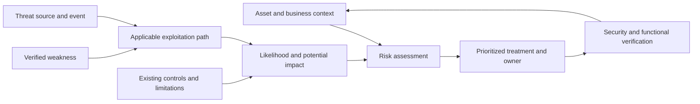

# Historical September 17 teaching notes — recovered October 22

This preserves the previously uncommitted September 17 analysis below. Its source-verification statements describe that earlier capture; external sources were not rechecked on October 22. The September 15 source is now present in remote history, and the [September 18 course-aligned route](../../study-plan/uuu-aligned-ceh-cehp-2026-09-18.md) supersedes the historical pacing and next-action instructions below. Use the current saved learner state before choosing another question.

The [existing lesson](lesson-01-weakness-to-harm.md) retains September 15 material. The [October 22 Planning closeout](../../../planning-everything-track/weeks/2026-W43/days/2026-10-22.md#ceh-source-reconciliation-2026-10-22) owns publication status and capacity. No new learner answer, study minutes or readiness result follows from this recovery.

---

# M05 — Vulnerability analysis: from weakness to verified improvement

## Source, ownership and learner state

Captured for the September 17, 2026 planning day. Jason supplied two complete Traditional Chinese teaching passages and requested full notes and connections. [Verbatim source](2026-09-17-teaching.source.md) preserves both passages, their examples, citations, corrections, unscored understanding check and the displayed `M05-A-Q1`. These English notes organize the supplied material; they are not learner answers.

- **Source preserved:** 38,571 UTF-8 bytes; SHA-256 `51830db88cf48eaffedf62fd5a36f49eb073d7292916536153af164f6408b3e4`. Only the enclosing triple quotation delimiters are excluded; whitespace inside them is preserved. The source has two independent numbered bibliographies; read each with its own passage, or use the explicit links below rather than merged Markdown reference resolution.
- **Custody boundary:** September 15 Planning records already referenced this note's path, but neither the note nor its older source was available in this checkout. This document uses that established canonical location with today's newly supplied material. The older source remains pending restoration; this is not a reconstruction or proof of September 15 learner activity.
- **Teaching evidence:** definitions, management workflow, scanner limitations, risk context, Equifax and WannaCry explanations are present in the supplied tutor text. Actual reading, comprehension and focus minutes are unreported.
- **Assessment:** `M05-A`, answered **0/10**, correct/answered undefined, no numeric percentage, no confidence response, no learner errors observed, no retests assigned. `M05-A-Q1` is displayed and unanswered. The earlier prose understanding check is also unanswered and unscored; it is not an additional scored item.
- **Next gate / Jason:** answer the existing Q1 with choice and low/medium/high confidence. Continue the same set; do not invent Q2–Q10 as already administered. [Assessment receipt](../../assessments/attempts/2026-09-17-m05-teaching.md).

FIRST PRINCIPLE: protect source fidelity, learner attention and truthful progress. CEH owns source, explanation and answers. [Planning W38](../../../planning-everything-track/weeks/2026-W38/weekly-plan.md) owns capacity and next action. This is offline exam learning: no scans, logins, exploitation, malware execution or target requests are authorized.

## 1. The decision M05 teaches

Ask three questions: where could a system fail securely, does the available evidence establish that weakness, and which confirmed issue deserves attention first? The [official curriculum](https://www.eccouncil.org/train-certify/certified-ethical-hacker-ceh/) includes classification, scoring, assessment and reporting. Module 05 is a course label; Domain 3 in the [exam blueprint](https://cert.eccouncil.org/wp-content/uploads/2024/04/CEH-Exam-Blueprint-v5.pdf) is an exam grouping. They are different classification systems.

The map connects evidence to a treatment decision. Risk is assessed before an incident; this is not a literal equation or a claim that every weakness is exploited.

## 2. Terms, distinctions and evidence

| Concept | Meaning in this lesson | Hypothetical university example | Evidence boundary |
| --- | --- | --- | --- |
| Asset | Something valuable to protect, including information, systems, accounts, reputation and continuity | Student grades and the ability to retrieve them | Identify owner, data, dependencies and business importance |
| Vulnerability | A security-relevant weakness in a system, procedure, control or implementation | Missing per-record authorization check | Can exist before any misuse; not every cosmetic bug is a security weakness |
| Threat source | Person, organization, accident or other origin capable of causing a harmful event | A student seeking another student's grades | Source is distinct from the event it may cause |
| Threat event | A potentially harmful circumstance or occurrence | Unauthorized disclosure of another student's grades | Can be malicious or accidental |
| Exploit | A method, input, sequence or program that takes advantage of a weakness | A method that uses the missing ownership check | Requires applicable conditions; existence of a method is not evidence of its use against this system |
| Impact | Harm to confidentiality, integrity, availability or organizational outcomes | Disclosure, altered grades or unavailable service | Describe specific consequences rather than assume all occur |
| Likelihood | How plausible the harmful scenario is under actual conditions | Who can access the system and what privileges are needed | Consider exposure, capability, applicable exploit and effective controls |
| Risk | Assessment combining likelihood and potential harm in context | Real student data versus an isolated synthetic test dataset | Neither a CVE identifier nor one universal score |
| Control | A measure that changes likelihood, impact or visibility | Authorization enforcement, restricted access and monitoring | A monitoring control does not itself repair missing authorization |

Definitions align with NIST's [vulnerability](https://csrc.nist.gov/glossary/term/vulnerability), [threat](https://csrc.nist.gov/glossary/term/threat), [threat source](https://csrc.nist.gov/glossary/term/threat_source) and [risk](https://csrc.nist.gov/glossary/term/risk) entries. [MITRE's exploit-development entry](https://attack.mitre.org/techniques/T1587/004/) supplies technical context, not a requirement to build an exploit.

Weaknesses may involve code, configuration, patch state, privileges, operational follow-through, human processes or physical access. A missing CVE does not exclude a weakness. An update being absent requires an applicability check; it does not prove that every unupdated program is vulnerable or compromised.

Authentication asks who the user is. Authorization asks whether that user may access this object or perform this action. The grade-system example illustrates missing authorization after login; the VPN example illustrates an authentication bypass. Preserve that distinction when connecting M05 to M06 and M14.

## 3. Risk context and treatment

The source's `Risk ≈ Likelihood × Impact` is a conceptual reminder, not a mandated arithmetic method. Its asset/weakness/threat/exploit/control addition-and-subtraction expression is also a mnemonic; those unlike quantities cannot simply be added or subtracted. Risk exists as a prospective assessment, not only after harm occurs.

Compare systems using exposure, actual data, owner, dependencies, reachable paths, exploitation evidence and control effectiveness. A test machine can be important if it contains production credentials or connects to production. An internet-facing service is not automatically a vulnerability; it is exposure that may affect likelihood.

The source contrasts a CVSS 9.8 issue on an offline disposable test host with the same issue on an exposed VPN, and a CVSS 6.5 issue exposing sensitive case records. Those numbers are hypothetical severity examples, not scores calculated here. [FIRST's CVSS v4.0 guide](https://www.first.org/cvss/v4.0/user-guide) distinguishes Base severity from organization-specific risk and also provides Threat and Environmental metrics. Record the version and metric groups; do not simplify this to “CVSS has no environmental features.” Detailed scoring is still a learning gap.

| Treatment | Intended change | Example / operational check |
| --- | --- | --- |
| Remediate | Correct the root weakness | Patch affected code or restore the missing authorization check; verify behavior |
| Mitigate | Reduce exposure or harm while an issue remains | Disable the affected feature, restrict access or segment systems; verify the path is actually constrained |
| Accept | Authorized, explicit retention of residual risk | Record rationale, approver, scope and review date |
| Transfer | Allocate some financial or contractual consequences | Document what is transferred and what technical/operational responsibility remains |
| Avoid | Remove the risk-producing activity | Retire the service or stop the feature with an agreed business alternative |

The supplied remediation/mitigation distinction is a useful teaching convention; operational vocabularies may use remediation more broadly. A control must fit the mechanism: MFA should not be assumed to stop a flaw that bypasses the authentication path itself. Monitoring improves detection; it cannot by itself establish that exploitation is prevented. These are analytical qualifications to the source's generic control list, not new findings about a real hospital.

## 4. Workflow with observable outputs

The two passages give nine-step and six-step versions of the same teaching workflow. They are compatible teaching groupings, not competing official checklists. [NIST SP 800-115](https://csrc.nist.gov/pubs/sp/800/115/final) supports planned testing, evidence analysis and mitigation development.

| Step | Question and expected output | Common failure |
| --- | --- | --- |
| 1. Scope and authorization | What assets, methods, time, service limits and escalation contacts are agreed? Produce explicit scope. | Treating a vague request as permission for all systems |
| 2. Asset inventory | Which domains, IPs, services, software, data, owners and dependencies exist? Identify production versus test. | Omitted assets or results assigned to the wrong host |
| 3. Discover findings | Collect inventory, vendor advisories, configuration, code-review and scanner evidence. Preserve observation and collection method. | Treating a banner match as final proof |
| 4. Validate applicability | Check exact package/build, enabled feature, patch/backport and check success. Separate confirmed, disproved and unresolved findings. | Confusing not checked with checked and absent |
| 5. Prioritize | Combine severity, exposure, exploitation evidence, asset impact, paths and controls. Record urgency and scheduling constraints separately. | Letting patch difficulty silently reduce estimated risk |
| 6. Choose treatment | Assign remediation, mitigation, acceptance, transfer or avoidance, with owner and review point. | “Accept” without an authorized decision |
| 7. Implement | Record what actually changed and on which assets. | A ticket or downloaded patch mistaken for installation |
| 8. Verify | Confirm the security condition improved and required service behavior still works. | Missing restart, partial fleet rollout or functional regression |
| 9. Report and repeat | Record asset, finding, evidence, impact, rationale, action, owner, target date, verification and residual risk. | Closing the work without technical evidence or revisiting changed conditions |

[NIST SP 800-40 Rev. 4](https://csrc.nist.gov/pubs/sp/800/40/r4/final) places verification within patch management. The grade-system acceptance example needs both authorized access still working and unauthorized cross-student access denied. Blocking everyone is not a complete functional repair.

## 5. Scanner reasoning

| Tool report | Actual condition | Interpretation |
| --- | --- | --- |
| Positive | Applicable weakness present | True positive |
| Positive | Claimed weakness absent | False positive |
| Negative | Applicable weakness present | False negative |
| Negative after a valid check | Claimed weakness absent | True negative for that check and conditions |
| No valid check / unreachable / authentication failure | Unknown | Incomplete coverage; not a clean result |

Preserve tool configuration, reachability, privileges and coverage with every conclusion. A firewall that blocks an exploitation route may reduce exposure while the vulnerable code remains; that alone does not make a scanner's existence finding false. An affected feature being absent or a vendor fix being installed is a different applicability question.

[Red Hat's backporting explanation](https://access.redhat.com/security/updates/backporting) confirms that security fixes can be incorporated without adopting a newer upstream version. Version-only tools can consequently overreport. Verify the installed vendor package and advisory rather than infer vulnerability from the upstream version string alone.

Public PoC availability establishes a potential capability. Evidence such as suspicious logins, processes, altered files or unusual transfers may justify investigation, but each signal still requires context before claiming a compromise or data theft. This is the bridge from M05 to M06/M07 evidence interpretation.

## 6. Incident comparisons and source verification

Sources below were checked during this capture. Public references verify subject matter; they cannot verify Jason's understanding or participation.

### Equifax, 2017

The [FTC complaint dated July 22, 2019](https://www.ftc.gov/system/files/documents/cases/172_3203_equifax_complaint_7-22-19.pdf), paragraphs 15–17, alleges that a March 2017 internal notice required patching within 48 hours, the responsible ACIS employee did not receive that notice, and the automated scan was configured inadequately to find all affected assets. The ACIS portal remained unpatched. Attribute these details to the complaint; do not turn allegations into an independent court finding.

The [FTC settlement announcement](https://www.ftc.gov/news-events/news/press-releases/2019/07/equifax-pay-575-million-part-settlement-ftc-cfpb-states-related-2017-data-breach) describes approximately 147 million affected people and alleges failures involving segmentation, plaintext administrative credentials and detection. The supplied source links Apache Struts CVE-2017-5638 to the entry point. The teaching inference is that inventory, responsibility, coverage and verification must work together; purchasing a scanner alone does not establish that process.

### WannaCry and England's NHS, 2017

[Microsoft's May 12, 2017 analysis](https://www.microsoft.com/en-us/security/blog/2017/05/12/wannacrypt-ransomware-worm-targets-out-of-date-systems/) connects WannaCrypt/WannaCry propagation to SMB weaknesses addressed by the March 14 MS17-010 update. Distinguish vulnerable software, the exploit capability and the malware that uses it.

The [NAO investigation published October 27, 2017](https://www.nao.org.uk/reports/investigation-wannacry-cyber-attack-and-the-nhs/) reports that NHS England identified 6,912 cancelled appointments and estimated more than 19,000 in total. The larger number is an estimate. NAO also records NHS Digital's belief that no patient data were compromised or stolen; this is attributed evidence, not universal proof that theft was impossible. Availability harm does not automatically establish confidentiality loss. NAO describes the missing formal mechanism to confirm local compliance before the incident.

| Case | Process lesson | Connection |
| --- | --- | --- |
| Equifax | Reach the responsible owner, inventory affected assets and validate scanner coverage | M05 findings and patch verification; M06 access paths |
| WannaCry/NHS | Verify installation and operational readiness after an update is available | M05 patch process; M07 malware behavior; M08 network propagation context |
| Hypothetical grade system | Distinguish authentication from object authorization and test normal function after repair | M14 application access control |
| Hypothetical hospital VPN | Separate weakness, attacker, exploit, potential impact and effective controls | M06 access; M07 detection and containment |

## 7. Corrections retained beside the source

- The first passage sometimes uses threat broadly for an attacker; the second clarifies **threat source** versus **threat event**. Q1 explicitly declares its broad usage. This is tutor wording clarification, not a learner mistake.
- The first passage's threat citation points to the CSRC homepage; use the precise threat and threat-source entries linked above for interpretation. The original URL remains untouched in the raw source.
- The second passage refines CVSS wording to distinguish Base from Threat/Environmental metrics. Preserve this refinement when teaching scoring.
- Equifax facts are attributed to the FTC complaint/announcement. NHS cancellation counts retain estimate versus identified distinctions; no unsupported patient-data theft claim is added.
- A failed or omitted scan belongs to unknown coverage; effective mitigation and false-positive classification remain distinct.
- Source wording `0/0` denotes no answered questions, not a zero-percent result. The clearer ledger is answered `0/10`, score/percentage blank, no confidence or retest result.

## 8. Coverage and next learning

| Area | Supplied material | Remaining evidence / teaching |
| --- | --- | --- |
| Definitions and mechanism | Detailed explanations and hypothetical examples | Q1 choice/confidence and later transfer |
| Management lifecycle | Two compatible workflow summaries | Learner prioritization and verification reasoning |
| Scanner uncertainty | False results, backports and incomplete checks | Learner classification using evidence |
| Scoring and databases | CVE mentioned; CVSS context clarified | Identifier/database distinctions, scoring version/metrics and practice |
| Assessment types/tools | General discovery and analysis overview | Assessment-type distinctions, tool selection and report interpretation |
| Reporting and treatment | Owner, action, verification and residual-risk fields | Learner explanation of treatment and closure evidence |

**M05 is in progress; M06–M08 completion is not established by this capture.** Resume `M05-A-Q1`, then administer remaining original items one at a time. Collect choice plus confidence, explain feedback, and give at least three varied checks after each wrong answer. A wrong retest receives the same correction rule. Keep original and retest scores separate; do not create retests before an error exists. The local 8/10 study criterion is separate from complete coverage and official readiness.

For M05–M07 catch-up, Jason has removed the 25-minute session restriction. Use an agreed endpoint or no fixed endpoint, breaks and actual responses. The earlier 240-minute weekly allocation is a planning baseline; no new numerical weekly budget or measured minutes were supplied. Reconcile effort and tradeoffs before adding commitments, preserving fixed duties and recovery. M08 and W37 gaps remain visible in the weekly plan; no historic lab acceptance task is reactivated.

## Connection map

- [Active exam-only plan](../../study-plan/ceh-exam-only-2026-09-11.md): continuation, M05–M08 weekly scope and pacing update.
- [Official scope map](../../curriculum/official-scope-map.md): M01 authorization, M02 inventory, M03/M04 discovery and enumeration, M05 validation, M06 exploitation, M07 malware, M08 traffic, M14 authorization; CEHP reuse remains future scope.
- [Readiness dashboard](../../assessment-governance/readiness_dashboard.md) and [attempt receipt](../../assessments/attempts/2026-09-17-m05-teaching.md): evidence and scoring boundaries.
- [W38 historical research brief](../../research-briefs/2026-W38.md): related WannaCry sources; the current capture does not activate its incident project or claim a learner live research cycle.
- [Planning locator](../../../planning-everything-track/data/projects/2026-07-ceh-cehp-certification-training.md), [September 17](../../../planning-everything-track/weeks/2026-W38/days/2026-09-17.md) and [W38](../../../planning-everything-track/weeks/2026-W38/weekly-plan.md): next action and capacity, without duplicating the source.

Jason owns the next answer and actual time report. The tutor owns further teaching, scoring and source clarification. Older source restoration remains a custody task, separate from exam learning.
