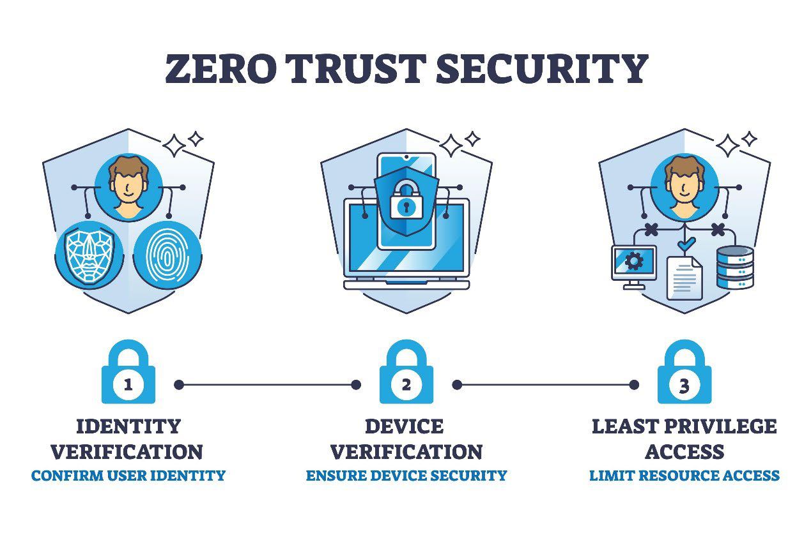

# CEH v13 (312-50v13) — Practice Questions

- **Source:** `ceh13-03.pdf`
- **PDF pages:** 32
- **Question entries present:** 125
- **Transcription:** Original English text and option order retained. Font ligatures normalized. Reflowed PDF line breaks for Markdown readability.

> Note: This PDF has no separate printed answer table. The correct-answer options are indicated by bold font in the source; the bold markings are retained below, with a derived summary table at the end.

## Questions

## Question 1
<!-- Source PDF: p. 1 -->

**A security researcher is analyzing a target organization’s publicly accessible cloud infrastructure. While reviewing the website’s HTML source code, the researcher discovers direct references to files hosted on Amazon S3. What is the most effective way to identify additional publicly accessible bucket URLs used by the target?**

- (A) Exploit XSS to force the page to reveal the S3 links.
- **(B) Use Google advanced search operators to enumerate S3 bucket URLs.**
- (C) Perform packet sniffing to intercept internal S3 bucket names.
- (D) Use SQL injection to extract internal file paths from the database.

## Question 2
<!-- Source PDF: p. 1 -->

**A penetration tester discovers that a web application is using outdated SSL/TLS protocols (TLS 1.0) to secure communication. What is the most effective way to exploit this vulnerability?**

- (A) Conduct a Cross-Site Scripting (XSS) attack on the application.
- (B) Perform a brute-force attack on the SSL/TLS handshake.
- (C) Execute a SQL injection attack on the application’s backend.
- **(D) Use a man-in-the-middle (MitM) attack to intercept and decrypt traffic.**

## Question 3
<!-- Source PDF: pp. 1–2 -->

**During routine network monitoring, the blue team notices several LLMNR and NBT-NS broadcasts originating from a workstation attempting to resolve an internal hostname. They also observe suspicious responses claiming to be the requested host. What type of password-cracking setup is likely being staged?**

- (A) Use GPU resources to guess passphrases quickly.
- (B) Decrypt login tokens from wireless networks.
- (C) Match captured credentials with rainbow tables.
- **(D) Exploit name resolution to capture password hashes.**

## Question 4
<!-- Source PDF: p. 2 -->

**During a red team simulation, an attacker attempts to deliver a payload to a web server. The approach involves crafting packets with intentionally malformed checksums so that the packets are accepted by the IDS but discarded by the destination system. This is which evasion technique?**

- (A) Polymorphic shellcode
- **(B) Insertion attack**
- (C) Session splicing
- (D) Fragmentation attack

## Question 5
<!-- Source PDF: p. 2 -->

**A penetration tester visits https://www.targetcorp.com/robots.txt and finds Disallow entries referencing /admin-panel/ and /backup/. Directly visiting these paths allows access to sensitive files. Which stage is this?**

- (A) Executing CSRF attacks.
- **(B) Gathering information through exposed indexing instructions.**
- (C) Leveraging directory traversal flaws.
- (D) Injecting malicious SQL queries.

## Question 6
<!-- Source PDF: p. 2 -->

**An Android application stores sensitive user data but does not use proper encryption for data at rest. What is the most effective exploit?**

- **(A) Access the local storage to retrieve data directly from the device.**
- (B) Perform a brute-force attack on credentials.
- (C) Use SQL injection on the backend.
- (D) Execute XSS to steal cookies.

## Question 7
<!-- Source PDF: pp. 2–3 -->

**To hijack a legitimate user's session in a web app using HTTPS and MFA without triggering alerts, which advanced technique should be used?**

- (A) Man-in-the-middle attack via network device.
- (B) Session token replay.
- **(C) Exploit a browser zero-day vulnerability to inject scripts.**
- (D) Perform a CSRF attack.

## Question 8
<!-- Source PDF: p. 3 -->

**An attacker places a malicious VM on the same physical server as a target VM in a cloud environment and extracts keys using CPU timing analysis. What is this?**

- **(A) Side-channel attack**
- (B) Metadata spoofing
- (C) Cloud cryptojacking
- (D) Cache poisoned denial of service (CPDoS)

## Question 9
<!-- Source PDF: p. 3 -->

**To enumerate all running processes on a Linux host via SNMPv2 (community "public"), which Nmap command is most effective?**

- (A) nmap -sU -p 161 --script snmp-sysdescr
- (B) nmap -sU -p 161 --script snmp-interfaces
- (C) nmap -sU -p 161 --script snmp-win32-services
- **(D) nmap -sU -p 161 --script snmp-processes**

## Question 10
<!-- Source PDF: p. 3 -->

**A mobile app session tokens are not invalidated upon logout. What is the most effective exploit?**

- **(A) Perform a replay attack by using the same token after logout.**
- (B) Brute-force session tokens.
- (C) SQL injection for tokens.
- (D) CSRF attack.

## Question 11
<!-- Source PDF: pp. 3–4 -->

**Which technique evades an IDS/Firewall that blocks non-standard ports?**

- **(A) Use a low-and-slow scan.**
- (B) Conduct a full TCP Connect scan.
- (C) Perform a SYN flood.
- (D) Execute a TCP ACK scan to map rules.

## Question 12
<!-- Source PDF: p. 4 -->

**An Industrial Control System (ICS) uses weak default passwords. What is the most effective exploit?**

- **(A) Gain unauthorized access to the ICS and control operations.**
- (B) Brute-force default passwords.
- (C) Conduct a DoS attack.
- (D) Execute a CSRF attack.

## Question 13
<!-- Source PDF: p. 4 -->

**What is the most appropriate approach to test for SQL injection in a login form?**

- **(A) Enter ' OR '1'='1 in the username/password fields.**
- (B) Brute-force the login page.
- (C) Perform a directory traversal attack.
- (D) Inject JavaScript for XSS testing.

## Question 14
<!-- Source PDF: p. 4 -->

**To obtain network credentials without raising suspicion from HR, which social engineering technique is most effective?**

- (A) Fake social media profiles.
- **(B) Create a convincing fake onboarding portal.**
- (C) Pose as a new employee for password reset.
- (D) Phishing email with a fake HR policy.

## Question 15
<!-- Source PDF: p. 4 -->

**Which protocol uses the "Three-way Handshake" (SYN, SYN-ACK, ACK) which can be exploited for a SYN stealth scan?**

- (A) UDP
- **(B) TCP**
- (C) ICMP
- (D) IGMP

## Question 16
<!-- Source PDF: p. 5 -->

**A hacker uses intitle:index of "config" in Google. This is an example of what?**

- (A) Social Engineering
- **(B) Google Hacking (Dorking)**
- (C) Banner Grabbing
- (D) Vulnerability Scanning

## Question 17
<!-- Source PDF: p. 5 -->

**Which Nmap flag is used to perform an OS fingerprinting scan?**

- (A) -sV
- (B) -sS
- **(C) -O**
- (D) -p

## Question 18
<!-- Source PDF: p. 5 -->

**What is the main difference between a Black Box and a White Box penetration test?**

- (A) Black Box has full knowledge; White Box has none.
- **(B) White Box has full knowledge; Black Box has none.**
- (C) Both have partial knowledge.
- (D) Black Box is done by internal employees.

## Question 19
<!-- Source PDF: p. 5 -->

**Which tool is most commonly used for intercepting and modifying web traffic (Proxy)?**

- (A) Wireshark
- **(B) Burp Suite**
- (C) Nmap
- (D) Metasploit

## Question 20
<!-- Source PDF: pp. 5–6 -->

**In the context of IoT security, what does "Shodan" primarily help a researcher find?**

- (A) WiFi passwords
- **(B) Publicly accessible internet-connected devices**
- (C) Malware source code
- (D) Personal emails

## Question 21
<!-- Source PDF: p. 6 -->

**A network administrator is configuring a firewall to block all traffic except for web browsing. Which ports should be left open to allow both standard and encrypted web traffic?**

- (A) 21 and 22
- (B) 25 and 110
- **(C) 80 and 443**
- (D) 53 and 67

## Question 22
<!-- Source PDF: p. 6 -->

**A penetration tester is using a tool that sends a series of TCP packets with different flags (FIN, URG, PSH) to a target to determine the operating system based on how it responds. What is this technique called?**

- (A) Passive Fingerprinting
- **(B) Active OS Fingerprinting**
- (C) Banner Grabbing
- (D) Port Scanning

## Question 23
<!-- Source PDF: p. 6 -->

**Which of the following Nmap scans is considered the most "stealthy" because it does not complete the full TCP connection and is less likely to be logged by basic application-level logs?**

- (A) TCP Connect Scan (-sT)
- **(B) Stealth SYN Scan (-sS)**
- (C) UDP Scan (-sU)
- (D) IDLE Scan (-sI)

## Question 24
<!-- Source PDF: pp. 6–7 -->

**During a vulnerability assessment, a security professional identifies a flaw that allows an attacker to redirect users to a malicious website by exploiting the trust of a legitimate site. Which type of attack is this?**

- (A) SQL Injection
- (B) Buffer Overflow
- **(C) Cross-Site Scripting (XSS)**
- (D) Privilege Escalation

## Question 25
<!-- Source PDF: p. 7 -->

**What is the primary purpose of a "Vulnerability Management Life Cycle"?**

- (A) To buy the most expensive security software.
- **(B) To continuously identify, prioritize, and remediate security weaknesses.**
- (C) To arrest hackers after an attack.
- (D) To encrypt all internal emails.

## Question 26
<!-- Source PDF: p. 7 -->

**Which of the following tools is a command-line network analyzer that allows a user to display TCP/IP and other packets being transmitted or received over a network?**

- (A) Nmap
- (B) Metasploit
- **(C) Tcpdump**
- (D) Nessus

## Question 27
<!-- Source PDF: p. 7 -->

**An attacker is trying to identify the version of a web server by analyzing the header information returned in an HTTP response. This is an example of:**

- (A) Footprinting
- **(B) Banner Grabbing**
- (C) Enumeration
- (D) Social Engineering

## Question 28
<!-- Source PDF: p. 8 -->

**In a "Ping Sweep," which protocol is primarily used to determine if multiple hosts on a network are alive?**

- (A) TCP
- (B) UDP
- **(C) ICMP**
- (D) SNMP

## Question 29
<!-- Source PDF: p. 8 -->

**Which of the following is a common framework used to rate the severity of software vulnerabilities on a scale of 0 to 10?**

- (A) OWASP
- (B) NIST
- **(C) CVSS (Common Vulnerability Scoring System)**
- (D) GDPR

## Question 30
<!-- Source PDF: p. 8 -->

**A penetration tester finds a server that responds to an "Inverse Mapping" scan. What can the tester conclude from this?**

- (A) The target is a Windows machine.
- **(B) There is likely a firewall or packet filter that identifies which ports are open/closed.**
- (C) The server is vulnerable to SQL injection.
- (D) The server is offline.

## Question 31
<!-- Source PDF: pp. 8–9 -->

**Which of the following Nmap commands performs a "Half-Open" scan that does not complete the TCP three-way handshake?**

- (A) nmap -sT
- **(B) nmap -sS**
- (C) nmap -sU
- (D) nmap -sA

## Question 32
<!-- Source PDF: p. 9 -->

**An attacker sends a TCP packet with the FIN, PSH, and URG flags set to a target port. If the port is closed, the target sends an RST. If the port is open, it ignores the packet. What type of scan is this?**

- (A) Null Scan
- **(B) Xmas Scan**
- (C) Stealth Scan
- (D) IDLE Scan

## Question 33
<!-- Source PDF: p. 9 -->

**During the enumeration phase, you find that port 445 is open. Which protocol is likely running and could be used to enumerate user accounts?**

- (A) HTTP
- (B) SMTP
- **(C) SMB**
- (D) DNS

## Question 34
<!-- Source PDF: p. 9 -->

**What is the default community string for SNMPv1 and SNMPv2 that often allows read-only access to network device information?**

- **(A) public**
- (B) private
- (C) admin
- (D) secret

## Question 35
<!-- Source PDF: pp. 9–10 -->

**A penetration tester uses the command fping -a -g 192.168.1.0/24. What is the primary goal of this command?**

- (A) To find open ports on a single host.
- **(B) To identify active (alive) hosts within a subnet.**
- (C) To perform a banner grabbing attack.
- (D) To capture packets on the local network.

## Question 36
<!-- Source PDF: p. 10 -->

**Which tool is specialized in extracting metadata from public documents (PDF, DOCX) found on a target's website to identify usernames and software versions?**

- (A) Maltego
- (B) Recon-ng
- **(C) FOCA**
- (D) Wireshark

## Question 37
<!-- Source PDF: p. 10 -->

**In a "Side-Channel Attack" on a cloud provider, what is the attacker primarily trying to exploit?**

- (A) A flaw in the web application's code.
- **(B) Physical information leaked by the hardware (e.g., power consumption, timing).**
- (C) The lack of a firewall on the virtual machine.
- (D) Weak passwords used by the cloud administrator.

## Question 38
<!-- Source PDF: p. 10 -->

**Which type of password attack involves trying every possible combination of characters until the correct one is found?**

- (A) Dictionary Attack
- **(B) Brute-Force Attack**
- (C) Hybrid Attack
- (D) Rainbow Table Attack

## Question 39
<!-- Source PDF: pp. 10–11 -->

**You have captured a password hash. Instead of cracking it, you use the hash itself to authenticate to a remote service. What is this technique called?**

- (A) Salting
- **(B) Pass-the-Hash (PtH)**
- (C) Birthday Attack
- (D) Precomputed Hash Attack

## Question 40
<!-- Source PDF: p. 11 -->

**What is the primary purpose of a "Honeypot" in a network?**

- (A) To encrypt all outgoing traffic.
- **(B) To distract and monitor attackers by providing a decoy system.**
- (C) To act as a high-speed backup server.
- (D) To block all incoming SQL injection attempts.

## Question 41
<!-- Source PDF: p. 11 -->

**Which of the following is a vulnerability scanner that provides comprehensive reports on missing patches and misconfigurations?**

- (A) Nmap
- (B) Metasploit
- **(C) Nessus**
- (D) Netcat

## Question 42
<!-- Source PDF: p. 11 -->

**Which DNS record type should a penetration tester look for to identify the mail servers of an organization?**

- (A) A record
- (B) PTR record
- **(C) MX record**
- (D) CNAME record

## Question 43
<!-- Source PDF: p. 11 -->

**A hacker uses a tool to impersonate a legitimate Wireless Access Point, tricking users into connecting to it. What is this attack called?**

- (A) Bluejacking
- **(B) Evil Twin**
- (C) Wardriving
- (D) MAC Spoofing

## Question 44
<!-- Source PDF: p. 12 -->

**Which tool is used to perform man-in-the-middle attacks, DNS spoofing, and credential sniffing on a local network?**

- (A) John the Ripper
- **(B) Ettercap**
- (C) Nikto
- (D) Snort

## Question 45
<!-- Source PDF: p. 12 -->

**What does the "D" in D.O.S. stand for?**

- (A) Distributed
- (B) Database
- **(C) Denial**
- (D) Detection

## Question 46
<!-- Source PDF: p. 12 -->

**Which attack targets the "human element" of security through manipulation and deceit?**

- (A) Buffer Overflow
- (B) SQL Injection
- **(C) Social Engineering**
- (D) Rootkit Installation

## Question 47
<!-- Source PDF: p. 12 -->

**A tester finds a vulnerability where an application stores sensitive data in the URL (e.g., ?session_id=123). This is an example of:**

- (A) Improper Error Handling
- **(B) Sensitive Data Exposure**
- (C) Insecure Deserialization
- (D) Command Injection

## Question 48
<!-- Source PDF: pp. 12–13 -->

**Which Nmap script category is used to discover vulnerabilities on a target system?**

- (A) discovery
- (B) intrusive
- **(C) vuln**
- (D) safe

## Question 49
<!-- Source PDF: p. 13 -->

**What is the purpose of "Salting" a password before hashing it?**

- (A) To make the hashing process faster.
- **(B) To prevent the use of precomputed Rainbow Tables.**
- (C) To encrypt the password so it can be decrypted later.
- (D) To limit the length of the password.

## Question 50
<!-- Source PDF: p. 13 -->

**Which type of malware records every stroke made on a keyboard?**

- (A) Ransomware
- **(B) Keylogger**
- (C) Trojan
- (D) Worm

## Question 51
<!-- Source PDF: p. 13 -->

**In the "Cyber Kill Chain" model, which phase comes immediately after Reconnaissance?**

- (A) Delivery
- **(B) Weaponization**
- (C) Exploitation
- (D) Installation

## Question 52
<!-- Source PDF: pp. 13–14 -->

**Which command is used on a Windows system to view the local routing table?**

- (A) ipconfig /all
- (B) tracert
- **(C) route print**
- (D) netstat -an

## Question 53
<!-- Source PDF: p. 14 -->

**An attacker uses a fraudulent email that appears to be from a high-ranking executive to target a specific employee. This is known as:**

- (A) Phishing
- **(B) Spear Phishing**
- (C) Vishing
- (D) Smishing

## Question 54
<!-- Source PDF: p. 14 -->

**Which protocol operates on Port 22?**

- (A) Telnet
- **(B) SSH**
- (C) FTP
- (D) RDP

## Question 55
<!-- Source PDF: p. 14 -->

**What is the main goal of "Footprinting"?**

- (A) To gain administrative access.
- (B) To crash the target server.
- **(C) To collect as much information as possible about a target network.**
- (D) To delete log files.

## Question 56
<!-- Source PDF: p. 14 -->

**Which of the following is an example of an "Asymmetric" encryption algorithm?**

- (A) AES
- (B) DES
- **(C) RSA**
- (D) Blowfish

## Question 57
<!-- Source PDF: pp. 14–15 -->

**What is a "Rootkit" primarily used for?**

- (A) To spread viruses to other computers.
- (B) To crack passwords using a GPU.
- **(C) To maintain hidden access to a system at the OS level.**
- (D) To perform a DDoS attack.

## Question 58
<!-- Source PDF: p. 15 -->

**Which HTTP method is typically used to upload a file to a web server?**

- (A) GET
- (B) POST
- **(C) PUT**
- (D) DELETE

## Question 59
<!-- Source PDF: p. 15 -->

**A penetration tester discovers a "Cross-Site Scripting (XSS)" vulnerability. What is the primary risk?**

- (A) Deleting the server's database.
- **(B) Executing malicious scripts in the victim's browser.**
- (C) Gaining root access to the web server.
- (D) Cracking the server's SSH password.

## Question 60
<!-- Source PDF: p. 15 -->

**Which tool can be used to scan for open wireless networks while driving?**

- (A) Aircrack-ng
- **(B) NetStumbler**
- (C) Wireshark
- (D) Hashcat

## Question 61
<!-- Source PDF: pp. 15–16 -->

**A hacker exploits a vulnerability in the WPA2 protocol that allows them to decrypt traffic without knowing the password by manipulating the 4-way handshake. What is this attack called?**

- (A) Blueborne
- **(B) KRACK (Key Reinstallation Attack)**
- (C) ChopChop Attack
- (D) Fragmentation Attack

## Question 62
<!-- Source PDF: p. 16 -->

**In Burp Suite, which tab is used to automatically scan a web application for vulnerabilities like SQL injection or XSS?**

- (A) Repeater
- (B) Intruder
- **(C) Dashboard / Scanner**
- (D) Sequencer

## Question 63
<!-- Source PDF: p. 16 -->

**Which type of SQL injection does not return any data directly to the attacker but instead relies on the database's response to TRUE/FALSE questions?**

- (A) In-band SQLi
- **(B) Blind SQLi**
- (C) Union-based SQLi
- (D) Error-based SQLi

## Question 64
<!-- Source PDF: p. 16 -->

**What occurs when a program writes more data to a memory buffer than it can hold, potentially allowing an attacker to execute arbitrary code?**

- (A) Race Condition
- **(B) Buffer Overflow**
- (C) Integer Underflow
- (D) Memory Leak

## Question 65
<!-- Source PDF: pp. 16–17 -->

**What is the practice of hiding a secret message or file within another non-secret file (like an image or audio file)?**

- (A) Cryptography
- **(B) Steganography**
- (C) Obfuscation
- (D) Encapsulation

## Question 66
<!-- Source PDF: p. 17 -->

**In the Cloud Shared Responsibility Model, who is responsible for the physical security of the data center in a SaaS (Software as a Service) environment?**

- **(A) The Cloud Service Provider (CSP)**
- (B) The Customer
- (C) Both the CSP and the Customer
- (D) The Internet Service Provider (ISP)

## Question 67
<!-- Source PDF: p. 17 -->

**Which lightweight messaging protocol is commonly used in IoT (Internet of Things) devices for communication?**

- (A) HTTP
- **(B) MQTT**
- (C) SSH
- (D) FTP

## Question 68
<!-- Source PDF: p. 17 -->

**An attacker provides specifically crafted input to a Machine Learning model to cause it to make a wrong classification. This is known as:**

- (A) Model Inversion
- (B) Data Poisoning
- **(C) Adversarial Attack**
- (D) Model Stealing

## Question 69
<!-- Source PDF: pp. 17–18 -->

**Which technology allows multiple isolated user-space instances to run on a single host, often managed by tools like Docker or Kubernetes?**

- (A) Virtual Machines
- **(B) Containers**
- (C) Bare Metal
- (D) Serverless

## Question 70
<!-- Source PDF: p. 18 -->

**Which type of malware encrypts a user's files and demands payment in cryptocurrency to provide the decryption key?**

- (A) Spyware
- (B) Adware
- **(C) Ransomware**
- (D) Rootkit

## Question 71
<!-- Source PDF: p. 18 -->

**What does a "Digital Signature" provide in terms of security?**

- (A) Confidentiality and Availability
- **(B) Integrity, Non-repudiation, and Authentication**
- (C) Encryption and Privacy
- (D) Speed and Efficiency

## Question 72
<!-- Source PDF: p. 18 -->

**What is the primary difference between an IDS (Intrusion Detection System) and an IPS (Intrusion Prevention System)?**

- (A) IDS is hardware; IPS is software.
- (B) IDS monitors traffic; IPS encrypts traffic.
- **(C) IDS alerts on threats; IPS actively blocks threats.**
- (D) There is no difference.

## Question 73
<!-- Source PDF: p. 18 -->

**A firewall that keeps track of the state of active connections and makes decisions based on the context of the traffic is called:**

- (A) Packet Filter
- **(B) Stateful Inspection Firewall**
- (C) Circuit-Level Gateway
- (D) Proxy Firewall

## Question 74
<!-- Source PDF: pp. 18–19 -->

**Which of the following is a "one-way" function used to ensure data integrity?**

- (A) Symmetric Encryption
- (B) Asymmetric Encryption
- **(C) Hashing**
- (D) Encoding

## Question 75
<!-- Source PDF: p. 19 -->

**Which organization maintains the "Top 10" list of the most critical web application security risks?**

- (A) SANS Institute
- **(B) OWASP**
- (C) NIST
- (D) IEEE

## Question 76
<!-- Source PDF: p. 19 -->

**In the Metasploit Framework, which module is used to deliver a specific piece of code to a target system to gain access?**

- (A) Auxiliary
- **(B) Exploit**
- (C) Post
- (D) NOP

## Question 77
<!-- Source PDF: p. 19 -->

**You are using Wireshark to analyze traffic. Which filter would you use to see only traffic destined for or coming from IP address 10.0.0.5?**

- (A) tcp.port == 80
- **(B) ip.addr == 10.0.0.5**
- (C) http.request
- (D) eth.src == 00:11:22

## Question 78
<!-- Source PDF: pp. 19–20 -->

**An attacker sends spoofed ARP messages onto a local area network to link their MAC address with the IP address of a legitimate server. This is called:**

- (A) DNS Poisoning
- **(B) ARP Poisoning (Spoofing)**
- (C) DHCP Starvation
- (D) ICMP Redirect

## Question 79
<!-- Source PDF: p. 20 -->

**What is the primary purpose of DNSSEC?**

- (A) To encrypt DNS queries for privacy.
- (B) To make DNS resolution faster.
- **(C) To provide authentication and integrity to DNS data.**
- (D) To block malicious websites automatically.

## Question 80
<!-- Source PDF: p. 20 -->

**Which of the following is an example of "Something you are" in Multi-factor Authentication (MFA)?**

- (A) Password
- (B) Hardware Token
- **(C) Fingerprint**
- (D) SMS Code

## Question 81
<!-- Source PDF: p. 20 -->

**An attacker uses a specialized tool to steal data (contacts, photos) from a victim's phone via an open Bluetooth connection. This is called:**

- (A) Bluejacking
- **(B) Bluesnarfing**
- (C) Blueprinting
- (D) Blueborne

## Question 82
<!-- Source PDF: pp. 20–21 -->

**What is the main function of an MDM (Mobile Device Management) solution?**

- (A) To increase the battery life of mobile devices.
- **(B) To enforce security policies and remotely wipe corporate mobile devices.**
- (C) To provide free WiFi to employees.
- (D) To track the physical location of all employees 24/7.

## Question 83
<!-- Source PDF: p. 21 -->

**Which API architectural style uses standard HTTP methods (GET, POST, PUT, DELETE) and is often exploited through improper authorization?**

- (A) SOAP
- **(B) REST**
- (C) GraphQL
- (D) XML-RPC

## Question 84
<!-- Source PDF: p. 21 -->

**In which attack does a victim's browser perform an unwanted action on a different website where the victim is currently authenticated?**

- (A) XSS
- **(B) CSRF (Cross-Site Request Forgery)**
- (C) Clickjacking
- (D) SQL Injection

## Question 85
<!-- Source PDF: p. 21 -->

**A tester changes a URL from example.com/view?id=101 to example.com/view?id=102 and is able to see another user's private data. This is an example of:**

- (A) Broken Authentication
- **(B) IDOR (Insecure Direct Object Reference)**
- (C) Security Misconfiguration
- (D) Cross-Site Scripting

## Question 86
<!-- Source PDF: pp. 21–22 -->

**In a Security Operations Center (SOC), which role is typically responsible for the initial monitoring and triaging of security alerts?**

- **(A) Tier 1 Analyst**
- (B) Tier 3 Analyst (Threat Hunter)
- (C) SOC Manager
- (D) Incident Response Commander

## Question 87
<!-- Source PDF: p. 22 -->

**What is the first phase of the Incident Response process?**

- (A) Containment
- (B) Eradication
- **(C) Preparation**
- (D) Recovery

## Question 88
<!-- Source PDF: p. 22 -->

**Which document outlines how a business will continue to operate during and after a significant disaster?**

- (A) SLA
- (B) NDA
- **(C) BCP (Business Continuity Plan)**
- (D) AUP

## Question 89
<!-- Source PDF: p. 22 -->

**In Linux, what does the command chmod 777 file.txt do?**

- (A) Deletes the file.
- (B) Makes the file read-only.
- **(C) Grants full read, write, and execute permissions to everyone.**
- (D) Changes the owner of the file to "777".

## Question 90
<!-- Source PDF: p. 22 -->

**Which Windows Registry hive contains configuration information for the currently logged-in user?**

- (A) HKEY_LOCAL_MACHINE (HKLM)
- **(B) HKEY_CURRENT_USER (HKCU)**
- (C) HKEY_CLASSES_ROOT (HKCR)
- (D) HKEY_USERS (HKU)

## Question 91
<!-- Source PDF: p. 23 -->

**After gaining access to a system with a low-privilege account, an attacker exploits a kernel vulnerability to gain administrative rights. What is this process called?**

- (A) Horizontal Privilege Escalation
- **(B) Vertical Privilege Escalation**
- (C) Lateral Movement
- (D) Maintaining Persistence

## Question 92
<!-- Source PDF: p. 23 -->

**To hide their activities on a Windows system, an attacker clears the Security, System, and Application logs. Which tool is commonly used for this?**

- (A) ipconfig /flushdns
- (B) taskkill
- **(C) wevtutil or Event Viewer**
- (D) netsh

## Question 93
<!-- Source PDF: p. 23 -->

**In malware analysis, what is the term for running a suspicious file in a controlled, isolated environment to observe its behavior?**

- (A) Static Analysis
- **(B) Dynamic Analysis (Sandboxing)**
- (C) Reverse Engineering
- (D) Code Auditing

## Question 94
<!-- Source PDF: pp. 23–24 -->

**Which type of Trojan allows an attacker to gain complete remote control over a victim's machine, often including webcam access and file manipulation?**

- (A) Ransomware
- **(B) RAT (Remote Access Trojan)**
- (C) Rootkit
- (D) Botnet

## Question 95
<!-- Source PDF: p. 24 -->

**An attacker uses "Session Splicing" to bypass an IDS. How does this technique work?**

- (A) It encrypts the entire payload.
- **(B) It splits the attack payload into multiple small packets to avoid signature matching.**
- (C) It uses a proxy to hide the attacker's IP.
- (D) It floods the IDS with fake alerts.

## Question 96
<!-- Source PDF: p. 24 -->

**To evade a firewall, an attacker wraps a non-permitted protocol (like SSH) inside a permitted protocol (like HTTPS). This is called:**

- (A) Port Scanning
- **(B) Tunneling**
- (C) IP Spoofing
- (D) Banner Grabbing

## Question 97
<!-- Source PDF: p. 24 -->

**What is the most effective way to prevent SQL injection in a modern web application?**

- (A) Using a complex firewall.
- (B) Limiting the length of input fields.
- **(C) Using Prepared Statements (Parameterized Queries).**
- (D) Running the database as root.

## Question 98
<!-- Source PDF: pp. 24–25 -->

**In a cloud environment, which service model provides the highest level of control to the customer, including managing the OS and middleware?**

- **(A) IaaS (Infrastructure as a Service)**
- (B) PaaS (Platform as a Service)
- (C) SaaS (Software as a Service)
- (D) SECaaS (Security as a Service)

## Question 99
<!-- Source PDF: p. 25 -->

**An attacker targets the PLC (Programmable Logic Controller) of a water treatment plant. This is an attack on which type of system?**

- (A) Cloud Computing
- (B) IoT
- **(C) OT / ICS (Operational Technology / Industrial Control Systems)**
- (D) Mobile Platforms

## Question 100
<!-- Source PDF: p. 25 -->

**Which of the following is an example of a "Zero-Day" vulnerability?**

- (A) A vulnerability that has been patched for years.
- (B) A misconfiguration in a firewall.
- **(C) A vulnerability that is unknown to the vendor and has no available patch.**
- (D) A password that is too short.

## Question 101
<!-- Source PDF: pp. 25–26 -->

**What is the primary security goal of "Zero Trust Architecture"?**

- (A) To trust everyone inside the corporate network.
- (B) To eliminate all firewalls.
- **(C) To never trust, always verify, regardless of where the request originates.**
- (D) To use only open-source software.

*Image credit in source PDF: Shutterstock (p. 26).*

## Question 102
<!-- Source PDF: p. 26 -->

**In AI security, an attacker subtly modifies training data to introduce a "backdoor" into a Machine Learning model. This is called:**

- (A) Evasion Attack
- **(B) Data Poisoning**
- (C) Model Inversion
- (D) Prompt Injection

## Question 103
<!-- Source PDF: p. 26 -->

**Which Bluetooth attack involves sending unsolicited messages to nearby devices but does not involve data theft?**

- **(A) Bluejacking**
- (B) Bluesnarfing
- (C) Blueborne
- (D) Blueprinting

## Question 104
<!-- Source PDF: pp. 26–27 -->

**What does the "S" in WPA3-SAE stand for, providing better protection against offline dictionary attacks?**

- (A) Secure
- **(B) Simultaneous (Simultaneous Authentication of Equals)**
- (C) Static
- (D) Shared

## Question 105
<!-- Source PDF: p. 27 -->

**A security professional is calculating risk. If the Asset Value is $100,000 and the Exposure Factor is 0.5, what is the Single Loss Expectancy (SLE)?**

- (A) $200,000
- **(B) $50,000**
- (C) $10,000
- (D) $100,000

## Question 106
<!-- Source PDF: p. 27 -->

**Which type of security policy defines the general security goals and principles of an entire organization?**

- **(A) Enterprise Information Security Policy (EISP)**
- (B) Issue-Specific Security Policy (ISSP)
- (C) System-Specific Security Policy (SSSP)
- (D) Acceptable Use Policy (AUP)

## Question 107
<!-- Source PDF: p. 27 -->

**Which law in the United States requires healthcare providers to protect patient data privacy and security?**

- (A) SOX
- (B) PCI-DSS
- **(C) HIPAA**
- (D) GDPR

## Question 108
<!-- Source PDF: pp. 27–28 -->

**During a pen test, you find an open Telnet port. You connect to it and the system displays "Welcome to Ubuntu 22.04". This is an example of:**

- (A) Social Engineering
- **(B) Banner Grabbing**
- (C) Vulnerability Scanning
- (D) SQL Injection

## Question 109
<!-- Source PDF: p. 28 -->

**Which Nmap timing template (T0-T5) is the most aggressive and fastest, but also the most likely to be detected?**

- (A) T0 (Paranoid)
- (B) T1 (Sneaky)
- (C) T3 (Normal)
- **(D) T5 (Insane)**

## Question 110
<!-- Source PDF: p. 28 -->

**What is the primary purpose of a "Purge" in the data destruction process?**

- (A) To simply delete the file pointers.
- **(B) To make data recovery impossible even with laboratory-grade tools.**
- (C) To recycle the hardware.
- (D) To archive data for 10 years.

## Question 111
<!-- Source PDF: p. 28 -->

**Which tool is often used for "Google Dorking" to find vulnerable web servers?**

- (A) Nmap
- (B) Wireshark
- **(C) Google Search Engine**
- (D) Metasploit

## Question 112
<!-- Source PDF: pp. 28–29 -->

**In the context of the "Hacker Classes," which one describes an individual who hacks for a political or social cause?**

- (A) Script Kiddie
- **(B) Hacktivist**
- (C) White Hat
- (D) State-Sponsored Hacker

## Question 113
<!-- Source PDF: p. 29 -->

**Which of the following is a "Physical" security control?**

- (A) Firewall
- (B) Antivirus
- **(C) Security Guard**
- (D) Encryption

## Question 114
<!-- Source PDF: p. 29 -->

**What happens during the "Containment" phase of Incident Response?**

- (A) The attacker is identified and arrested.
- **(B) The affected systems are isolated to prevent the threat from spreading.**
- (C) All backups are restored.
- (D) The vulnerability is patched.

## Question 115
<!-- Source PDF: p. 29 -->

**An attacker uses a "Side-Channel Attack" to monitor the power consumption of a smart card to guess its PIN. What is this specifically called?**

- (A) Timing Attack
- **(B) Power Analysis Attack**
- (C) Electromagnetic Attack
- (D) Fault Injection Attack

## Question 116
<!-- Source PDF: pp. 29–30 -->

**Which of the following is a "Container" security best practice?**

- (A) Running containers as root.
- **(B) Using minimal base images and scanning for vulnerabilities.**
- (C) Storing passwords in clear text in the Dockerfile.
- (D) Disabling all logging.

## Question 117
<!-- Source PDF: p. 30 -->

**What is the purpose of the nc -l -p 4444 command in Netcat?**

- (A) To scan ports 1 to 4444.
- **(B) To listen for an incoming connection on port 4444.**
- (C) To connect to a remote server on port 4444.
- (D) To transfer a file.

## Question 118
<!-- Source PDF: p. 30 -->

**Which protocol is used by "Traceroute" to map the path of a packet?**

- (A) TCP
- (B) UDP
- **(C) ICMP**
- (D) ARP

## Question 119
<!-- Source PDF: p. 30 -->

**A "Buffer Overflow" attack that targets the function return address on the stack is called:**

- **(A) Stack-based Buffer Overflow**
- (B) Heap-based Buffer Overflow
- (C) Integer Overflow
- (D) Format String Attack

## Question 120
<!-- Source PDF: p. 30 -->

**Which of the following is a symptom of a "Slowloris" attack?**

- (A) The database crashes due to malformed queries.
- **(B) The web server runs out of available connections because many remain partially open.**
- (C) The network bandwidth is completely saturated by UDP packets.
- (D) All files on the server are encrypted.

## Question 121
<!-- Source PDF: pp. 30–31 -->

**In a "Public Key Infrastructure" (PKI), who is responsible for issuing and signing digital certificates?**

- (A) The User
- (B) The Browser
- **(C) The Certificate Authority (CA)**
- (D) The ISP

## Question 122
<!-- Source PDF: p. 31 -->

**What is "Fuzzing"?**

- (A) A technique for social engineering.
- **(B) Sending massive amounts of random data to a program to find crashes and vulnerabilities.**
- (C) A type of wireless encryption.
- (D) The process of removing logs.

## Question 123
<!-- Source PDF: p. 31 -->

**Which type of scan is the most "silent" because it sends no packets to the target but instead observes existing traffic?**

- (A) SYN Scan
- (B) Connect Scan
- **(C) Passive Discovery**
- (D) UDP Scan

## Question 124
<!-- Source PDF: p. 31 -->

**What is the main ethical rule for a "White Hat" hacker?**

- (A) Gain access by any means necessary.
- (B) Sell vulnerabilities on the dark web.
- **(C) Always obtain written permission before testing.**
- (D) Keep the found vulnerabilities secret from the owner.

## Question 125
<!-- Source PDF: pp. 31–32 -->

**Which phase of the CEH methodology involves the final delivery of the findings and recommendations to the client?**

- (A) Scanning
- (B) Gaining Access
- (C) Maintaining Access
- **(D) Reporting**

## Bolded Options in the Original PDF (derived index)

| Question | Bolded Option |
|---:|:---:|
| 1 | B |
| 2 | D |
| 3 | D |
| 4 | B |
| 5 | B |
| 6 | A |
| 7 | C |
| 8 | A |
| 9 | D |
| 10 | A |
| 11 | A |
| 12 | A |
| 13 | A |
| 14 | B |
| 15 | B |
| 16 | B |
| 17 | C |
| 18 | B |
| 19 | B |
| 20 | B |
| 21 | C |
| 22 | B |
| 23 | B |
| 24 | C |
| 25 | B |
| 26 | C |
| 27 | B |
| 28 | C |
| 29 | C |
| 30 | B |
| 31 | B |
| 32 | B |
| 33 | C |
| 34 | A |
| 35 | B |
| 36 | C |
| 37 | B |
| 38 | B |
| 39 | B |
| 40 | B |
| 41 | C |
| 42 | C |
| 43 | B |
| 44 | B |
| 45 | C |
| 46 | C |
| 47 | B |
| 48 | C |
| 49 | B |
| 50 | B |
| 51 | B |
| 52 | C |
| 53 | B |
| 54 | B |
| 55 | C |
| 56 | C |
| 57 | C |
| 58 | C |
| 59 | B |
| 60 | B |
| 61 | B |
| 62 | C |
| 63 | B |
| 64 | B |
| 65 | B |
| 66 | A |
| 67 | B |
| 68 | C |
| 69 | B |
| 70 | C |
| 71 | B |
| 72 | C |
| 73 | B |
| 74 | C |
| 75 | B |
| 76 | B |
| 77 | B |
| 78 | B |
| 79 | C |
| 80 | C |
| 81 | B |
| 82 | B |
| 83 | B |
| 84 | B |
| 85 | B |
| 86 | A |
| 87 | C |
| 88 | C |
| 89 | C |
| 90 | B |
| 91 | B |
| 92 | C |
| 93 | B |
| 94 | B |
| 95 | B |
| 96 | B |
| 97 | C |
| 98 | A |
| 99 | C |
| 100 | C |
| 101 | C |
| 102 | B |
| 103 | A |
| 104 | B |
| 105 | B |
| 106 | A |
| 107 | C |
| 108 | B |
| 109 | D |
| 110 | B |
| 111 | C |
| 112 | B |
| 113 | C |
| 114 | B |
| 115 | B |
| 116 | B |
| 117 | B |
| 118 | C |
| 119 | A |
| 120 | B |
| 121 | C |
| 122 | B |
| 123 | C |
| 124 | C |
| 125 | D |
